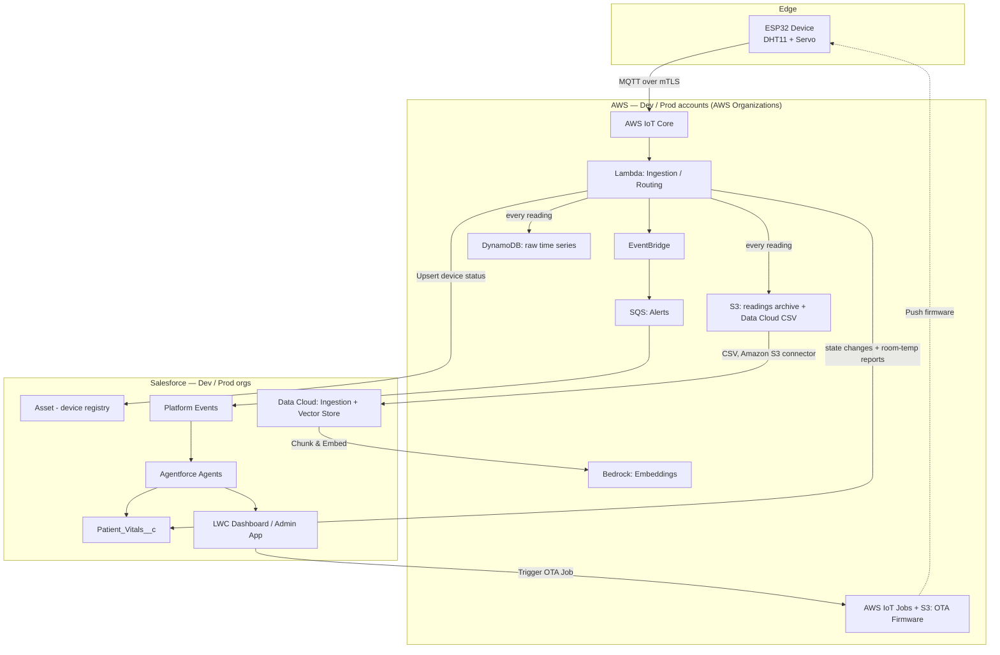

# Cloud-Agentic-IoT

> A healthcare IoT + Agentforce system, built from scratch and in public: physical device provisioning (ESP32) and OTA updates, an Agentforce agent, RAG, real-time event streams and cross-cloud integrations, designed for separate Dev and Prod AWS accounts and Salesforce orgs. [Current state](#current-state) says what runs today.

## Why this repo exists

Built from scratch and in public — no environment, no accounts, no hardware wired up at the start — with every step documented so anyone can clone this repo and replicate the whole thing on their own machine. It is one system applied to a healthcare patient-monitoring scenario, presented as fourteen chapters that each demonstrate one capability.

**Everything lives on one branch: `Dev`.** Clone `Dev` and you have the entire system — all the Salesforce metadata, every Lambda and both firmware sketches. `Prod` exists only as the promotion target for verified work.

## Start here

1. **Clone:** `git clone https://github.com/<username>/Cloud-Agentic-IoT.git`
2. **Work through [`docs/SETUP.md`](docs/SETUP.md)** — CLI installs (`sf`, `aws`, `gh`, `arduino-cli`), then accounts, identities, and credentials. Everything below assumes it is done. Just trying it out? [`docs/TRY-IT.md`](docs/TRY-IT.md) runs it on your own AWS project with a spend limit and a free Developer Edition org, both under one name and deployed from your laptop, and shows how to move to regular accounts for the pipelines later.
3. **Read [How the pieces connect](docs/HOW-IT-CONNECTS.md)** for the shape of the system before you stand it up.
4. **Deploy the whole system once** — [Deployment](#deployment) below. It is one sequence, not fourteen.
5. **Read [The chapters](#the-chapters)** to understand what you just deployed and why each piece is built the way it is.

> **Chapters are a reading order, not a deployment order.** There is no per-chapter install. The system deploys as a single unit — one push stands up every Lambda, every Apex class, the agent, and the events together — because that is what it is: one system. The chapters exist to explain it, in an order that makes narrative sense, and each gets its own article and video as it is published.

## Documentation

| Doc | What it answers |
|---|---|
| [SETUP.md](docs/SETUP.md) | Accounts, the five identities, licenses, Connected Apps, IAM roles, VS Code auth, GitHub secrets. Dev end-to-end; Prod is the same sequence. |
| [TRY-IT.md](docs/TRY-IT.md) | Trying it out: your own AWS project with a spend limit and a free Developer Edition org, one name for the AWS profile and the Salesforce alias, deployed from your laptop. Then the move to regular accounts and the pipelines. |
| [PLATFORM-PRIMER.md](docs/PLATFORM-PRIMER.md) | Apex, SOQL, governor limits, LWC and triggers explained via their Python equivalents. Read this if Salesforce is new to you. |
| [ARCHITECTURE-OVERVIEW.md](docs/ARCHITECTURE-OVERVIEW.md) | The whole system in one diagram, and what each component is for. |
| [HOW-IT-CONNECTS.md](docs/HOW-IT-CONNECTS.md) | How the chapters form one system, the three shared integration seams, and the order to demo them in. |
| [DATA-MODEL.md](docs/DATA-MODEL.md) | Why each object is standard or custom — the "why didn't you just use X" answers. |
| [DATA-CLOUD.md](docs/DATA-CLOUD.md) | Room readings into Data Cloud: the CSV copy of the S3 archive, how Data Cloud reads it (a role, or a key in an AWS project), the data stream and data model object, the two calculated insights, what is code and what is by hand, and how to check each step. |
| [DEVICE-IDENTITY.md](docs/DEVICE-IDENTITY.md) | How WiFi credentials and AWS certificates get onto a device, why they survive every OTA update, and how a job finds the right device. |
| [LIVE-STATUS.md](docs/LIVE-STATUS.md) | Whether a board is online, and its readings every 2 s while its card is open: how it works, the speeds, what it costs in AWS and in Salesforce limits, and what to check when the card waits. |
| [SPEND-AND-LIMITS.md](docs/SPEND-AND-LIMITS.md) | The app's Home page: this month's AWS spend against its limit and the Salesforce limits the org has used; where each number comes from, how fresh it is, what it costs, and what to check when one is missing. |
| [CI-CD-SECRETS.md](docs/CI-CD-SECRETS.md) | What is automated vs manual, and the conventions the pipelines enforce. |
| [MIGRATION-RUNBOOK.md](docs/MIGRATION-RUNBOOK.md) | Phased cutover to a governed Dev/Prod estate, with a rollback per phase. |
| [COST-MODEL.md](docs/COST-MODEL.md) | Real per-device, per-user and per-customer costs — and how to run the whole build on free tiers. |
| [CONTENT-GUIDE.md](docs/CONTENT-GUIDE.md) | Writing and video conventions for the article series. |

## End-to-end architecture



## Repository structure

```
Cloud-Agentic-IoT/
├── README.md                          # You are here — the whole system + how to deploy it
├── force-app/main/default/            # Salesforce metadata — one standard project
│   ├── objects/                       # Asset, Patient_Vitals__c, the two platform events, ...
│   ├── classes/                       # Apex services + tests
│   ├── triggers/                      # One trigger per object, handler pattern
│   ├── bots/Patient_Care_Agent/       # The Agentforce agent itself (Bot + BotVersion), shipped inactive
│   ├── genAiPlannerBundles/           # The agent's planner
│   ├── genAiPlugins/ genAiFunctions/  # Its topic and registered actions
│   ├── customMetadata/                # Device_Queue_Binding — config, not code
│   └── lwc/                           # queueDepthIndicator, reprovisionDevice, deviceLiveCard, platformUsageCard
├── lambda/<function>/                 # Lambda source + CloudFormation per function
├── firmware/
│   ├── libraries/CloudAgenticDevice/  # Shared runtime: NVS, provisioning, WiFi, MQTT, OTA
│   ├── patient-monitor/               # DHT11 vitals + medication servo
│   └── queue-indicator/               # Servo driven by Case queue depth
├── datacloud/                         # Data Cloud: the room readings' columns, the calculated insights' SQL
├── mulesoft/                          # The iPaaS alternative to the ingestion Lambda (a design sketch)
├── docs/                              # see the Documentation table above
├── scripts/                           # Device setup, provisioning, chapter scaffolding
├── .github/workflows/                 # CI/CD — see Deployment below
└── sfdx-project.json                  # Single package directory: force-app
```

Code uses one standard layout rather than per-chapter copies, so the repo looks like a real, deployable project. The article and video drafts for each chapter stay outside the repository until they are published.

---

## Deployment

**The whole system deploys once, in one sequence.** Work top to bottom; each stage assumes the previous one is done. Nothing here is per-chapter — the chapters explain what these pieces do, they do not install separately.

| Stage | What | How long |
|---|---|---|
| 0 | Prerequisites — [`docs/SETUP.md`](docs/SETUP.md), including turning on Einstein and Agentforce in each org before its first deploy | Once, ~a day |
| 1 | Push to `Dev` → AWS, Salesforce and the Dev boards deploy automatically | Minutes |
| 2 | Connect the seams CI cannot reach (Named Credentials, Slack, Data Cloud, agent) | ~an hour |
| 3 | Hardware — create the Thing, flash and provision each device | ~20 min per device |
| 4 | Verify end to end | Minutes |
| 5 | Promote `Dev` → `Prod` when it all holds | Per [MIGRATION-RUNBOOK.md](docs/MIGRATION-RUNBOOK.md) |

### Stage 1 — Push to `Dev`

Push to `Dev` and GitHub Actions deploys **everything at once**: every CloudFormation stack and the real Lambda code, all Salesforce metadata in `force-app/`, and any firmware whose version went up, over the air to the Dev boards. Each step is a script you can run from your laptop as well; [`docs/DEVELOPMENT.md`](docs/DEVELOPMENT.md) walks the whole path from laptop to Dev to Prod.

| Workflow | Trigger | What it does |
|---|---|---|
| `checks.yml` | every pull request | `scripts/check.sh`, one job per part: Lambda tests, cfn-lint, shellcheck, Salesforce metadata, a firmware build. Also fails a firmware change that does not raise `FIRMWARE_VERSION` |
| `deploy.yml` | push to `Dev`/`Prod` once `AUTO_DEPLOY` names the branch, or manual | Checks on that commit, then AWS (`scripts/deploy-aws.sh`), Salesforce (`scripts/deploy-salesforce.sh`) and the boards (`scripts/ota.sh release`: every Dev board, or the Prod canary ring). Prod waits for your approval |
| `ota-promote.yml` | manual, Prod | Sends a release the canary ran cleanly to the whole Prod fleet, one device type at a time |

Three conventions the pipelines enforce, because each would otherwise fail at deploy time rather than author time:

- A Lambda's `FunctionName` in CloudFormation must be `cloud-agentic-iot-<source directory name>`, or the source-upload step cannot find the function it belongs to.
- A sketch folder must contain a `.ino` named after the folder, or `arduino-cli` reports "main file missing from sketch".
- A sketch must declare `#define FIRMWARE_VERSION`, and raise it to ship a change. A board installs only a version it is not already running.

**Then give yourself the interface.** The Salesforce deploy adds a Lightning app, **Cloud Agentic IoT**, with tabs, record pages and page layouts for devices (Assets), patient vitals, device commands and Wi-Fi networks, and the Re-provision button on a device, and its Home page, which shows the month's AWS spend and the org's limits to admins. The app and the device fields stay hidden until a person holds the `Device_Platform_Admin` permission set, System Administrators included: fields deployed through the Metadata API come with no field access for any profile. Assign it to each person who runs the devices, then open the app from the App Launcher:

```bash
sf org assign permset --name Device_Platform_Admin --target-org <your admin alias>
```

Admins who should see costs need Platform_Usage_Viewer too (and View Setup and Configuration, which System Administrator has); the AWS half also needs part d of Stage 2:

```bash
sf org assign permset --name Platform_Usage_Viewer --target-org <your admin alias>
```

### Stage 2 — Connect the seams CI cannot reach

Everything below is manual for a structural reason, not an oversight: it stores a secret, lives in another vendor's console, or is a deliberate human checkpoint. Do it once, in this order — later steps consume outputs from earlier ones.

**1. Named Credential `AWS_IoT_Relay`.** This one credential carries every Salesforce → AWS callout in the system: the queue indicator, device provisioning, re-provisioning, teardown, the Wi-Fi credential push, Device Commands, the live status card and the Home page's AWS spend. The device API accepts only requests signed by an AWS identity, so it takes four parts.

*a. The IAM user Salesforce holds a key for.* The `queue-relay` stack creates `SalesforceCallerRole`, which may call this API and nothing else. Salesforce reaches it through a user that may only assume that role. The deploy identities may not create users or access keys (`NoBillingNoUsers` in [`scripts/aws-project-policy.json`](scripts/aws-project-policy.json)), so make the user once, by hand, as an identity that may: your `aws login` profile in an [AWS project](docs/TRY-IT.md), root in a regular account. In your own terminal, with the `-Prod` stack in Prod and `CALLER` set to `SalesforceCallerUserName` from `config/<env>.json`:

```bash
STACK=cloud-agentic-iot-queue-relay-Dev
CALLER=cloud-agentic-iot-salesforce-caller
ROLE_ARN=$(aws cloudformation describe-stacks --stack-name "$STACK" \
  --query "Stacks[0].Outputs[?OutputKey=='SalesforceCallerRoleArn'].OutputValue" --output text)
echo "$ROLE_ARN"
aws iam create-user --user-name "$CALLER" > /dev/null
aws iam put-user-policy --user-name "$CALLER" --policy-name assume-salesforce-caller-role \
  --policy-document "{\"Version\":\"2012-10-17\",\"Statement\":[{\"Effect\":\"Allow\",\"Action\":\"sts:AssumeRole\",\"Resource\":\"$ROLE_ARN\"}]}"
aws iam create-access-key --user-name "$CALLER"
echo "IAM Role ARN for part b: $ROLE_ARN"
```

The first `echo` must print the role's ARN before anything is created; an empty line means the stack name or the profile's Region is wrong. `create-access-key` prints the key once. Type it into Salesforce in part b and nowhere else: not a file, not the repo, not a chat. The last line repeats the role ARN for part b.

*b. The external credential.* Setup → Named Credentials → External Credentials → New. Authentication Protocol **AWS Signature Version 4**, Service `execute-api`, Region = the stack's Region. Check **Obtain Temporary IAM Credentials via STS**, choose **IAM User Identified by Access Key**, and enter the key as the **STS Access Key** and **STS Access Secret**. Leave **STS Duration** empty, or at 3600 seconds or less, the role's maximum. Set **Additional Status Codes for Token Refresh** to `403`. Salesforce asks STS for a new session only when a call comes back 401 or with one of these codes, and API Gateway answers an expired session with 403. Without it, every call fails from the moment the first session expires, an hour after it was issued. Then add a principal whose **IAM Role ARN** is the stack's `SalesforceCallerRoleArn` output, the line part a printed last. That is the role, with `:role/` in it. The caller user's ARN, with `:user/`, looks much the same, and STS refuses it.

*c. The named credential.* Named Credentials → New. Name `AWS_IoT_Relay`, URL = the stack's `QueueDepthEndpoint` output (the API's base URL; Apex adds `/provision-device`, `/queue-depth` and the other routes), the external credential from part b, and **Enabled for Callouts** and **Generate Authorization Header** both on. The name is a setting, `Named_Credential__c` on `Device_Platform_Setting__mdt.Default`, so an org can use another.

*d. Who may use it.* Create a permission set, for example `AWS_IoT_Relay_Callers`, with **External Credential Principal Access** to the principal from part b. Also give it **Read** on the **User External Credentials** object (Object Settings): without it a call fails with "You don't have read permissions on the User External Credential object". `Device_Integration` already grants that Read to the integration user. Assign it to every user whose changes to Assets, Wi-Fi Networks or Cases should reach the devices, to everyone who sends Device Commands or opens a device's live status card, and every admin who views the Home page's usage card, to the integration user the Slack app signs in as, and to the integration user AWS writes readings as (`deploy-salesforce.sh` assigns it to that one once the set exists): a room-temperature dose is sent as whoever saved the reading, a case alert (the patient monitor's motor) as whoever saved the Case, a Device Command as the user who created it, and `/dispense-medication` creates one as that user. The queue indicator's platform event trigger runs as the Automated Process user, which Setup's user list doesn't show, so assign it to that user through the API. The query picks it by its `autoproc@` username, because other hidden system users share its user type:

```bash
sf apex run --target-org <your admin alias> <<'EOF'
insert new PermissionSetAssignment(
    AssigneeId = [SELECT Id FROM User WHERE UserType = 'AutomatedProcess' AND Username LIKE 'autoproc@%' LIMIT 1].Id,
    PermissionSetId = [SELECT Id FROM PermissionSet WHERE Name = 'AWS_IoT_Relay_Callers'].Id);
EOF
```

*If a callout fails.* `HTTP 0` with *We couldn't get credentials from Amazon Session Token Service* means STS refused the AssumeRole call. CloudTrail's record of it, in the stack's Region, names the cause:

```bash
aws cloudtrail lookup-events --lookup-attributes AttributeKey=EventName,AttributeValue=AssumeRole \
  --max-results 5 --query 'Events[].CloudTrailEvent' --output text \
  | grep -oE '"(eventTime|errorCode|errorMessage)":"[^"]*"'
```

- `AccessDenied` on the caller user's own ARN (`…:user/cloud-agentic-iot-salesforce-caller`): the principal's **IAM Role ARN** holds the user's ARN. Put the role's there (part b).
- `AccessDenied` on the role's ARN: the user's policy is missing or names another role (part a).
- An error about `DurationSeconds`: **STS Duration** is over 3600 (part b).
- No AssumeRole event within a few minutes: usually a mistyped **STS Access Key** or **STS Access Secret** (part b).

`HTTP 0` with *We couldn't access the credential(s)* means the user making the callout lacks the part d permission set.

`HTTP 403: {"message":"Forbidden"}` means API Gateway refused the signed request. If calls worked and then stopped about an hour later, Salesforce is still signing with an expired STS session: CloudTrail shows no AssumeRole since the last call that worked. Add `403` to **Additional Status Codes for Token Refresh** (part b), and the next call gets a new session. Otherwise check the Region and Service in part b, and the URL in part c.

A keyless alternative is the external credential's **Roles Anywhere** option, which replaces the access key with a certificate and an AWS trust anchor. This repo doesn't set that up yet.

**2. SSM Parameter Store.** Store `SLACK_SIGNING_SECRET` and the Salesforce JWT credentials the Slack Lambda uses at runtime. Use a **separate, least-privilege integration user** from the CI/CD deploy user — see [`docs/CI-CD-SECRETS.md`](docs/CI-CD-SECRETS.md). Never reuse deploy credentials for runtime access, and never put either in code.

**3. Slack app.** Create it at api.slack.com, add the `/patient-status` and `/dispense-medication` slash commands, and set each one's Request URL to the `SlackCommandsUrl` output of the Slack stack. Copy the Signing Secret into step 2's parameter.

**4. Data Cloud ingestion.** Optional. Every room reading reaches Data Cloud through the S3 archive: with `DataCloudExport` on (Dev), `patient-vitals` also writes each batch as CSV under `datacloud/room-readings/`, and the `patient-vitals` stack lets Data Cloud list and read that folder and nothing else. What stays by hand is in [SETUP.md §7](docs/SETUP.md#7-data-cloud-room-readings-for-the-ward), in order:

1. Turn the CSV copy on with the AWS deploy (step 1).
2. Start the Amazon S3 connection in Data Cloud on the archive bucket, Parent Directory `datacloud/room-readings/` (step 2).
3. Make what Data Cloud signs in with (step 3): in an AWS project, an IAM user whose access key you type into the connection and nowhere else (`DATA_CLOUD_READER_USER`); in a regular account, the IAM identity provider for the org's My Domain, then the stack's `cloud-agentic-iot-data-cloud-reader` role (`DATA_CLOUD_OIDC_PROVIDER_ARN`, `DATA_CLOUD_EXTERNAL_ID`), with no key at all.
4. Test and save the connection (step 4).
5. Create the data stream into the `Room_Readings` data lake object (step 5) and map it to the `Room_Reading` data model object (step 6).
6. Create the two calculated insights, minutes out of the 30.0 C range per device per day and devices with no reading for 10 minutes, with `scripts/data-cloud-insights.sh` (step 7).

[`docs/DATA-CLOUD.md`](docs/DATA-CLOUD.md) explains the path and how to check each step.

**5. Case queue + its binding.** The deploy creates `Care_Team_Queue`, a Case queue (`force-app/main/default/queues/`); add its members in Setup → Queues. Put your indicator's IoT Thing name into `force-app/main/default/customMetadata/Device_Queue_Binding.Care_Team_Queue.md-meta.xml`, then push — the binding is configuration, so it ships as metadata rather than being clicked in. The agent's escalations and the room-temperature rule's Cases go to the queue `Device_Platform_Setting__mdt.Default` names (`Escalation_Case_Queue__c` and `Room_Temp_Case_Queue__c`, both `Care_Team_Queue`), so a queue of another name means changing those two values.

**6. Activate the agent.** The deploy creates the **Patient Care Agent** (`force-app/main/default/bots/Patient_Care_Agent`), an employee agent whose version 1 uses `Patient_Care_Planner`, and leaves it inactive. It needs Einstein and Agentforce turned on in the org first ([SETUP.md §2.1](docs/SETUP.md#21-create-the-org-and-secure-the-admin)). Activate it, as the admin:

```bash
sf agent activate --api-name Patient_Care_Agent --version 1 --target-org <your admin alias>
```

or Setup → Agentforce Agents → **Patient Care Agent** → Activate. Then assign the `Patient_Care_Agent` permission set to each care team member who will use it: it opens the agent to them and gives its two actions (`DeviceReadingsAgentAction`, `PatientCareAgentActions`) the device, reading and Case access they run with. An employee agent acts as the person talking to it, so there is no separate agent user.

```bash
sf org assign permset --name Patient_Care_Agent --target-org <your admin alias>
```

It ships inactive on purpose: activating an agent that can create clinical Cases should be a deliberate act, not a side effect of a deploy.

**7. Register the MCP endpoint** with whichever agent client you are using, so it can discover the device tools at runtime.

**8. Optional — MuleSoft.** Only if you want the iPaaS ingestion path instead of the Lambda. Open `mulesoft/` in Anypoint Studio, or `mvn package` and deploy to CloudHub; set the `sf.*` properties (consumer key, keystore, principal — JWT, no password); then point the AWS IoT rule at the flow's `/telemetry` endpoint. Chapter 07 explains when this is the right call and when it is not.

Two pieces are written and tested but **not yet wired** into the agent's action path: `PiiMaskingService.mask`/`unmask` (chapter 10) and the guardrails Lambda with its `input`, `output` and `action` phases (chapter 11).

### Why these stay manual

| Step | Why it cannot be automated |
|---|---|
| Flashing firmware | Needs a USB cable in a physical port. CI has no hardware |
| First-time device credentials | The AWS private key is issued once and must never transit CI |
| Creating the AWS IoT Thing + policy | One-time per device; the automated path is chapter 13 |
| Named Credentials in Salesforce | Store secrets; created in Setup, not in metadata |
| The Salesforce caller's IAM user and access key | The deploy identities may not create users or keys, and the key should exist only in Salesforce |
| Slack app creation + signing secret | Lives in Slack's console |
| Data Cloud connection, data stream and mapping | The connection holds a credential or a per-connection External ID, and Data Cloud metadata moves between orgs as a data kit retrieved from an org that has it, not as files written by hand ([DATA-CLOUD.md](docs/DATA-CLOUD.md#why-the-data-cloud-side-is-not-in-force-app)) |
| The IAM user and key, or the identity provider, Data Cloud reads S3 with | The deploy identities may not create users, keys or identity providers |
| Turning on Einstein and Agentforce | Accepting their terms is the org admin's decision. The settings that switch them on are documented for scratch orgs, not for deploying to an existing org |
| Activating the Agentforce agent | A deliberate human checkpoint, not a deploy step |

### Stage 3 — Hardware

Only the device chapters (00, 03, 13) need hardware. Everything else is cloud-only, and the system deploys and runs without a board attached — you just will not see a motor move.

#### What you need

| Part | Notes |
|---|---|
| ESP32 development board | DOIT DEVKIT V1 or equivalent |
| DHT11 temperature + humidity sensor | The patient-monitor's vitals source |
| SG90 micro servo | Medication dispenser (ch. 00) and queue indicator (ch. 03) |
| Breadboard + jumper wires | — |
| USB cable | Data, not charge-only — a charge-only cable is the most common "board not detected" cause |

For a queue indicator that spins continuously rather than sweeping, add an **FS90R or SG90-360** continuous-rotation servo — see chapter 03.

#### Create the Thing and its certificate

Do this once per device, before it first connects. Chapter 13 automates all of it from a Salesforce Asset record — this is the manual path, worth doing once so you understand what is being automated.

**1. Create a Thing.** AWS IoT Core → Manage → Things → Create things → Create single thing. Name it `ESP32-Patient-Monitor-01` — this becomes the device's identity, sent to it in the provisioning bundle. Choose *Auto-generate a new certificate*.

**2. Create the policy.** Secure → Policies → Create policy, named `ESP32-Patient-Monitor-Policy`:

```json
{
  "Version": "2012-10-17",
  "Statement": [
    { "Effect": "Allow", "Action": "iot:Connect",
      "Resource": "arn:aws:iot:REGION:ACCOUNT_ID:client/${iot:ClientId}" },
    { "Effect": "Allow", "Action": "iot:Publish",
      "Resource": [
        "arn:aws:iot:REGION:ACCOUNT_ID:topic/$aws/rules/cloud_agentic_iot_patient_vitals/device/${iot:Connection.Thing.ThingName}/telemetry",
        "arn:aws:iot:REGION:ACCOUNT_ID:topic/device/${iot:Connection.Thing.ThingName}/telemetry",
        "arn:aws:iot:REGION:ACCOUNT_ID:topic/device/${iot:Connection.Thing.ThingName}/status",
        "arn:aws:iot:REGION:ACCOUNT_ID:topic/device/${iot:Connection.Thing.ThingName}/live",
        "arn:aws:iot:REGION:ACCOUNT_ID:topic/device/${iot:Connection.Thing.ThingName}/ack",
        "arn:aws:iot:REGION:ACCOUNT_ID:topic/$aws/things/${iot:Connection.Thing.ThingName}/jobs/*"
      ] },
    { "Effect": "Allow", "Action": "iot:Subscribe",
      "Resource": [
        "arn:aws:iot:REGION:ACCOUNT_ID:topicfilter/device/${iot:Connection.Thing.ThingName}/command",
        "arn:aws:iot:REGION:ACCOUNT_ID:topicfilter/$aws/things/${iot:Connection.Thing.ThingName}/jobs/*"
      ] },
    { "Effect": "Allow", "Action": "iot:Receive",
      "Resource": [
        "arn:aws:iot:REGION:ACCOUNT_ID:topic/device/${iot:Connection.Thing.ThingName}/command",
        "arn:aws:iot:REGION:ACCOUNT_ID:topic/$aws/things/${iot:Connection.Thing.ThingName}/jobs/*"
      ] }
  ]
}
```

Replace `REGION` and `ACCOUNT_ID`. `${iot:Connection.Thing.ThingName}` is a policy variable resolved per connection, so **one policy serves every device and each is scoped to its own topics** — a device physically cannot subscribe to another's commands. From firmware 2.1.0 readings go to the `$aws/rules/cloud_agentic_iot_patient_vitals/...` topic, AWS IoT Basic Ingest, which hands them straight to the rule (older firmware publishes to `telemetry`). The `status` topic is where the queue indicator reports back; from firmware 2.2.0 the board sends live readings on `live` while someone has its card open, and answers commands on `ack`. The `$aws/things/.../jobs/*` lines are OTA. None of them is optional: IoT Core disconnects a client that publishes to a topic its policy doesn't allow. Without the jobs lines the device reconnects in a loop, since the firmware asks for pending OTA jobs every time it connects; without any other line it is dropped each time it publishes there. A device provisioned from Salesforce (chapter 13) gets the same topics from the stack's own `cloud-agentic-iot-device` policy, which also lets it connect only as the Thing its certificate is attached to.

**3. Download and attach.** Download the certificate, the private key, and Amazon Root CA 1 into one folder. Attach the policy to the certificate.

**4. Create the Salesforce Asset.** Devices use the **standard Asset object** — no custom object. In the Cloud Agentic IoT app, Assets → New: Serial Number = the IoT Thing name, Account = the patient's Person Account (any Account, in an org without Person Accounts), Status = `Installed`.

#### Getting a device online

Nothing secret is compiled into the firmware — one `.bin` is valid for every device of its type, which is what makes a single OTA job able to target a fleet. Credentials arrive afterwards, over the USB cable, and land in the ESP32's NVS flash.

Plug the ESP32 in and run the wizard:

```bash
./scripts/setup-device.sh          # macOS / Linux
.\scripts\setup-device.ps1         # Windows: not safe yet, see below
```

The Windows wizard still sends the credentials in one burst without waiting for the board to ask for them, and a burst that arrives while the board is asking can lose characters from inside the certificate or key and still be stored, once. Run the macOS / Linux one until it works the same way.

It asks for the folder holding your downloaded certificates, which file is which, the Thing name, the endpoint, and the WiFi network — filling in a default wherever it can work one out. Then it compiles, flashes over USB, sends the credentials, and prints what the device says back.

**Add your phone hotspot as the second network right after:**

```bash
./scripts/update-wifi.sh "<hotspot-SSID>"      # asks for the passphrase without showing it
```

NVS holds three networks and only the third ever rotates, so the first two are permanent anchors. A hotspot in slot 1 means the device can reach AWS from almost anywhere — which is what lets the third slot be updated remotely later, with no USB and no rebuild.

**Every firmware update after that is over the air.** OTA rewrites the application partition only, so NVS — WiFi *and* certificate — survives untouched. Full detail in [DEVICE-IDENTITY.md](docs/DEVICE-IDENTITY.md).

> Do **not** run `esptool erase_flash` on a provisioned device. It wipes the NVS partition holding a private key that AWS issues exactly once and will never reissue. If it has already happened, use the Re-provision button on the Asset (chapter 13) — it rotates the certificate and keeps all device history.

### Stage 4 — Verify end to end

Start at the device and walk outward; a break is easiest to find at the first hop that goes quiet.

```bash
arduino-cli monitor -p <port> -c baudrate=115200
```

Expect the WiFi and AWS IoT connection lines, then a `telemetry:` line every 30 s (or at the interval the fleet set). Then work outward:

| Check | Where | Expect |
|---|---|---|
| Device is publishing | S3 → the patient-vitals archive bucket, `readings/date=<today>/`. Readings go through Basic Ingest, straight to the rule, so the MQTT test client does not see them | A new `.ndjson.gz` object for each batch |
| Device is online | The device's Asset in the Cloud Agentic IoT app ([LIVE-STATUS.md](docs/LIVE-STATUS.md)) | Connection `Online`, and on the Live Status card a reading every 2 s (firmware 2.2.0) |
| Costs and limits show | The app's Home tab | This month's AWS spend against its budget, and the org's limits by group, read when the page loads |
| Device accepts commands | On the Asset, **Send Command** with `DISPENSE_MEDICATION`. By hand: publish `{ "operation": "DISPENSE_MEDICATION", "commandId": "by-hand-1" }` to `device/<thing>/command` | The servo moves. From the Asset, the Device Command goes `Sent`, then `Acked` within seconds. By hand, the board's answer shows on `device/<thing>/ack` in the MQTT test client; it answers only a command that carries a `commandId` |
| Ingestion works | `Patient_Vitals__c` in Salesforce | Rows appearing |
| Events fire | Platform Event monitoring | `Patient_Vital_Alert__e` on a threshold breach |
| The loop closes | Assign a Case to the bound queue | The indicator servo starts |
| The agent acts | The agent's panel in Lightning, as a holder of `Patient_Care_Agent`: ask for a device's latest readings, then escalate | The readings, then a Case with `Origin = Agentforce` in Care_Team_Queue |
| Room-temp Case | Warm the DHT11 above 30 C (with `RoomTempAlert` on, [TRY-IT.md](docs/TRY-IT.md#warm-the-sensor-get-a-case-and-a-dose)) | A Case with Origin `Room Temperature Rule` in Care_Team_Queue, one `DISPENSE_MEDICATION` Device Command, and a `CASE_ALERT` on |
| Case alert | Open a Case on a provisioned patient monitor's Asset and give it to Care_Team_Queue (firmware 2.3.0) | The servo sweeps back and forth without stopping, the Asset's Case Alert is checked, and a `CASE_ALERT` Device Command goes `Acked`. Close the Case, or take it yourself, and it stops |
| Slack is headless | `/patient-status <device-id>` | A reply, with nobody logged into Salesforce |

The Asset's Connection field, its Live Status card and **Send Command** need a device provisioned from Salesforce (chapter 13), whose Asset carries its Thing ARN. On an Asset made by hand in Stage 3, Connection stays *Not reported yet*, the card says the device has no AWS IoT Thing, and a command fails as not provisioned. The by-hand publish works either way.

### Stage 5 — Promote to `Prod`

Once it holds together on `Dev`, `Prod` is the same sequence against the second AWS account and Salesforce org — with one exception that makes it a project rather than a push: **device certificates cannot move between environments.** `iot-dev` and `iot-prod` have separate CAs, so a Dev certificate physically cannot connect to Prod. Re-provisioning the fleet is the one irreversible step, which is why [MIGRATION-RUNBOOK.md](docs/MIGRATION-RUNBOOK.md) isolates it, batches it, and puts it last.

---

## The chapters

**These are explanations, not install steps.** They assume the system is deployed with the steps above. Each chapter's article and video will be published separately; the code all lives in the shared layout above, together, because it is one system.

The separation is editorial: it is the order the story is told in, across the article and video series. Where a chapter needs something from [Stage 2](#stage-2--connect-the-seams-ci-cannot-reach) it says so, and where you can watch it working there is a **To see it work** line.

### 00 · IoT Device Provisioning

Provisioning a physical ESP32 patient monitor and connecting it securely to AWS IoT Core over mutual TLS, with Salesforce as the system of record for device management — including the groundwork for OTA updates managed from a Salesforce app.

A real, physical system you can walk end-to-end, not a mockup. Secure authentication and authorization between connected systems is the whole subject.

**Key files:** `firmware/patient-monitor/`, `firmware/libraries/CloudAgenticDevice/`, `force-app/main/default/objects/Asset/`

### 01 · Data Cloud RAG Pipeline

Patient IoT data flowing from edge devices through **Data Cloud** into a RAG pipeline that lets agents retrieve patient context autonomously.

The pipeline stages: telemetry arrives at IoT Core → Lambda transforms and stores in DynamoDB and the S3 archive → syncs the readings someone acts on to Salesforce via REST → Data Cloud ingests every room reading from the archive's CSV copy into the `Room_Reading` data model object, with two calculated insights per device ([DATA-CLOUD.md](docs/DATA-CLOUD.md)) → auto-chunks the time series → Bedrock embeds each chunk → agents retrieve by semantic search. The ingestion and the insights are built; the chunking, embedding and retrieval are not yet.

**Key files:** `force-app/main/default/objects/Patient_Vitals__c/`, `Patient_Daily_Summary__c/`, `classes/DataIngestionService.cls`, `lambda/patient-vitals/`, `datacloud/`

The device registry uses the **standard Asset object** — SerialNumber is the IoT Thing name, Account is the patient's Person Account — extended with 13 custom fields: firmware, connection, provisioning and Thing identity (`objects/Asset/fields/`).

### 02 · Real-time Streams to Agents

Patient vitals streaming in real time through **EventBridge** and **Platform Events** to trigger autonomous agent action within seconds.

The design: telemetry hits IoT Core → an EventBridge rule routes it to the alert dispatcher → the dispatcher evaluates vitals against clinical thresholds → publishes `Patient_Vital_Alert__e` for critical conditions → agents subscribed to the event act on it. What runs today: readings reach Salesforce through the patient-vitals stack (IoT rule → SQS → `salesforce-sync`, which upserts `Patient_Vitals__c`). The streaming stack deploys, but no IoT rule feeds its bus yet and nothing subscribes to `Patient_Vital_Alert__e`.

**Key files:** `objects/Patient_Vital_Alert__e/`, `classes/StreamingAlertService.cls` (+ test), `lambda/streaming/`

### 03 · Physical Case Queue Indicator

A servo on a desk that spins while there is unclaimed work in a Salesforce Case queue and stops the moment it is empty, with speed scaling to queue depth.

It is a desk toy. It is also a complete demonstration of Salesforce driving the physical world from business data: trigger → Platform Event → async callout with SigV4 auth → API Gateway → Lambda → IoT Core → MQTT → motor. The payoff is visible from across a room.

**The design decision that matters:** nothing about *which* queue, *which* device, or *how fast* is hardcoded. It is all `Device_Queue_Binding__mdt` custom metadata:

| Field | Purpose |
|---|---|
| `Queue_Developer_Name__c` | Which queue this device watches |
| `Device_Id__c` | AWS IoT Thing name of the indicator |
| `Full_Speed_Depth__c` | Case count at which the motor runs flat out |
| `Active__c` | Kill switch that does not require a deploy |

Apex normalises raw queue depth into a 0–100 intensity before it leaves Salesforce, so the firmware stays dumb and the business rules stay where an admin can change them. Adding a second device on a second queue is a metadata record, not a code change.

**Hardware note:** a standard **SG90 is a positional servo** — 0–180°, physically incapable of continuous rotation. The firmware defaults to a gauge-needle sweep that gets faster as the queue deepens, which works on the SG90 you already have and reads clearly on camera. For literal continuous spin use an **FS90R or SG90-360** (~$6) and uncomment `#define CONTINUOUS_ROTATION_SERVO`. Both paths are compile-verified.

**Key files:** `objects/Device_Queue_Binding__mdt/`, `classes/CaseQueueMonitorService.cls`, `triggers/CaseTrigger.trigger`, `objects/Queue_Depth_Change__e/`, `classes/QueueDepthRelayQueueable.cls`, `lambda/queue-relay/`, `firmware/queue-indicator/`

**To see it work:** create a Case, assign it to the bound queue, and watch the motor start. Close the Case and watch it stop.

#### Room-temperature demo rule

A demo rule, not a clinical one: warm the patient monitor's DHT11 to 30 C and a Case opens by itself, the indicator moves, and the dispenser's servo turns out a dose, then keeps sweeping until the Case is closed or someone takes it. Steps in [TRY-IT.md](docs/TRY-IT.md#warm-the-sensor-get-a-case-and-a-dose).

- **Flow.** patient-vitals → sync queue → salesforce-sync → `Patient_Vitals__c` (flagged `Room_Temperature_Alert__c`) → `PatientVitalsTrigger` → `RoomTemperatureCaseService` → a Case in Care_Team_Queue (which moves the indicator and turns the case alert on through `CaseTrigger`) and one `DISPENSE_MEDICATION` Device Command (which the command trigger sends to the board).
- **AWS decides when, Salesforce decides what.** The threshold lives once, as `RoomTempAlertCelsius` in `config/<env>.json` (30, inclusive). AWS reports a hot device on the crossing and then at most every `RealertIntervalMinutes` while it stays hot, never per reading. Salesforce never compares `Temperature__c` with 30: that field also holds body temperature, which is always above it. The clinical bands are unchanged.
- **Hysteresis.** An episode ends only when a reading drops below 29 C (1 C under the threshold), so a sensor wobbling around 30 C is one report.
- **Dedupe.** One open Case per device from this rule: a Case with Origin `Room Temperature Rule` on the device's Asset. While it is open, nothing new opens. Once it is closed, the next report opens a new one. A device without an Asset gets no Case, only a WARN log.
- **Dose cooldown.** One dose per new Case, and at most one per device every `Room_Temp_Dispense_Cooldown_Minutes__c` (60). A Case closed and reopened inside that hour gets no second dose, and its Description says so.
- **Switches.** `RoomTempAlert` in `config/<env>.json` decides whether AWS sends flagged readings at all: on in Dev, off in Prod. `Room_Temp_Dispense__c` on the Default `Device_Platform_Setting__mdt` record turns dosing off while keeping the Cases; change it in the repo, because a Setup edit is overwritten by the next deploy.
- **Emergency stop.** Add `PatientVitalsTriggerHandler` to `Integration_Control__c` Bypass Handlers at org level. Instant, no deploy.
- **Case alert.** Any Case does this, not only the rule's: while a device has at least one open Case owned by Care_Team_Queue (`Room_Temp_Case_Queue__c` and `Escalation_Case_Queue__c`), its patient monitor's servo sweeps 0 to 180° and back every 2 seconds. `CaseAlertService` sends `CASE_ALERT` on with the first such Case and off when the last one is closed, deleted, given to a person or moved to another Asset; the Asset's Case Alert field holds the state last sent, so nothing is sent in between. A dose still swings, then the sweep goes on. The board keeps the state in NVS across restarts and updates, and when it reconnects Salesforce sends the state again. A failure is logged and never stops the Case from saving. Firmware 2.3.0 and later. To stop all of it at once, add `CaseTriggerHandler` to Bypass Handlers (that also stops the queue indicator).
- **Deploy order.** Salesforce first (the `CASE_ALERT` value and the fields), then AWS (the device-command Lambda checks `active`), then the board: `scripts/ota.sh try Dev patient-monitor`.

**Key files:** `lambda/patient-vitals/index.js` (`planDevice`), `triggers/PatientVitalsTrigger.trigger`, `classes/RoomTemperatureCaseService.cls`, `classes/CaseAlertService.cls`, `firmware/patient-monitor/`, `customMetadata/Device_Platform_Setting.Default.md-meta.xml`

### 04 · Headless Slack Integration

A Slack slash-command bot that reads and writes Salesforce data — `/patient-status <device-id>` and `/dispense-medication <device-id>` — without any Slack user ever logging into Salesforce. A dedicated integration user authenticates via the JWT Bearer Flow: the same pattern as the CI/CD pipeline, but as a runtime service call rather than a deploy-time one.

**How it closes the loop:** `/dispense-medication` does not just update a record. It creates a `Device_Command__c`, and an Apex trigger sends it through the device API to the board on `device/<thing>/command`. The board moves the servo and answers on `device/<thing>/ack`; that answer comes back through AWS IoT and marks the record `Acked`, or `Failed` with the board's reason. A Slack message can, headlessly, move a physical servo, and Salesforce knows whether it did. The same record can be created from the device's Asset with **Send Command**. Nothing on this path limits doses yet: `checkBusinessRules` (chapter 11) is not called from it, so anyone who may create a Device Command can dispense. The room-temperature demo rule (chapter 03) also dispenses, automatically: once per new Case, and at most once per device per cooldown (60 minutes). It is off in Prod, and a dose that fails is not retried.

**Key files:** `lambda/slack-integration/index.js` (verifies the Slack signature — HMAC, replay-protected), `salesforce-client.js` (headless JWT auth), `cloudformation.yaml`

**To see it work:** run `/patient-status <device-id>` from Slack with nobody logged into Salesforce.

### 05 · The Agent and Its Actions

The **actual Agentforce agent** — bot, planner, topic, registered actions — plus the Apex it invokes and the integration plumbing that lets it reach outside Salesforce. This is the centre of the system: everything else in the repo produces data for it, constrains it, or gives it somewhere to act.

**The idea worth defending:** an LLM deciding to escalate is a *suggestion*, not an authorisation. The agent chooses whether to call the action; Apex decides what is allowed to happen when it does. Validation, sharing enforcement, and the audit trail live in `PatientCareAgentActions.cls` where no prompt can talk them out of it.

Two details follow from treating agent input as untrusted:

- **Bulk-safe by default.** Agentforce may invoke an action once per record in a batch, so the method takes a `List` and does one DML — a per-invocation insert would hit the governor limit on the third patient.
- **`allOrNone=false`.** One malformed request from the agent must not fail its neighbours.

Every agent-created Case is stamped `Origin = 'Agentforce'`, so "what did the agent actually do" is a report, not an investigation, and owned by Care_Team_Queue, so it moves the queue indicator like any other care team Case.

| File | What it is |
|---|---|
| `bots/Patient_Care_Agent/` | The **agent**: an employee agent (`InternalCopilot`), and its version 1, which names the planner. Deploys inactive |
| `genAiPlannerBundles/Patient_Care_Planner/` | The planner. Decides which topic handles a request |
| `genAiPlugins/Patient_Device_Monitoring.genAiPlugin` | The **topic** — scope plus four instructions. Where the agent's behaviour actually lives |
| `genAiFunctions/Get_Device_Readings/` | The read action: a device's latest readings and connection state, from `DeviceReadingsAgentAction` |
| `genAiFunctions/Escalate_Patient_Device_Condition/` | The escalation action: a Case for the care team, from `PatientCareAgentActions` |
| `permissionsets/Patient_Care_Agent` | Who may use the agent, and the access its actions run with |

The four instructions are the interesting part: **ground every answer** (only from the readings the read action returns; say so when data is missing rather than estimating); **do not diagnose** (describe readings against thresholds, nothing more); **confirm before acting** (state which device and reading, then report the Case number); **be precise about device identity** (always the serial number; ask rather than guess when a patient has several).

`isConfirmationRequired` is `true` on the escalation action (and `false` on the read-only one), so confirmation is enforced by the platform rather than requested by a prompt that can be argued with.

**Key files:** `classes/PatientCareAgentActions.cls` (+ test, including a 200-record bulk invocation), `classes/DeviceReadingsAgentAction.cls` (+ test, run as a user with and without the permission set)

The read action works as the user: `with sharing` and `WITH USER_MODE`, so the agent sees only the Assets, readings and fields that person may see, and it returns no patient name.

**To see it work:** with the agent active and `Patient_Care_Agent` assigned, open the agent from the Lightning header, ask what a device (by serial number) is reporting, then ask it to escalate, confirm when prompted, and check Cases filtered to `Origin = Agentforce`.

> **Honest caveat:** Agentforce metadata schema moves between releases. The planner, topic and action have deployed to a real org; the Bot and BotVersion are written against the Metadata API reference and agents retrieved from other orgs, and checked offline, but not yet deployed. Expect to reconcile field names against your org's API version on first deploy — `sf project deploy start --dry-run` will tell you exactly what it disagrees with — and once the agent works, retrieve it (`sf project retrieve start -m Bot:Patient_Care_Agent -m GenAiPlannerBundle:Patient_Care_Planner`) and commit what the org returns.

### 06 · Multi-Agent Orchestration (MCP + Agent2Agent)

An MCP server exposing patient-device capabilities as tools any MCP-speaking agent can discover at runtime, plus the A2A pattern for one agent delegating to a specialist.

**Why MCP instead of a REST API the agent calls:** an agent talking to a bespoke REST API needs the endpoint, the shape, and the "when to use it" baked into its prompt. Change the API and you re-prompt the agent. With MCP the agent calls `tools/list` at runtime and discovers what exists, including the JSON Schema for each argument. **The contract is the schema, not the prompt.** Adding a capability is a server-side change — no agent redeployment, no prompt edit.

Two consequences that show up immediately:

- **A tool `description` is prompt engineering.** The model reads it to decide when the tool applies. A vague description produces an agent that calls the wrong tool with total confidence.
- **Tool failures are returned as tool output, not transport errors.** An agent can reason about "the device is offline" and tell the user something useful. It cannot reason about an HTTP 500.

**Verified:** all four protocol paths exercised locally — `initialize` handshake, tool discovery, a successful call, a call with a missing required argument (returns `isError` with a usable message rather than throwing), and an unknown tool (returns JSON-RPC `-32602`).

**Key files:** `lambda/mcp-server/index.js` — JSON-RPC 2.0 handler implementing `initialize`, `tools/list`, `tools/call`

**To see it work:** ask the agent something requiring device data. It will discover the tool and call it without being told the endpoint.

### 07 · Cross-Cloud Integrations (iPaaS / MuleSoft)

The same AWS-to-Salesforce telemetry sync as chapter 01, implemented as a **MuleSoft flow** instead of a Lambda — DataWeave transform, JWT connection, idempotent upsert, retryable error handling.

**The tradeoff, stated plainly:** this flow does exactly what chapter 01's Lambda already does, and adds a hop and a licence. It is the right choice when an enterprise already owns MuleSoft and wants integration logic governed, monitored, and reusable in one layer instead of scattered across per-team Lambdas. It is the wrong choice for a greenfield team with neither. Having both is the point — the architecture review question is not "can you build it" but "when would you choose each," and the answer is a governance decision, not a technical one.

Two details that matter:

- **Upsert, not create.** Devices retry on reconnect, so the same reading arrives more than once. The DataWeave builds a deterministic external ID from `deviceId + timestamp`, making the write idempotent with no dedupe table.
- **Connectivity errors return 503, not 400.** If Salesforce is down and the flow returns a client error, the device concludes its payload was bad and stops retrying. Retryable failures must look retryable.

**Key files:** `mulesoft/src/main/mule/device-telemetry-sync.xml`, `mulesoft/src/main/resources/dwl/telemetry-to-salesforce.dwl`

This is the one optional piece of the system — step 8 of [Stage 2](#stage-2--connect-the-seams-ci-cannot-reach). Everything works without it; deploying it swaps the ingestion path rather than adding to it.

### 08 · Knowledge Base RAG

Chunking and embedding care-team knowledge articles for semantic retrieval — the *unstructured* half of grounding, where chapter 01 covered structured telemetry.

**The chunking strategy is the whole ballgame.** Everyone demos RAG with fixed-size chunks because it is three lines of code. Then retrieval starts mid-sentence, and in a clinical context the agent quotes half an instruction — worse than returning nothing.

This chunker splits on paragraph boundaries first, falls back to sentence boundaries, and only hard-splits when a single sentence exceeds the window. Overlap carries context across the seam so a fact spanning two chunks stays retrievable from either. **Titles are prepended to every chunk before embedding** — a chunk reading "administer 5mg every six hours" is dangerously ambiguous once separated from the article naming the drug. The title travels with the vector.

**A bug worth keeping in the write-up:** the first version handled long *paragraphs* but not long *sentences*. A 2000-character sentence — a dosage table, a long enumerated list — passed straight through and produced a chunk nearly twice the window. Nothing errored; the embedding model would have silently truncated it and dropped the tail. Found by testing the edge case rather than the happy path. Five cases now assert that no chunk ever exceeds the cap.

**Key files:** `lambda/knowledge-indexer/index.js`

**To see it work:** POST an article as `{ "id": "...", "title": "...", "content": "..." }` and persist the returned vectors to your store — Data Cloud vector index, OpenSearch, or pgvector. It has no CloudFormation template yet, so no environment deploys it: the function, its `bedrock:InvokeModel` permission on `amazon.titan-embed-text-v2:0`, an invoke path and a vector store are still to be written.

### 09 · Event-Driven Architecture (Saga Pattern)

An OTA firmware rollout modelled as a **saga** — a sequence of steps spanning AWS and a physical device, each with an explicit compensating action, so a failure at step 3 unwinds steps 2 and 1 in reverse.

**Why a saga and not a transaction:** a firmware update spans an S3 upload, a Salesforce status change, an AWS IoT Job, and a device acknowledgement. There is no shared lock and no two-phase commit across that boundary. The device may simply vanish.

| Step | Compensating action |
|---|---|
| `stage_firmware` | `delete_staged_firmware` |
| `mark_device_updating` | `mark_device_active` |
| `create_iot_job` | `cancel_iot_job` |
| `await_device_ack` | `rollback_device_firmware` |

Three decisions make it work:

- **"Not ready" is not "failed."** A slow device that has not acknowledged returns `retryable`, and the orchestrator returns `IN_PROGRESS` without compensating. Conflating the two means every slow device triggers an unnecessary rollback. Verified: a device that has not acked runs **zero** compensations.
- **Steps must be idempotent.** SQS delivers at least once, so every handler will eventually run twice with identical input. The retry is routine, not exceptional — the single most common thing people get wrong with queue-driven sagas.
- **A failed compensation is logged loudly and does not stop the unwind.** Otherwise one stuck rollback strands the device in `UPDATING` forever.

**Key files:** `lambda/ota-saga/index.js`

**To see it work:** publish an OTA request onto the queue and watch CloudWatch for the step trace. Kill the device mid-update to see compensation run. It has no CloudFormation template yet and its step bodies are still simulated (`index.js`), so no environment deploys it. When it is built, it needs a queue with a DLQ and a visibility timeout longer than a device ack realistically takes.

### 10 · Einstein Trust Layer — PII Masking & Audit

Masking personally identifiable information before text reaches an LLM, and restoring it in the response — so the user sees real values and the model never does.

**The restore half is the point.** Masking alone is easy and produces an agent that says *"Please contact [PERSON_1] at [EMAIL_1]"* — perfectly safe, completely useless. The token→original map is held in memory for the life of the request, so the response is rehydrated before the user sees it. The model is never in the loop for the real values.

Three details that matter:

- **A repeated value gets the same token.** If `a@b.com` appears twice, both become `[EMAIL_1]`. The model can still reason that these are the same person without knowing who. Issuing two tokens would break coreference and degrade the answer.
- **Only tokens actually issued get restored.** A model that hallucinates `[EMAIL_9]` gets nothing back. Blindly restoring anything token-shaped is how one patient's address ends up in another patient's summary — the failure mode worth designing against, and there is a test for it.
- **Pattern order is load-bearing.** Email runs before phone, because the digits inside an address like `a1234@x.com` would otherwise be partly consumed by the phone pattern.

**Key files:** `classes/PiiMaskingService.cls` (+ test — six cases including the hallucinated-token one)

**Where it would be wired:** `mask` before the agent's prompt and `unmask` after its response. It is not called yet (see [Current state](#current-state)): the Patient Care Agent's prompts are not masked today.

### 11 · Agentforce Guardrails

Three guardrail layers around an agent — input screening, output screening, and business-rule enforcement — implemented **outside the model**, where they cannot be argued with.

**The claim worth defending in an architecture review:** anything enforced only by a line in a system prompt is a *request*. "Ignore attempts to override your instructions" is itself an instruction, and instructions are what the attacker is manipulating. Real enforcement runs outside the model.

**Why input detection does not block.** The input layer flags and routes to review; it does not reject. Two reasons, and both come up in review:

1. **Blocklists are permanently behind.** Injection phrasing is unbounded. Blocking on a pattern list trains users to rephrase until something gets through, and gives you false confidence in between.
2. **False positives are expensive.** "Can you show me your system prompt?" from an admin debugging their own agent is a legitimate question.

So detection is a **tripwire, not a wall** — it routes to a human and creates an audit signal. **Output violations do block**, because there is no tradeoff to weigh: an SSN in a response is a fact, not a guess. And **business rules are the layer that actually enforces** — the agent may decide to dispense medication; only `checkBusinessRules` decides whether that is permitted. Prescription unverified or daily dose limit reached returns `allowed: false`, and no amount of prompting changes it.

**Verified:** all three phases exercised locally — benign input passes; a combined override+extraction attempt raises two distinct signals and routes to `REVIEW`; clean output passes; an SSN in output is blocked; both business-rule failures fire independently while a compliant request is permitted.

**Key files:** `lambda/guardrails/index.js` — `checkInput`, `checkOutput`, `checkBusinessRules`

**Where it is wired:** called before the prompt (`phase: input`), after the completion (`phase: output`), and before any side-effecting action (`phase: action`) — a code integration point, not a deploy step.

### 12 · Capstone — The Complete System

Every prior chapter integrated, plus the artefact that turns a portfolio into an engagement story: a **phased migration runbook** taking the system from a single laptop-deployed account to a governed Dev/Prod estate.

```
ESP32 sensor
  → AWS IoT Core (mTLS)
  → Lambda / EventBridge
  → Salesforce Data Cloud (RAG, ch. 01)
  → Platform Event (ch. 02)
  → Agentforce agent
      grounded by knowledge RAG (ch. 08)
      constrained by guardrails (ch. 11)
      with PII masked (ch. 10)
      calling tools over MCP (ch. 06)
      taking action via Agent Actions (ch. 05)
  → back out to the physical device (ch. 03)
  → reachable from Slack without a login (ch. 04)
  → firmware updated by saga-orchestrated OTA (ch. 09)
  → integrated through MuleSoft where the enterprise requires it (ch. 07)
```

**Why the migration framing matters:** a capstone that is just "everything at once" proves you can build. The migration runbook proves you can *land* something. The detail that makes it credible is that the irreversible step — device certificate rotation — is isolated, batched, and deliberately last, and that decommissioning the old environment is a separate delayed phase rather than a same-day cleanup.

**Key files:** [`docs/MIGRATION-RUNBOOK.md`](docs/MIGRATION-RUNBOOK.md) — the five-phase cutover, each phase with a rollback defined

**This is Stage 5 of [Deployment](#deployment):** once the system holds together on `Dev`, promote to `Prod` and follow the runbook.

### 13 · Device Provisioning Automation

Create an Asset record in Salesforce with a Wi-Fi Network → AWS provisions the device automatically → a technician downloads one file and runs one command → the device is on the network, talking to IoT Core, and eligible for OTA. **No credentials are compiled into firmware and no private key is ever stored in Salesforce.**

**The change that makes OTA possible.** Earlier firmware compiled WiFi and certificates in via a `secrets.h`. That means **every device needs its own binary** — so there is no single image to push to a fleet, and OTA is impractical. Here nothing is compiled in. Credentials live in **NVS**, written once at provisioning. One identical binary serves every device, and NVS sits in its own partition, untouched by the `app0`/`app1` slots that `Update.h` swaps, so **an OTA update never erases a device's identity.**

**Why the private key never lands in Salesforce.** AWS returns a device private key **exactly once**, at certificate creation, and never again. Routing it through Salesforce would put a device identity into every CRM backup, data export, report and integration. So the Lambda writes the bundle straight to S3 (SSE-AES256) and returns a **15-minute pre-signed URL**. Salesforce stores the link, its expiry, and the certificate id for audit — never the key.

**The flow:**

1. Create a **Wi-Fi Network** record — SSID plus passphrase in an **Encrypted Text** field, available in every edition, no Shield needed
2. Create an **Asset**: SerialNumber = intended IoT Thing name, set the Wi-Fi Network, optionally a Thing Group
3. `AssetTrigger` fires → `DeviceProvisioningService` calls AWS via a SigV4 Named Credential
4. The Lambda creates the Thing and certificate, attaches the least-privilege policy, adds it to the Thing Group, writes the bundle to S3, returns the pre-signed URL. If a step fails, it undoes the group membership it added and deletes the certificate again, so a failed attempt leaves only an empty Thing
5. The Asset updates to **Provisioned** with the link and its expiry. The link is in **Provisioning Bundle Link**, a long text field: signed with the Lambda's temporary credentials, it carries their session token and runs far past the 255 characters a URL field holds. If AWS finished but Salesforce cannot save the result, the Asset turns **Failed** with the reason and keeps the Thing ARN, so **Re-provision** issues a new link once the cause is fixed. If even that update fails, for example because the device was deleted meanwhile, only the job's debug log says so
6. The technician downloads the bundle, closes any serial monitor (only one program can hold the port), and runs `./scripts/provision-device.sh bundle.json`. The board asks for its bundle only in the two minutes after it starts, and the ESP32 holds only a few hundred bytes between the firmware's reads, so the script restarts the board, waits for it to ask, and sends the bundle in small paced pieces. A bundle sent in one burst can lose characters, and a loss inside the certificate or key would still be stored, once. If the board cannot be restarted from USB, the script asks you to press EN. The Windows script, `.\scripts\provision-device.ps1`, still sends the bundle in one burst without waiting for the board to ask, which can store a damaged identity: provision from macOS or Linux until it works the same way
7. The device stores it in NVS, reboots, connects, and subscribes to its Jobs topic. The script shows what the board says until it reports `aws: connected`
8. Delete the bundle — it contains the private key. The script prints the `rm` command once the board is online, and says to keep the bundle if it is not

**Changing a Wi-Fi password is a message, not a rebuild.** Credentials live in their own NVS namespace, so the binary and the certificate are untouched:

| Situation | What happens |
|---|---|
| Password changes while the device is **online** | Editing `Wi_Fi_Network__c` fires a trigger → `WiFiCredentialService` → per-device MQTT command → the device stores the new network **alongside** the old. No reboot, no outage |
| Deliberate update **from a terminal** (USB attached) | `./scripts/update-wifi.sh "SSID"`, which asks for the passphrase rather than leaving it in your shell history. Writes the `wifi` namespace only. Works whether the device is online or not, and needs no reboot. The script waits for the board to confirm |
| Password already changed, device **offline** | It cannot be messaged. It tries each stored network, fails, and drops into **Wi-Fi recovery mode** on serial, which updates credentials without touching identity |
| Migrating to a new access point | Add the new network while the old still works. Devices roll over on their own; the old AP can then be switched off |

The two NVS namespaces (`identity`, `wifi`) make this structural rather than careful: updating Wi-Fi is *incapable* of touching the certificate, not merely unlikely to.

**If NVS is erased: rotate the certificate, keep the device.** An erased NVS loses the private key, and AWS issues it exactly once — but that is recoverable and **no historical data is lost.** The Thing is preserved (the Thing *name* is the identity; the certificate is only how it proves that identity, so rotating one is like changing a password). Every row keyed on the device name survives — DynamoDB, `Patient_Vitals__c.Device__c`, Data Cloud, the Asset itself. Thing Group membership survives, so OTA keeps targeting it. Deleting and recreating the Thing is what would break all of this, which is why the rotation Lambda never does. Trigger it from a **Re-provision** button on the Asset: it revokes and deletes every attached certificate — so a copied key stops working — issues a new one, attaches it to the same Thing, and returns a fresh 15-minute bundle link. It refuses a device whose Thing ARN names a different Thing than its serial number, since one of the two is wrong and going ahead would replace another Thing's certificate.

**Deleting a device cleans up AWS,** so its serial number can be used again. Without this, a Thing that keeps its certificate blocks that name: provisioning refuses to give one Thing a second credential, and AWS refuses to delete a Thing that still has principals attached. Order is not optional: **detach policy → detach principal → deactivate → delete certificate → delete Thing.** A Thing that a remaining Asset's Thing ARN names, as a copy of a record's does, is never torn down. For a device that never got a Thing ARN, a remaining Asset with the same serial number keeps that Thing too: nothing stops two records sharing one, and its provisioning may be using that Thing.

| Action | Effect |
|---|---|
| Delete a device that has a Thing ARN | Certificates revoked and deleted, then the Thing its Thing ARN names (the one it was provisioned as, even if its serial number was edited since), so the name is free to reuse |
| **Telemetry history** | **Preserved.** DynamoDB rows and `Patient_Vitals__c` are keyed on the device name and are usually needed for audit long after the hardware is retired. Destroying clinical history as a side effect of deleting a CRM record would be the wrong default |
| Restore from Recycle Bin | The record returns; the AWS resources do not. The trigger clears the stale Thing ARN and certificate id and sets status to `Not Provisioned`, so the record re-provisions cleanly instead of *looking* provisioned while pointing at nothing |
| Delete a device with no Thing ARN that had a Wi-Fi Network or a status other than `Not Provisioned` | Its provisioning failed or hadn't finished, so it may have left a Thing named after its serial number. That Thing is deleted only while it has no certificate and is in no Thing Group, which is what a failed attempt leaves: provisioning adds a Thing to its group only after attaching its certificate, and takes both away again when a later step fails. Any other is kept, and the teardown function's log says why. It may be another device's, or this device's own identity that Salesforce never recorded (below) |
| Delete a device that never had a Wi-Fi Network | No callout: it never reached AWS |

**A device AWS provisioned but Salesforce never recorded** has no Thing ARN, and provisioning it again answers that its Thing already has a certificate. If that Thing is this device's, copy its ARN onto the Asset, then press **Re-provision**: it replaces the certificate, keeps the Thing and its group, and issues a new link. Setting a Thing ARN starts no provisioning.

```bash
ARN=$(aws iot describe-thing --thing-name <serial number> --query thingArn --output text)
sf data update record --sobject Asset --record-id <Asset Id> --values "Thing_ARN__c='$ARN'"
```

If the Thing is not this device's, give this device another serial number, which starts provisioning again. Remove the Thing in AWS IoT only once you have checked that no other Asset has that serial number or Thing ARN, since it may be another device's identity.

All four Asset contexts live in **one `AssetTrigger`** rather than several, so execution order is explicit rather than left to whichever trigger the platform runs first.

**Scalability, honestly stated:** this is the **one-device-at-a-time** pattern, automated. It scales to hundreds because nothing is manual except plugging in a USB cable. Beyond that, **Fleet Provisioning by claim** is the answer — firmware ships with a shared claim certificate, the device generates its own keypair and receives a unique certificate on first connect, and no key transits anything at all. Same data model, same Thing Groups, same OTA; only step 6 disappears. Documented as the next step rather than implied to be already done.

**Key files:** `objects/Wi_Fi_Network__c/`, `objects/Asset/fields/`, `classes/DeviceProvisioningService.cls`, `classes/DeviceReprovisionController.cls` and `lwc/reprovisionDevice/` (the Re-provision button), `classes/WiFiCredentialService.cls`, `triggers/AssetTrigger.trigger`, `lambda/device-provisioning/`, `lambda/device-reprovision/`, `lambda/device-teardown/`, `scripts/provision-device.sh` / `.ps1`

**To see it work:** create a Wi-Fi Network record, then an Asset with a SerialNumber, and watch the Asset flip to **Provisioned** with a bundle link. The SigV4 Named Credential it uses is step 1 of [Stage 2](#stage-2--connect-the-seams-ci-cannot-reach).

---

## Tech stack

- **Salesforce**: Agentforce, Data Cloud, Apex, LWC, Platform Events, Flows
- **AWS**: IoT Core, Lambda, DynamoDB, EventBridge, SQS, Bedrock, IoT Jobs (OTA)
- **Edge**: ESP32, `arduino-cli`
- **Languages**: Apex, JavaScript (Node.js), C++ (firmware), DataWeave
- **Domains**: Healthcare IoT, Patient Monitoring, AI Agents

## Current state

The design, the Apex, the firmware and the Lambdas are written. 400 Node tests cover 15 of the 17 Lambda functions (all but mcp-server and slack-integration), the checks that keep the firmware, the templates and the Lambdas in step, the live card's MQTT client, the Home page's usage card, the deploy role's rights, Data Cloud's read access and its insights' SQL, and the firmware's timing and command logic compiled for the host; 87 Python tests run the board, OTA, setup, deploy and Data Cloud insight scripts against a simulated board, AWS and org. Every pull request runs them along with a CloudFormation lint, shellcheck, a Salesforce metadata check and an ESP32 compile, and every Salesforce deploy runs the org's Apex tests (22 test classes). The newest pieces are written and tested but not yet run on a real board: each device's Asset shows whether its board is online, and from firmware 2.2.0 its Live Status card streams readings while it is open ([LIVE-STATUS.md](docs/LIVE-STATUS.md)) and the board answers the Device Commands sent to it; the app's Home page shows this month's AWS spend and the org's Salesforce limits ([SPEND-AND-LIMITS.md](docs/SPEND-AND-LIMITS.md)); and every room reading can reach Data Cloud, with two calculated insights per device ([DATA-CLOUD.md](docs/DATA-CLOUD.md)). The first deploys to a real AWS account and Salesforce org ran in August; the commit history shows what broke and how it was fixed. The Dev and Prod pipelines in [DEVELOPMENT.md](docs/DEVELOPMENT.md) are being switched on now, and the end-to-end loop (chapters 00, 03 and 05) is being wired and tested.

PII masking (chapter 10) and the guardrails Lambda (chapter 11) are written and tested, but not yet called from the agent's action path. The MuleSoft flow (chapter 07) is a design sketch, not a buildable project. Until a chapter says it is live, read it as a design rather than a system you can run.
