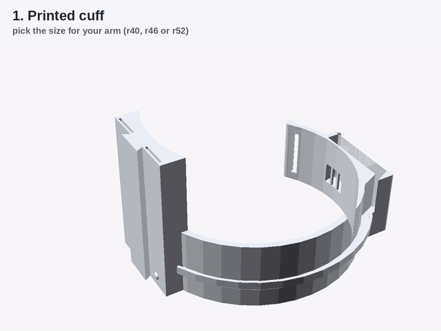
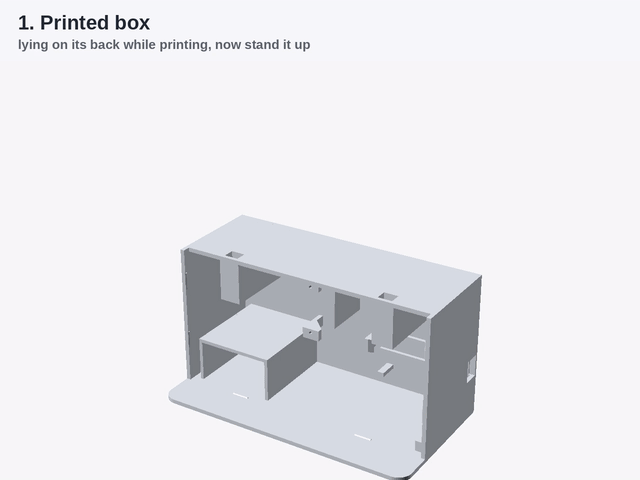
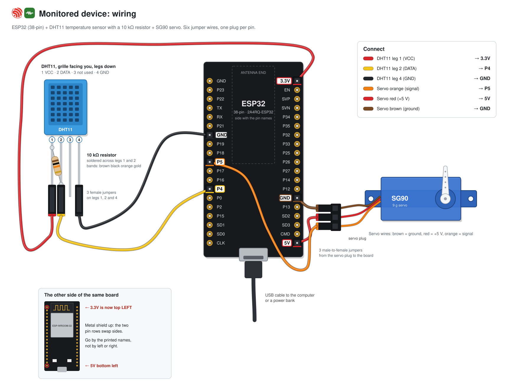
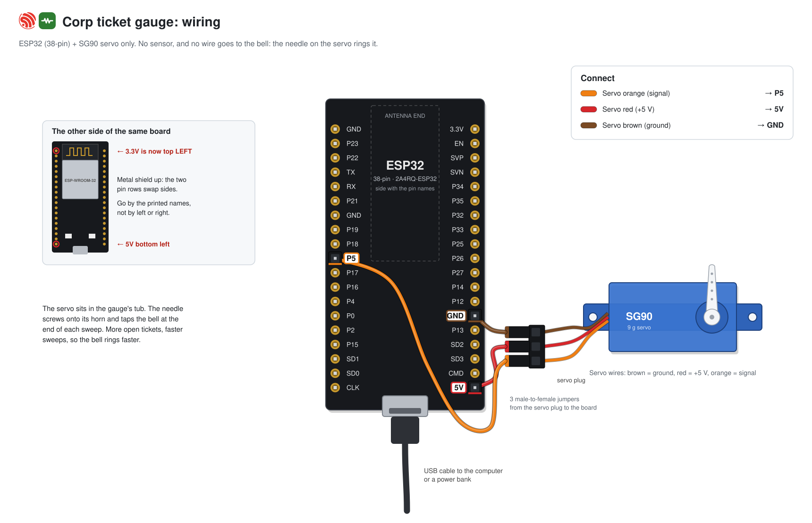
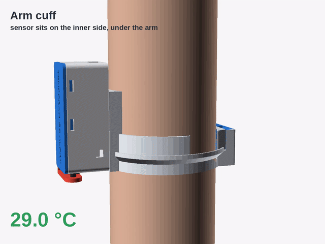
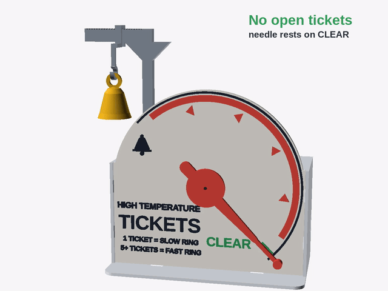
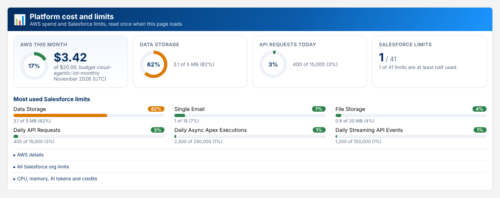
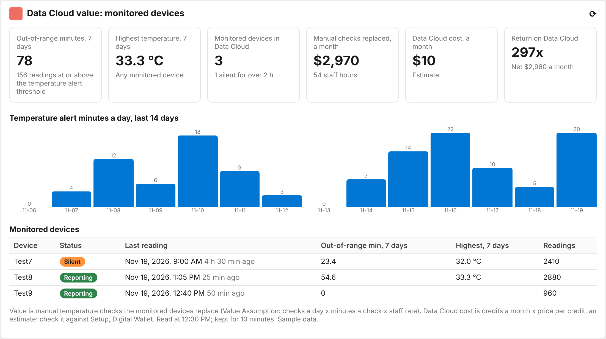
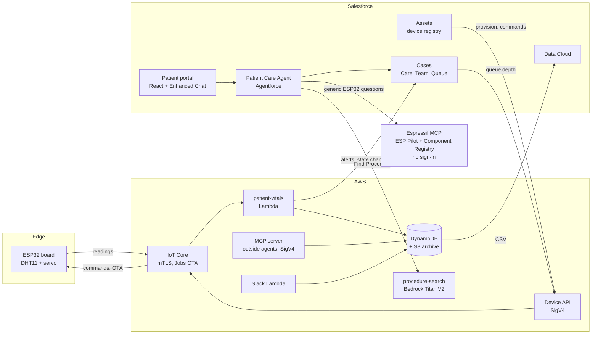

# Cloud-Agentic-IoT

> A healthcare IoT + Agentforce system, built from scratch and in public. A physical ESP32 board measures temperature, AWS IoT streams it, Salesforce turns it into Cases, and an Agentforce agent answers from the readings and the ward's procedures, in Salesforce, Slack and a patient portal.

<!--
  VIDEO PLACEHOLDER: replace the block below with the walkthrough video.
  On GitHub a thumbnail that links to YouTube works best:
  
-->
> [!NOTE]
> **Video walkthrough: coming soon.** A short video showing the end result (board, alerts, agent, portal) and where each part lives in this repository.

## See what you build

Two ESP32 boards in 3D-printed cases, AWS IoT, Salesforce with Agentforce and Data Cloud, all running together. Everything below comes from the [Quick Install Guide](https://cloudarchitect101.github.io/Cloud-Agentic-IoT/INSTALL), steps 12 and 13.

**0. Tech stack**

<table>
<tr>
<th width="50%"> Salesforce</th>
<th width="50%"> AWS</th>
</tr>
<tr>
<td valign="top"> <b>Salesforce</b>: Service Cloud Cases, Apex, Lightning  <b>Agentforce</b>: two agents, new builder  <b>Data Cloud</b>: reading history and insights  <b>Slack</b>: slash command and agent DMs</td>
<td valign="top"> <b>AWS IoT Core</b>: mutual TLS, rules, OTA jobs  <b>Lambda</b>: alerts, commands, Salesforce sync  <b>Bedrock</b>: SOP search with embeddings  <b>S3</b>: reading archive and firmware</td>
</tr>
</table>

**1. Build two devices** ([step 12](https://cloudarchitect101.github.io/Cloud-Agentic-IoT/INSTALL#step-12))

<table>
<tr>
<td width="50%" valign="top"> <b>Monitored device</b> <code>PatientExternalESP32</code>: an ESP32, a DHT11 temperature sensor and a servo in a 3D-printed arm cuff.</td>
<td width="50%" valign="top"> <b>Corp ticket gauge</b> <code>CompanyInternalESP32</code>: an ESP32 and a servo that swings a needle and rings a bell for the care team.</td>
</tr>
<tr>
<td valign="top"> Wiring, drawn from the real parts: DHT11 on P4 with a 10 kΩ pull-up, servo on P5.</td>
<td valign="top"> Wiring: one servo on P5. Saving the board's Asset in Salesforce gives it its own X.509 certificate, with no secrets in the firmware.</td>
</tr>
</table>

**2. Watch it work** ([step 13](https://cloudarchitect101.github.io/Cloud-Agentic-IoT/INSTALL#step-13))

<table>
<tr>
<td width="50%" valign="top"> <b>30 C on the arm.</b> The board's own servo spins within 5 s, even offline. AWS IoT Core flags the crossing, and Salesforce opens one Case for the care team.</td>
<td width="50%" valign="top"> <b>The office hears it.</b> The open Case drives the gauge through a platform event, an AWS callout and MQTT: its needle sweeps and its bell rings until someone closes the Case. The Patient Care Agent then reads the device and cites the ward's procedure.</td>
</tr>
</table>

**3. Run it as a business** (the app's Home tab)

<table>
<tr>
<td width="50%" valign="top"> <b>Cost and limits.</b> This month's AWS spend against its budget (about $0.08 per device a month), and the org's limits: storage, API calls, async Apex, streaming events.</td>
<td width="50%" valign="top"> <b>Data Cloud value.</b> Out-of-range minutes, the highest temperature, which devices went silent, and the manual checks the system replaces, measured against what Data Cloud costs.</td>
</tr>
</table>

The animations are renders of the real 3D models, and the Home cards show sample data. Real footage and org screenshots will replace them under the same file names.

  
   
  Opens the guide website: pick your path (Salesforce admin, device builder, developer or pipelines) and follow it step by step.

## What it does

| Part | What happens |
|---|---|
|    **Sense** | An ESP32 with a DHT11 sends readings to AWS IoT Core over mutual TLS. No secrets are compiled into the firmware, and every update after the first USB flash goes over the air. |
|    **Alert** | At 30 C the board's own motor turns at once (it works offline), and AWS flags the reading so Salesforce opens one Case for the care team. A ward board spins while that queue has work. |
|   **Act** | The Patient Care Agent (Agentforce, new builder) reads the device, cites the ward's SOPs found with Bedrock embeddings, and escalates only after you confirm. Both agents answer generic ESP32 questions from Espressif's open MCP servers in Agentforce Registry, with no sign-in and no org data sent out. Guardrails and PII masking run outside the model. |
|   **Reach** | Patients sign in to a **React site on Salesforce** (Multi-Framework, React 19) and chat with their own care assistant through **Enhanced Chat v2**: a second Agentforce agent that only ever sees the signed-in patient's devices and can send a nurse request. Staff use **Slack**: `/patient-status <device>` answers with no Salesforce login (JWT integration user), and the Patient Care Agent answers in Slack DMs. |
|   **Measure** | The app's Home tab shows the month's AWS spend against its limit, the org's limits, and a Business Value dashboard: alert response, chat deflection, hours avoided and cost per device. |

Product names and logos belong to their owners, shown to say what this project works with, not endorsement. [Icon credits](docs/images/platforms/CREDITS.md).

## How it works

New here? Begin at **[Start here](docs/START-HERE.md)**. Prefer to go step by step? Open the [interactive walkthrough](https://cloudarchitect101.github.io/Cloud-Agentic-IoT/process/) (Prev / Next, arrow keys, or Play). Both are drawn from one list of steps in [`scripts/render-process-flow.py`](scripts/render-process-flow.py).

## Architecture

More diagrams and the reasoning behind each piece: [How the pieces connect](docs/HOW-IT-CONNECTS.md) and [Architecture overview](docs/ARCHITECTURE-OVERVIEW.md).

## Install

**New here? [Start here](docs/START-HERE.md)** picks your path in one table: clinic Salesforce admin, device builder, developer, or a team with pipelines. Everyone follows the Quick Install Guide step by step, with a check after each step; open the Detailed Install Guide beside it when you want the why behind a step.

| | [**Quick Install Guide**](docs/INSTALL.md) | [**Detailed Install Guide**](docs/INSTALL-GUIDE.md) |
|---|---|---|
| For | Getting it running | Understanding every step |
| What you get | Every feature as execution steps in order, deployed in one run by `scripts/install.sh` | Each step, why it is done that way, and what to check when it fails |
| Target | Your own AWS project with a spend limit and a free Developer Edition org, from your laptop, then the Dev and Prod pipelines | The same, or separate Dev and Prod accounts and orgs through GitHub Actions |
| Time | About two hours for every feature, plus 20 min per board | About a day for the full pipeline setup |

The board is optional: everything except the motor runs without one.

## What's where

| Folder | What lives there | Read more |
|---|---|---|
| [`force-app/main/default/`](force-app/main/default/) | All Salesforce metadata: objects, Apex and tests, triggers, LWCs, the agents (Agent Script), the portal | [DATA-MODEL.md](docs/DATA-MODEL.md), [CHAPTERS.md §05](docs/CHAPTERS.md#05--the-agent-and-its-actions) |
| [`force-app/main/default/uiBundles/patientPortal/`](force-app/main/default/uiBundles/patientPortal/) | The patients' React site with the Enhanced Chat window | [PATIENT-PORTAL.md](docs/PATIENT-PORTAL.md) |
| [`lambda/slack-integration/`](lambda/slack-integration/) | The Slack `/patient-status` command: signature check, then AWS and Salesforce reads | [CHAPTERS.md §04](docs/CHAPTERS.md#04--headless-slack-integration) |
| [`lambda/`](lambda/) | 18 AWS Lambda functions, each with its CloudFormation template, plus `shared/` code | [CHAPTERS.md](docs/CHAPTERS.md) |
| [`firmware/`](firmware/) | One ESP32 sketch for every board and its shared library (NVS, WiFi, MQTT, OTA) | [firmware/README.md](firmware/README.md), [DEVICE-IDENTITY.md](docs/DEVICE-IDENTITY.md) |
| [`infra/`](infra/) | Account-level stacks: the deploy role and budget, alarms, the OTA bucket | [SETUP.md](docs/SETUP.md) |
| [`config/`](config/) | Per-environment settings (`Dev.json`, `Prod.json`) and the vital thresholds | [DEVELOPMENT.md](docs/DEVELOPMENT.md) |
| [`knowledge/sops/`](knowledge/sops/) | The ward's sample procedures the agent finds and cites | [SOP-GROUNDING.md](docs/SOP-GROUNDING.md) |
| [`datacloud/`](datacloud/) | Columns of the readings feed and the calculated insights' SQL | [DATA-CLOUD.md](docs/DATA-CLOUD.md), [SETUP.md §7](docs/SETUP.md#7-data-cloud-room-readings-for-the-ward) |
| [`scripts/`](scripts/) | The one-run install (`install.sh`), deploy, provisioning, OTA, agent publish, evals and checks, all runnable from a laptop | [INSTALL.md](docs/INSTALL.md) |
| [`test/`](test/) | Node and Python tests for the Lambdas, firmware logic, scripts, agents and templates | [Quality](#quality) |
| [`.github/workflows/`](.github/workflows/) | Checks on every PR, deploys, OTA promotion, agent evals | [CI-CD-SECRETS.md](docs/CI-CD-SECRETS.md) |
| [`mulesoft/`](mulesoft/) | The iPaaS alternative to the ingestion Lambda (a design sketch) | [CHAPTERS.md §07](docs/CHAPTERS.md#07--cross-cloud-integrations-ipaas--mulesoft) |
| [`docs/`](docs/) | Everything else, listed below | |

## Documentation

Grouped by what you came to do, after the [Diátaxis](https://diataxis.fr/) framework.

| Learn by doing | Get a task done |
|---|---|
| [Quick Install Guide](docs/INSTALL.md): every feature, step by step | [Detailed Install Guide](docs/INSTALL-GUIDE.md): every step, explained |
| [Use case scenarios](docs/TRY-IT.md): after install, test every feature as one real situation each, by who you act as | [Setup](docs/SETUP.md): accounts, identities, licences, Connected Apps, GitHub secrets |
| [Platform primer](docs/PLATFORM-PRIMER.md): Apex, SOQL and LWC through their Python equivalents | [Development](docs/DEVELOPMENT.md): laptop to Dev to Prod |
| | [Migration runbook](docs/MIGRATION-RUNBOOK.md): phased cutover with a rollback per phase |
| | [Troubleshooting](docs/TROUBLESHOOTING.md): what broke, why, and the fix |

| Understand the design | Look something up |
|---|---|
| [The chapters](docs/CHAPTERS.md): 14 capabilities, one system | [Data model](docs/DATA-MODEL.md): why each object is standard or custom |
| [How it connects](docs/HOW-IT-CONNECTS.md) and [Architecture overview](docs/ARCHITECTURE-OVERVIEW.md) | [Cost model](docs/COST-MODEL.md): per device, per user, per customer |
| [Device identity](docs/DEVICE-IDENTITY.md): certificates and WiFi that survive OTA | [Spend and limits](docs/SPEND-AND-LIMITS.md): the Home page's numbers |
| [SOP grounding](docs/SOP-GROUNDING.md) and [Guardrails and MCP](docs/GUARDRAILS-AND-MCP.md) | [CI/CD and secrets](docs/CI-CD-SECRETS.md): what is automated and the conventions |
| [Patient portal](docs/PATIENT-PORTAL.md): the React site, Enhanced Chat and the patient agent | [Agent evals](docs/AGENT-EVALS.md): Testing Center specs and retrieval scores |
| [Slack](docs/CHAPTERS.md#04--headless-slack-integration): `/patient-status` with no login, and [the agent in Slack](docs/SETUP.md#talk-to-the-agent-from-slack-optional) | [Business value](docs/BUSINESS-VALUE.md): the KPI dashboard and its assumptions |
| [Live status](docs/LIVE-STATUS.md), [Data Cloud](docs/DATA-CLOUD.md), [Scaling](docs/SCALING.md) | |

## KPIs and cost

| Measure | Value | Source |
|---|---|---|
| AWS per monitored device | ≈ $0.08 a month (readings every 30 s) | [COST-MODEL.md](docs/COST-MODEL.md) |
| Total per patient and device | ≈ $0.60 to $2.50 a month, driven by Agentforce use | [COST-MODEL.md](docs/COST-MODEL.md) |
| Hardware per board | ≈ $37 CAD retail | [COST-MODEL.md](docs/COST-MODEL.md) |
| SOP search | Under a cent a month, nothing runs while idle | [SOP-GROUNDING.md](docs/SOP-GROUNDING.md) |
| Alert on the board | Within about 5 s of reaching 30 C, offline too | [CHAPTERS.md §03](docs/CHAPTERS.md#temperature-alert-demo-rule) |
| Business value | Net value, deflection vs break-even, response time before vs after, hours avoided | [BUSINESS-VALUE.md](docs/BUSINESS-VALUE.md) |
| Retrieval quality | hit@1, hit@3 and MRR on every eval run | [AGENT-EVALS.md](docs/AGENT-EVALS.md) |
| Spend guard | An AWS project spend limit, shown on the Home tab | [SPEND-AND-LIMITS.md](docs/SPEND-AND-LIMITS.md) |

## Quality

- **Tests:** 561 Node tests cover all 18 Lambda functions, the guardrails, the MCP server, the Espressif MCP setup (servers, agent routing, Trusted URLs), the SOP index and the firmware's logic compiled for the host. 118 Python tests run the board, OTA, install, deploy and setup scripts against a simulated board, AWS and org. Every Salesforce deploy to CI and Prod runs the org's Apex tests (38 test classes).
- **On every pull request:** the tests, a CloudFormation lint, shellcheck, a Salesforce metadata check, the portal's React build and an ESP32 compile ([`checks.yml`](.github/workflows/checks.yml)).
- **Security:** mutual TLS per device, least-privilege IAM, SigV4 on every Salesforce-to-AWS call, no private key ever stored in Salesforce, guardrails and PII masking outside the model.

<b>Current state</b> (test setup: one AWS project and one Developer Edition org)

| Chapter | State |
|---|---|
| 00, 13 · Provisioning | Live: two boards provisioned from their Assets, one Monitoring Device and one Internal Device |
| 01 · Data Cloud | The CSV copy is live in S3. The connection, stream and mapping are setup steps in the org, and the insights a script; not set up in the test org yet |
| 02 · Streams | Deployed. Fired by `scripts/streams-test.sh`, since the boards send only temperature and humidity |
| 03 · Queue indicator, 30 °C rule | Live on both boards since Nov 10 (the temperature alert motor). The one current firmware version is `FIRMWARE_VERSION` in [`firmware/patient-monitor/patient-monitor.ino`](firmware/patient-monitor/patient-monitor.ino) |
| 04 · Slack | Live: `/patient-status`, and the Patient Care Agent answers in Slack DMs |
| 05 · Agent | Live in the new Agentforce Builder: readings, procedures, escalation to a Case, in Salesforce and Slack |
| 06 · MCP | Deployed; `get_room_status` tested by a signed call |
| 06 · Espressif MCP | Live since Nov 19: both agents answer generic ESP32 questions from ESP Pilot and ESP Component Registry (Agentforce Registry, no sign-in), with docs links allowed by Trusted URLs |
| 07 · MuleSoft | A design sketch, not a buildable project |
| 08 · SOP RAG | Live since Nov 10: Find Procedure cites the SOP ID and version |
| 09 · OTA saga | Verified on one board |
| 10 · PII masking | In the agent's readings and procedure actions |
| 11 · Guardrails | Deployed; a refused command tested |
| Patient portal | Deployed (site live); its agent is published with `scripts/publish-portal-agent.sh` |

The Dev and Prod pipelines in [DEVELOPMENT.md](docs/DEVELOPMENT.md) are the next step: the same code, deployed by the pipeline into a second org and account.

## Tech stack

- **Salesforce:** Agentforce (Agent Script), Data Cloud, Apex, LWC, Platform Events, Experience Cloud with a React portal, Enhanced Chat
- **AWS:** IoT Core and Jobs, Lambda, DynamoDB, S3, SQS, EventBridge, API Gateway, Bedrock (Titan Text Embeddings V2), CloudFormation
- **Edge:** ESP32, `arduino-cli`
- **Languages:** Apex, JavaScript (Node.js), C++, Python, DataWeave

## Contributing

Issues and pull requests are welcome. This project was built with AI coding
assistants and every change is reviewed by the maintainer before it merges.
See [CONTRIBUTING.md](CONTRIBUTING.md), and report security problems privately
as described in [SECURITY.md](SECURITY.md).

## License

[MIT](LICENSE)
