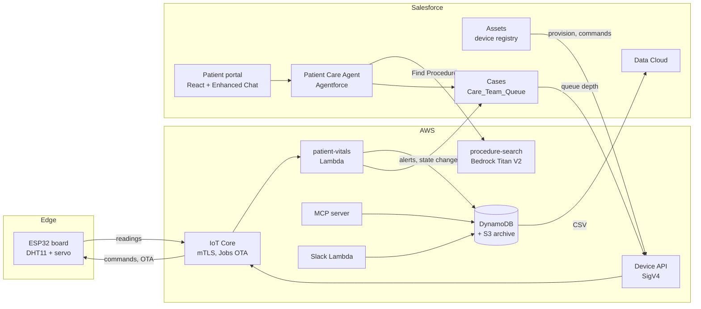

# Cloud-Agentic-IoT

> A healthcare IoT + Agentforce system, built from scratch and in public. A physical ESP32 board measures temperature, AWS IoT streams it, Salesforce turns it into Cases, and an Agentforce agent answers from the readings and the ward's procedures, in Salesforce, Slack and a patient portal.

<!--
  VIDEO PLACEHOLDER: replace the block below with the walkthrough video.
  On GitHub a thumbnail that links to YouTube works best:
  
-->
> [!NOTE]
> **Video walkthrough: coming soon.** A short video showing the end result (board, alerts, agent, portal) and where each part lives in this repository.

## What it does

| Part | What happens |
|---|---|
| **Sense** | An ESP32 with a DHT11 sends readings to AWS IoT Core over mutual TLS. No secrets are compiled into the firmware, and every update after the first USB flash goes over the air. |
| **Alert** | At 30 C the board's own motor turns at once (it works offline), and AWS flags the reading so Salesforce opens one Case for the care team. A ward board spins while that queue has work. |
| **Act** | The Patient Care Agent (Agentforce, new builder) reads the device, cites the ward's SOPs found with Bedrock embeddings, and escalates only after you confirm. Guardrails and PII masking run outside the model. |
| **Reach** | Patients sign in to a **React site on Salesforce** (Multi-Framework, React 19) and chat with their own care assistant through **Enhanced Chat v2**: a second Agentforce agent that only ever sees the signed-in patient's devices and can send a nurse request. Staff use **Slack**: `/patient-status <device>` answers with no Salesforce login (JWT integration user), and the Patient Care Agent answers in Slack DMs. |
| **Measure** | The app's Home tab shows the month's AWS spend against its limit, the org's limits, and a Business Value dashboard: alert response, chat deflection, hours avoided and cost per device. |

## How it works

Prefer to go step by step? Open the [interactive walkthrough](https://cloudarchitect101.github.io/Cloud-Agentic-IoT/process/) (Prev / Next, arrow keys, or Play). Both are drawn from one list of steps in [`scripts/render-process-flow.py`](scripts/render-process-flow.py).

## Architecture

More diagrams and the reasoning behind each piece: [How the pieces connect](docs/HOW-IT-CONNECTS.md) and [Architecture overview](docs/ARCHITECTURE-OVERVIEW.md).

## Install

Pick one. Both end with the same running system.

| | [**Quick install**](docs/INSTALL.md) | [**Install guide**](docs/INSTALL-GUIDE.md) |
|---|---|---|
| For | Getting it running | Understanding every step |
| What you get | Commands in order, one line of context each | Each step, why it is done that way, and what to check when it fails |
| Target | Your own AWS project with a spend limit and a free Developer Edition org, from your laptop | The same, or separate Dev and Prod accounts and orgs through GitHub Actions |
| Time | About an hour, plus 20 min per board | About a day for the full pipeline setup |

The board is optional: everything except the motor runs without one.

## What's where

| Folder | What lives there | Read more |
|---|---|---|
| [`force-app/main/default/`](force-app/main/default/) | All Salesforce metadata: objects, Apex and tests, triggers, LWCs, the agents (Agent Script), the portal | [DATA-MODEL.md](docs/DATA-MODEL.md), [CHAPTERS.md §05](docs/CHAPTERS.md#05--the-agent-and-its-actions) |
| [`force-app/main/default/uiBundles/patientPortal/`](force-app/main/default/uiBundles/patientPortal/) | The patients' React site with the Enhanced Chat window | [PATIENT-PORTAL.md](docs/PATIENT-PORTAL.md) |
| [`lambda/slack-integration/`](lambda/slack-integration/) | The Slack `/patient-status` command: signature check, then AWS and Salesforce reads | [CHAPTERS.md §04](docs/CHAPTERS.md#04--headless-slack-integration) |
| [`lambda/`](lambda/) | 18 AWS Lambda functions, each with its CloudFormation template, plus `shared/` code | [CHAPTERS.md](docs/CHAPTERS.md) |
| [`firmware/`](firmware/) | One ESP32 sketch for every board and its shared library (NVS, WiFi, MQTT, OTA) | [firmware/README.md](firmware/README.md), [DEVICE-IDENTITY.md](docs/DEVICE-IDENTITY.md) |
| [`infra/`](infra/) | Account-level stacks: the deploy role and budget, alarms, the OTA bucket | [SETUP.md](docs/SETUP.md) |
| [`config/`](config/) | Per-environment settings (`Dev.json`, `Prod.json`) and the vital thresholds | [DEVELOPMENT.md](docs/DEVELOPMENT.md) |
| [`knowledge/sops/`](knowledge/sops/) | The ward's sample procedures the agent finds and cites | [SOP-GROUNDING.md](docs/SOP-GROUNDING.md) |
| [`datacloud/`](datacloud/) | Columns of the readings feed and the calculated insights' SQL | [DATA-CLOUD.md](docs/DATA-CLOUD.md), [SETUP.md §7](docs/SETUP.md#7-data-cloud-room-readings-for-the-ward) |
| [`scripts/`](scripts/) | Deploy, provisioning, OTA, agent publish, evals and checks, all runnable from a laptop | [INSTALL.md](docs/INSTALL.md) |
| [`test/`](test/) | Node and Python tests for the Lambdas, firmware logic, scripts, agents and templates | [Quality](#quality) |
| [`.github/workflows/`](.github/workflows/) | Checks on every PR, deploys, OTA promotion, agent evals | [CI-CD-SECRETS.md](docs/CI-CD-SECRETS.md) |
| [`mulesoft/`](mulesoft/) | The iPaaS alternative to the ingestion Lambda (a design sketch) | [CHAPTERS.md §07](docs/CHAPTERS.md#07--cross-cloud-integrations-ipaas--mulesoft) |
| [`docs/`](docs/) | Everything else, listed below | |

## Documentation

Grouped by what you came to do, after the [Diátaxis](https://diataxis.fr/) framework.

| Learn by doing | Get a task done |
|---|---|
| [Quick install](docs/INSTALL.md): the shortest path to a running system | [Install guide](docs/INSTALL-GUIDE.md): every step, explained |
| [Try it](docs/TRY-IT.md): your own project and org, then each demo (warm the sensor, the saga, Slack) | [Setup](docs/SETUP.md): accounts, identities, licences, Connected Apps, GitHub secrets |
| [Platform primer](docs/PLATFORM-PRIMER.md): Apex, SOQL and LWC through their Python equivalents | [Development](docs/DEVELOPMENT.md): laptop to Dev to Prod |
| | [Migration runbook](docs/MIGRATION-RUNBOOK.md): phased cutover with a rollback per phase |
| | [Troubleshooting](docs/TROUBLESHOOTING.md): what broke, why, and the fix |

| Understand the design | Look something up |
|---|---|
| [The chapters](docs/CHAPTERS.md): 14 capabilities, one system | [Data model](docs/DATA-MODEL.md): why each object is standard or custom |
| [How it connects](docs/HOW-IT-CONNECTS.md) and [Architecture overview](docs/ARCHITECTURE-OVERVIEW.md) | [Cost model](docs/COST-MODEL.md): per device, per user, per customer |
| [Device identity](docs/DEVICE-IDENTITY.md): certificates and WiFi that survive OTA | [Spend and limits](docs/SPEND-AND-LIMITS.md): the Home page's numbers |
| [SOP grounding](docs/SOP-GROUNDING.md) and [Guardrails and MCP](docs/GUARDRAILS-AND-MCP.md) | [CI/CD and secrets](docs/CI-CD-SECRETS.md): what is automated and the conventions |
| [Patient portal](docs/PATIENT-PORTAL.md): the React site, Enhanced Chat and the patient agent | [Agent evals](docs/AGENT-EVALS.md): Testing Center specs and retrieval scores |
| [Slack](docs/CHAPTERS.md#04--headless-slack-integration): `/patient-status` with no login, and [the agent in Slack](docs/SETUP.md#talk-to-the-agent-from-slack-optional) | [Business value](docs/BUSINESS-VALUE.md): the KPI dashboard and its assumptions |
| [Live status](docs/LIVE-STATUS.md), [Data Cloud](docs/DATA-CLOUD.md), [Scaling](docs/SCALING.md) | |

## KPIs and cost

| Measure | Value | Source |
|---|---|---|
| AWS per monitored device | ≈ $0.08 a month (readings every 30 s) | [COST-MODEL.md](docs/COST-MODEL.md) |
| Total per patient and device | ≈ $0.60 to $2.50 a month, driven by Agentforce use | [COST-MODEL.md](docs/COST-MODEL.md) |
| Hardware per board | ≈ $37 CAD retail | [COST-MODEL.md](docs/COST-MODEL.md) |
| SOP search | Under a cent a month, nothing runs while idle | [SOP-GROUNDING.md](docs/SOP-GROUNDING.md) |
| Alert on the board | Within about 5 s of reaching 30 C, offline too | [CHAPTERS.md §03](docs/CHAPTERS.md#temperature-alert-demo-rule) |
| Business value | Net value, deflection vs break-even, response time before vs after, hours avoided | [BUSINESS-VALUE.md](docs/BUSINESS-VALUE.md) |
| Retrieval quality | hit@1, hit@3 and MRR on every eval run | [AGENT-EVALS.md](docs/AGENT-EVALS.md) |
| Spend guard | An AWS project spend limit, shown on the Home tab | [SPEND-AND-LIMITS.md](docs/SPEND-AND-LIMITS.md) |

## Quality

- **Tests:** 516 Node tests cover all 18 Lambda functions, the guardrails, the MCP server, the SOP index and the firmware's logic compiled for the host. 110 Python tests run the board, OTA, deploy and setup scripts against a simulated board, AWS and org. Every Salesforce deploy to CI and Prod runs the org's Apex tests (38 test classes).
- **On every pull request:** the tests, a CloudFormation lint, shellcheck, a Salesforce metadata check, the portal's React build and an ESP32 compile ([`checks.yml`](.github/workflows/checks.yml)).
- **Security:** mutual TLS per device, least-privilege IAM, SigV4 on every Salesforce-to-AWS call, no private key ever stored in Salesforce, guardrails and PII masking outside the model.

<b>Current state</b> (test setup: one AWS project and one Developer Edition org)

| Chapter | State |
|---|---|
| 00, 13 · Provisioning | Live: two boards provisioned from their Assets, one Monitoring Device and one Internal Device |
| 01 · Data Cloud | The CSV copy is live in S3. The connection, stream and mapping are setup steps in the org, and the insights a script; not set up in the test org yet |
| 02 · Streams | Deployed. Fired by `scripts/streams-test.sh`, since the boards send only temperature and humidity |
| 03 · Queue indicator, 30 °C rule | Live: firmware 2.6.0-try.1 on Test7 and Test8 since Nov 10 (the temperature alert motor) |
| 04 · Slack | Live: `/patient-status`, and the Patient Care Agent answers in Slack DMs |
| 05 · Agent | Live in the new Agentforce Builder: readings, procedures, escalation to a Case, in Salesforce and Slack |
| 06 · MCP | Deployed; `get_room_status` tested by a signed call |
| 07 · MuleSoft | A design sketch, not a buildable project |
| 08 · SOP RAG | Live since Nov 10: Find Procedure cites the SOP ID and version |
| 09 · OTA saga | Verified on one board |
| 10 · PII masking | In the agent's readings and procedure actions |
| 11 · Guardrails | Deployed; a refused command tested |
| Patient portal | Deployed (site live); its agent is published with `scripts/publish-portal-agent.sh` |

The Dev and Prod pipelines in [DEVELOPMENT.md](docs/DEVELOPMENT.md) are the next step: the same code, deployed by the pipeline into a second org and account.

## Tech stack

- **Salesforce:** Agentforce (Agent Script), Data Cloud, Apex, LWC, Platform Events, Experience Cloud with a React portal, Enhanced Chat
- **AWS:** IoT Core and Jobs, Lambda, DynamoDB, S3, SQS, EventBridge, API Gateway, Bedrock (Titan Text Embeddings V2), CloudFormation
- **Edge:** ESP32, `arduino-cli`
- **Languages:** Apex, JavaScript (Node.js), C++, Python, DataWeave

## License

[MIT](LICENSE)
