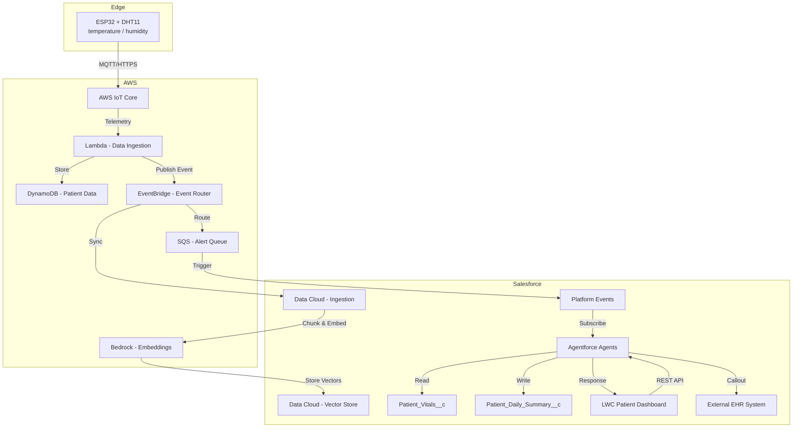

# Cloud-Agentic-IoT: Architecture Overview

## System Architecture

## A note on the sensor data

The physical device is an **ESP32 with a DHT11** — temperature and humidity only. The data model (`Patient_Vitals__c`, the alert thresholds in chapter `02`) also carries heart rate, SpO2 and blood pressure fields, because that is what a real patient monitor produces and the architecture should not have to change when the sensor does.

Those additional fields are only filled by the tests and the load simulation (`test/load/fleet-simulation.js`); on real hardware they stay empty. Any content or demo should say so — a viewer can see a DHT11 on the breadboard.

## Data Flow

1. **Edge**: The ESP32 patient monitor sends temperature and humidity (the data model also has heart rate, SpO2 and blood pressure, for a real monitor)
2. **AWS Ingestion**: IoT Core receives telemetry, Lambda processes and stores in DynamoDB
3. **Data Cloud Ingestion**: Every room reading reaches Data Cloud from the S3 archive's CSV copy, through an Amazon S3 data stream, into the `Room_Readings` data model object and two calculated insights ([DATA-CLOUD.md](DATA-CLOUD.md))
4. **RAG Pipeline**: Data is chunked, embedded (Bedrock), and indexed in Vector Store
5. **Platform Events**: Real-time alerts published to Platform Events
6. **Agentforce**: Agents consume Platform Events, retrieve context from Vector Store, and take actions
7. **External Systems**: Agents call EHR APIs, create Support Cases, update patient records

## Key Components

| Component | Purpose | Technology |
|-----------|---------|------------|
| Monitoring Device | Reads temperature and humidity wherever its sensor sits (on a patient, in a fridge, in a room), turns its alert motor while the reading is high | Physical ESP32 + DHT11 + servo (chapter `00`) |
| Queue Indicator | Physical Case-queue depth display | The same ESP32 firmware; an Asset of record type Internal Device follows Care_Team_Queue (chapter `03`) |
| Slack Bot | Headless Salesforce read/write from chat | Lambda + JWT Bearer Flow (chapter `04`) |
| Data Ingestion | Transform and route telemetry | AWS Lambda |
| Data Cloud | Unified patient data engine | Salesforce Data Cloud |
| Vector Store | Semantic search for patient context | Data Cloud + Bedrock |
| Platform Events | Real-time alert distribution | Salesforce Platform Events |
| Agentforce | Autonomous patient monitoring | Agentforce Topics + Actions |
| Patient Dashboard | LWC UI for care teams | Lightning Web Components |
| EHR Integration | Sync with external health systems | REST API + OAuth 2.0 |

## Security

- **PII Masking**: Patient data masked before LLM processing
- **Field-Level Security**: Agents run in designated user context
- **Audit Trail**: All agent actions logged to Agent_Audit_Log__c
- **Guardrails**: Every command to a board checked in device-command before it is published (allowed commands, settings and ranges); prompt injection detection, output checks and PII masking for the MCP server's answers ([GUARDRAILS-AND-MCP.md](GUARDRAILS-AND-MCP.md))
- **MCP server**: Room status and commands for agents outside Salesforce, behind a Lambda function URL that takes only SigV4-signed requests
- **Outside MCP servers (Espressif)**: Both agents call Espressif's open, read-only MCP servers (ESP Pilot, ESP Component Registry) through Agentforce Registry for generic ESP32 questions. No sign-in, nothing from the org goes into a tool input, results are treated as data, and only Trusted URLs (`docs.espressif.com`, `www.espressif.com`) reach the user as links ([GUARDRAILS-AND-MCP.md](GUARDRAILS-AND-MCP.md#espressif-mcp-servers-for-the-agents))
- **HIPAA Compliance**: Data encryption, access controls, audit logging

---

[← Docs home](index.md) · [Start here](START-HERE.md) · [Quick Install Guide](INSTALL.md) · [Troubleshooting](TROUBLESHOOTING.md)
