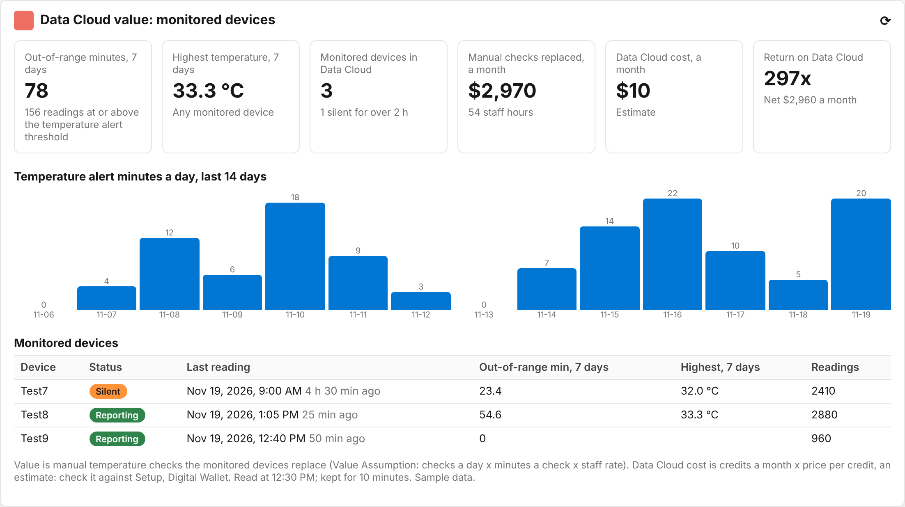

# Business Value dashboard: what the platform is worth, before and after

A business owner asks one question first: what does this save me, and what
does it cost? The **Business Value** dashboard answers it. It is the first thing
on the Cloud Agentic IoT app's **Home** tab (above the cost and limits
card), and also under Dashboards -> Business Value. It answers it with numbers the org measures every night, next
to the as-is baseline and the prices you set.

## What it shows

| Tile or chart | Measured from | Why an owner cares |
| --- | --- | --- |
| **Net value, last 7 days** | Staff time value - Agentforce cost - AWS cost | The bottom line |
| **Chats the agent handled %** (deflection) | Patient chats (MessagingSession) without a nurse request Case | Each one is a nurse visit that did not happen |
| **Deflection vs break-even** | Agentforce cost per chat / value of one nurse visit | Above the line the agent saves money; below it, it costs more than it saves |
| **Faster response %** | Minutes from an automatic alert Case opening to closing, vs the as-is minutes a high reading went unnoticed | Safety and service level |
| **Response time: before vs after** | Baseline-phase snapshots next to after-phase ones | The as-is / to-be comparison |
| **Agentforce: cost vs value** | (chats + staff escalations) x actions x price per action, against staff time value | Is the AI paying for itself? |
| **AWS per device per month** | Month-to-date AWS spend (the Home usage card) / provisioned devices, projected | Unit cost as the fleet grows |
| **Hours avoided** | Devices x manual checks a day x minutes a check, plus nurse chat time | Capacity given back to staff |

Every snapshot also keeps the alert counts, devices online, chats, nurse
requests and staff escalations it used, and an **Assumptions** text with the
exact values, so any number on the dashboard can be traced.

## Data Cloud value card



Under the dashboard on Home, the **Data Cloud value: monitored devices** card
shows what the room readings in Data Cloud measure, next to what Data Cloud
costs. It reads the two calculated insights ([DATA-CLOUD.md](DATA-CLOUD.md))
through Data Cloud's SQL query (`DataCloudValueController`), at most once
every 10 minutes per browser session: each read is two queries, which use
credits, and the insights only change hourly.

| Tile or chart | From | Why an owner cares |
| --- | --- | --- |
| **Out-of-range minutes, 7 days** | `Room_Out_Of_Range_Daily__cio`: minutes at or above the temperature alert threshold, all devices | How much high-temperature time the platform caught without anyone looking |
| **Highest temperature, 7 days** | Same insight, `max_temperature_c__c` | The worst moment, at a glance |
| **Monitored devices in Data Cloud** | `Room_Device_Silence__cio`, one row per device; **silent** when its last reading is over 2 hours old | Coverage: a device that stops reporting is a gap in monitoring |
| **Manual checks replaced, a month** | Devices x Manual Checks per Device per Day x Minutes per Manual Check x 30 days x Staff Hourly Rate | The value side |
| **Data Cloud cost, a month** | Data Cloud Credits per Month x Data Cloud Price per Credit | The cost side (an estimate) |
| **Return on Data Cloud** | Value / cost, and the net a month | The one number to say out loud |
| **Temperature alert minutes a day, 14 days** (bars) | The daily insight, summed per day | The trend after go-live |
| **Monitored devices** (table) | Both insights per device | Which device, when it last reported, how hot it got |

With the shipped assumptions, two devices replace 36 staff hours of manual
checks a month (2 x 12 checks x 3 min x 30 days), worth $1,980 at $55 an
hour, against about $10 of Data Cloud credits (2,000 credits x $0.005).
The two new assumption fields are **Data Cloud Credits per Month** and
**Data Cloud Price per Credit**: replace the credit estimate with what
Setup -> Digital Wallet shows after a month.

"Silent" here is about Data Cloud's copy, which is up to about two hours
old by design. The live, seconds-fresh signal is still the device's
**Connection** field on its Asset.

To see the card, a user needs **Business Value Viewer** and Data Cloud
access (a Data Cloud permission set, such as Data Cloud Architect or Data
Cloud User). Without Data Cloud access, each insight shows its own error
and the rest of the card still works.

## Before and after (as is / to be)

The assumptions live in custom metadata, **Value Assumption -> Default**
(Setup -> Custom Metadata Types), so changing one needs no code:

| Field | Shipped value | Meaning |
| --- | --- | --- |
| Phase | After | `Baseline` while you measure the as-is process, `After` once the platform runs it |
| Window (days) | 7 | Each snapshot measures the trailing week |
| Minutes per Manual Check | 3 | As is: one spot checked by hand |
| Manual Checks per Device per Day | 12 | As is: every two hours |
| Baseline Minutes to Respond | 60 | As is: a high reading goes unnoticed for about half the time between checks |
| Nurse Minutes per Question | 5 | As is: walking over to answer what the agent now answers |
| Staff Hourly Rate | 55 | Loaded cost of a staff hour |
| Agent Actions per Conversation | 3 | Get My Devices, sometimes Request a Nurse |
| Cost per Agent Action | 0.10 | 20 Flex Credits at $0.005 ([COST-MODEL.md](COST-MODEL.md) §7) |

**The shipped values are illustrative, not a real hospital's.** For a
customer, replace them with their own numbers in the first meeting. That
conversation is half the value of the dashboard.

Two ways to get a real baseline:
1. **Measured:** set Phase to `Baseline` for a week or two before go-live
   (or with the automatic Case rules switched off), let the nightly snapshots
   run, then set Phase to `After`. The "before vs after" chart averages each
   phase.
2. **Stated:** keep Phase `After` and enter the customer's current numbers
   as the baseline fields. The dashboard compares measured against stated.

## The Agentforce cost argument, worked through

With the shipped assumptions:
- a patient chat costs about **3 x $0.10 = $0.30** in agent actions;
- the nurse visit it replaces is worth **5 min x $55/h = $4.58**;
- so the agent breaks even when it handles **about 7 %** of chats alone, and
  each handled chat above that saves about **$4.28**.

In the demo the agent answers most chats (temperature questions) and opens
a Case only when the patient confirms they want a nurse, so deflection sits
far above break-even. That is the sentence to say in an interview, with
the chart behind it.

Agentforce cost is an **estimate**: Apex cannot read per-conversation Flex
Credit usage. Check it monthly against Setup -> Digital Wallet and adjust
Agent Actions per Conversation.

## Set it up

After `scripts/deploy-salesforce.sh` has deployed it:

```sh
sf org assign permset --name Business_Value_Viewer --target-org test-cloudarchitect101
sf apex run --target-org test-cloudarchitect101 <<'APEX'
System.schedule('Business Value snapshot', '0 0 1 * * ?', new ValueSnapshotJob());
ValueSnapshotService.takeSnapshot();
APEX
```

The first line lets you read the snapshots, the second schedules the nightly
snapshot (01:00 in the scheduling user's time zone) and takes the first one
now so the dashboard is not empty. One snapshot a day; a second run the same
day updates that day's record. The newest is flagged **Is Latest**, which the
headline tiles read.

## Limits worth saying out loud

- Response time is measured open-to-close of automatic alert Cases, not
  open-to-first-touch: Case field history is not tracked in this org.
- Deflection counts a chat as handled when no nurse request was opened in
  the window; a patient who left unhappy without asking still counts.
- In a Developer Edition the numbers are demo-sized. The arithmetic and the
  method are the point; the dashboard is the same in a customer's org.
