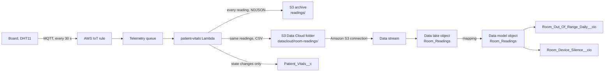

# Data Cloud: every reading from the monitored devices

Every monitored device measures the temperature of whatever it sits on, and
the humidity (a DHT11), every 30 seconds. Salesforce CRM sees only the readings someone has to
act on, as `Patient_Vitals__c` records; every reading is kept in the S3
archive. This page is how all of them reach **Data Cloud**, Salesforce's data
platform for large volumes, and become two answers per device: how long it
read at or above the temperature alert threshold each day, and whether it has
gone quiet. The Patient Care Agent reads both, and the raw readings, with
Get Device History ([How the agent reads it](#how-the-agent-reads-it)).

The setup steps are in [SETUP.md §7](SETUP.md#7-data-cloud-room-readings-for-the-ward).
This page explains the path, what is code and what is not, and how to check
each step.

## The path



1. **Board to AWS.** The board publishes `{deviceId, temperature, humidity}`
   to AWS IoT. The IoT rule adds the Thing name from the topic and the time
   AWS received it, and drops the message on the telemetry queue.
2. **The Lambda writes two copies.** `patient-vitals` takes the queue in
   batches. As before, it writes the whole batch as one gzipped NDJSON object
   under `readings/date=…/hour=…/`. With `DataCloudExport` on (Dev: on, Prod:
   off, in `config/<env>.json`) it also writes the same readings as one CSV
   file under `datacloud/room-readings/`. Both writes must succeed, or the
   batch is retried.
3. **S3 to Data Cloud.** An Amazon S3 connection in Data Cloud reads
   `datacloud/` in the archive bucket. A **data stream** on that connection
   imports the new CSV files on a schedule into a **data lake object** (DLO),
   Data Cloud's raw table for one source.
4. **DLO to DMO.** A mapping copies the DLO's fields onto a **data model
   object** (DMO), `Room_Readings`: the shape every Data Cloud feature reads,
   whatever source the data came from.
5. **Insights.** Two **calculated insights**, SQL that Data Cloud runs on a
   schedule over the DMO, give a table per device:
   - `Room_Out_Of_Range_Daily__cio`: per device and day, how many readings were
     at or above 30.0 C (the temperature alert rule's threshold,
     `RoomTempAlertCelsius`), about how many minutes that is at one reading
     every 30 seconds, and the day's highest temperature.
   - `Room_Device_Silence__cio`: per device, the time of its last reading
     (`last_reading_ts__c`) and its reading count. A calculated insight
     cannot use the current time after aggregating, so "minutes since" and
     "offline" are worked out where it is read: a segment, a flow or a
     report filter on `last_reading_ts__c`.

### Why a second copy, in CSV

Data Cloud's Amazon S3 connector reads CSV or Parquet files, and ignores files
in subfolders of the folder a data stream reads. The archive is gzipped
NDJSON in day and hour folders, built for Athena, so Data Cloud cannot read
it. Rather than change a format other readers rely on, the Lambda writes a
copy shaped for Data Cloud:

- one flat folder, `datacloud/room-readings/`, with the day and hour in the
  file name instead: `room-readings-2025-10-27-16-<message id>-<count>.csv`.
  No colons, which Data Cloud refuses in file names;
- plain CSV with a header row, text in double quotes, numbers bare, and a
  missing value as nothing, so a failed sensor read loads as null, not 0;
- one row per reading, deduplicated in the file on `reading_id`.

`readings/` is unchanged, so every reader of the archive is too.

### The columns

[`datacloud/room-readings.columns.json`](../datacloud/room-readings.columns.json)
is the list the data stream is built from; a test fails when it and the
Lambda differ.

| Column | Data Cloud type | What it is |
|---|---|---|
| `reading_id` | Text, primary key | `<device>-<timestamp>`: the same id as `Patient_Vitals__c.Device_Reading_Id__c`, so a reading in both places has one id, and a reading delivered twice is one row |
| `device_id` | Text | The board's AWS IoT Thing name, from the topic it published on |
| `serial_number` | Text | The Thing name again. It is the device Asset's `SerialNumber`, which is how a row finds its Asset |
| `reading_ts` | DateTime, event time | When the reading was taken, ISO 8601 in UTC (`2025-10-27T16:00:00.000Z`). The board sends no clock, so today it is when AWS IoT received it |
| `received_ts` | DateTime | When AWS IoT received it, in the same format. Rarely empty, which loads as null |
| `temperature_c` | Number | Temperature in °C, wherever the sensor sits; empty when the sensor did not read |
| `humidity_pct` | Number | Relative humidity in %; empty when the sensor did not read |
| `room` | Text | A room or location label, when the board sends `room` or `location`. The patient monitor sends neither, so it is empty today; the Asset's Account and location are in CRM |
| `source_system` | Text | `AWS_IoT` |

Both timestamps come from JavaScript's `toISOString()`, so they always look
like `2026-11-19T18:00:00.123Z`. In the data stream's **Add Date Format**
dialog that is not one of the listed formats: type it as a manual format,
`yyyy-MM-dd'T'HH:mm:ss.SSSXXX` (`XXX` reads the literal `Z` as UTC; a bare
`Z` expects `+0000` and fails).

The CSV holds no Asset Id: AWS knows a board by its Thing name. To join a
reading to its Asset in Data Cloud, bring the Asset object in through the
Salesforce CRM connector and relate `serial_number` to `SerialNumber`.

## How Data Cloud signs in to AWS

Data Cloud may read `datacloud/` and nothing else: it can find the bucket
(`s3:GetBucketLocation`), list keys under `datacloud/` (`s3:ListBucket` with
an `s3:prefix` condition) and read them (`s3:GetObject` on `datacloud/*`). Not
`readings/`, and no writes. These are the three permissions Salesforce lists
for an S3 source. The bucket's existing deny of non-TLS requests applies.

There are two ways to give it that, both in
[`lambda/patient-vitals/cloudformation.yaml`](../lambda/patient-vitals/cloudformation.yaml),
and both off until their parameters are set:

| | A role (preferred) | An access key |
|---|---|---|
| Where | A regular AWS account | An AWS project with a spend limit ([TRY-IT.md](TRY-IT.md)) |
| Data Cloud's setting | **Identity Provider (IdP) Based**: IAM Role Name and External ID | **Access Key/Secret Based** |
| How it works | Data Cloud gets a token from your org's own identity provider, `https://<My Domain>/services/connectors`, and assumes `cloud-agentic-iot-data-cloud-reader` with it. The role trusts only the connection whose External ID it names | An IAM user, made by hand, whose key Data Cloud holds. The bucket policy lets that user read `datacloud/`; the user has no policy of its own |
| What is by hand | The IAM identity provider for the org, once per account (the deploy identities may not create identity providers) | The user and its key (the deploy identities may not create either) |
| Secrets | None anywhere | One access key, which exists only in Data Cloud |
| Parameters | `DataCloudOidcProviderArn`, `DataCloudExternalId` | `DataCloudReaderUserName` |

An AWS project cannot hold an IAM identity provider, so the role is not
possible there; a key is the only way. The template never creates a user or
a key, and a test fails if any template in the repository does.

The three parameter values come from the environment of
`scripts/deploy-aws.sh` (`DATA_CLOUD_OIDC_PROVIDER_ARN`,
`DATA_CLOUD_EXTERNAL_ID`, `DATA_CLOUD_READER_USER`), as `ALARM_EMAIL` does, so
nothing about your org or account is written into the repository. In the
pipeline they are GitHub Environment variables of the same names. A deploy
that leaves one unset keeps the value the stack already has. To remove one,
deploy the stack once with that parameter empty:

```bash
aws cloudformation deploy --stack-name cloud-agentic-iot-patient-vitals-Dev \
  --template-file lambda/patient-vitals/cloudformation.yaml --capabilities CAPABILITY_NAMED_IAM \
  --parameter-overrides DataCloudReaderUserName=
```

## What is code, and what is by hand

| Piece | Code or by hand | Where |
|---|---|---|
| The CSV copy and its folder | Code | `lambda/patient-vitals/index.js`, `DataCloudExport` in `config/<env>.json` |
| How long the CSV files stay (`DataCloudExportRetentionDays`, 30 days) | Code | The bucket's lifecycle rule. They are only Data Cloud's pickup folder: what a stream ingested stays in Data Cloud, and the archive keeps every reading |
| Data Cloud's read access: the role, or the user's bucket grant | Code | `lambda/patient-vitals/cloudformation.yaml` |
| The IAM identity provider (role) or the IAM user and its key (key) | By hand | [SETUP.md §7](SETUP.md#7-data-cloud-room-readings-for-the-ward), step 3 |
| The Amazon S3 connection | By hand | Steps 2 and 4. It holds a credential or a per-connection External ID |
| The data stream, the DLO, the DMO and the mapping | By hand, then exportable | Steps 5 and 6; step 8 keeps them as metadata |
| The two calculated insights | Code: SQL in `datacloud/calculated-insights/`, created by `scripts/data-cloud-insights.sh` | Step 7 |

### Why the Data Cloud side is not in `force-app/`

The Salesforce CLI knows the Data Cloud metadata types: `DataConnectorS3`,
`DataStreamDefinition`, `DataStreamTemplate`, `MktDataTranObject` (a DLO),
`ObjectSourceTargetMap` and `DataSrcDataModelFieldMap` (mappings),
`MktCalcInsightObjectDef` (a calculated insight), `DataPackageKitDefinition`
(a data kit) and others. But Salesforce documents moving them in one way: build
them in an org, add them to a **data kit**, download the kit's manifest,
retrieve with `sf project retrieve start --manifest`, delete the generated
`KQ_` key qualifier files, and deploy that. The retrieved files carry names
the source org generated, and the connection's credential never travels.
Writing those files by hand for an org they were never built in is not a path
Salesforce supports, and `scripts/deploy-salesforce.sh` deploys all of
`force-app/` at once: one refused Data Cloud component would fail the whole
deploy, Apex and agent included.

So the first build is by hand, in the order SETUP.md §7 gives, and its step 8 retrieves it as
a data kit into `datacloud/kit/`, outside `force-app/`, for the next org. The
calculated insights are an exception: each is one Connect REST API call
(`POST /services/data/v64.0/ssot/calculated-insights`), so a script creates
them from the SQL in the repository.

## Check each step

Set these first, in your own terminal (the stack's outputs name the bucket):

```bash
STACK=cloud-agentic-iot-patient-vitals-Dev
BUCKET=$(aws cloudformation describe-stacks --stack-name "$STACK" \
  --query "Stacks[0].Outputs[?OutputKey=='ArchiveBucketName'].OutputValue" --output text)
echo "$BUCKET"
```

1. **The CSV copy is on.** The `DataCloudFolder` output says
   `datacloud/room-readings/`, not `off`. Within a minute of a board sending,
   files appear, and the newest one reads as the table above:

   ```bash
   LATEST=$(aws s3 ls "s3://$BUCKET/datacloud/room-readings/" | sort | tail -1 | awk '{print $4}')
   echo "$LATEST"
   aws s3 cp "s3://$BUCKET/datacloud/room-readings/$LATEST" - | head -5
   ```

2. **Data Cloud may read it, and only it.** For the role, the
   `DataCloudReaderRoleArn` output exists. For the key, the bucket policy
   names your user:

   ```bash
   aws s3api get-bucket-policy --bucket "$BUCKET" --query Policy --output text \
     | python3 -m json.tool | grep -A3 DataCloudReader
   ```

   In Data Cloud, the connection's **Test Connection** succeeds.
3. **The stream imports.** Data Streams → **Room Readings** shows a last run
   with records processed. **Refresh Now** runs it at once instead of waiting
   for the schedule.
4. **The DMO has rows.** Data Explorer → Data Model Object **Room_Readings**,
   or Query Editor:

   ```sql
   SELECT reading_id__c, device_id__c, reading_ts__c, temperature_c__c, humidity_pct__c
   FROM Room_Readings__dlm ORDER BY reading_ts__c DESC LIMIT 10
   ```

   A `reading_id__c` that is also a `Patient_Vitals__c.Device_Reading_Id__c`
   in CRM is the same reading.
5. **Out of range counts.** Warm the sensor to 30 C or above for a few
   minutes ([TRY-IT.md](TRY-IT.md#warm-the-sensor-get-a-high-temperature-alert)).
   After the next stream refresh and insight run, Data Explorer → Calculated
   Insight **Room Out Of Range Daily** shows today's row for that device with
   `readings_out_of_range__c` above 0 and `minutes_out_of_range__c` at half
   of it.
6. **Silence shows.** Unplug a board. After the next stream refresh and
   the next insight run, **Room Device Silence** shows its
   `last_reading_ts__c` stuck at the time it was unplugged, while the other
   boards' move on.

### How fresh it is

A data stream from S3 and a calculated insight each run on a schedule, so the
insights are as old as the stream's last refresh plus the insight's last run:
up to a couple of hours for Room Device Silence, which runs hourly, and up
to about 7 hours for Room Out Of Range Daily, which runs every 6 hours to
spend fewer credits (`publishScheduleInterval` in
`datacloud/calculated-insights.json`). They are for the ward's trends
and daily review, not for alarms. The live signals stay where they are: a
board's **Connection** on its Asset changes within seconds of it going offline
([LIVE-STATUS.md](LIVE-STATUS.md)), and a high reading opens a Case through the
temperature alert rule (CHAPTERS.md, chapter 03).

`Room_Device_Silence__cio` lists only devices with at least one reading in
Data Cloud. A board that never sent a reading is not in it.

### What it costs

In AWS: one more S3 PUT per batch (a few hundred bytes per reading), the
storage of 30 days of CSV, and Data Cloud's LIST and GET requests and data
transfer out when a stream runs: cents a month for a ward of boards. In
Salesforce: Data Cloud counts rows ingested and insight runs against the org's
Data Cloud credits; the org's consumption pages show what each stream and
insight used.

## How the agent reads it

The Patient Care Agent's **Get Device History** action
(`classes/DeviceHistoryAgentAction.cls`, `genAiFunctions/Get_Device_History`)
reads the two insights and the raw readings, so a nurse can ask:

| A nurse asks | What the answer decides | SOP it feeds |
| --- | --- | --- |
| "Has PatientExternalESP32 been running hot this week, or is today a one-off?" | Escalate now, or recheck the device first | SOP-WARD-001 |
| "How long was PatientExternalESP32 at or above 30 C yesterday?" | What goes into the shift handover | SOP-WARD-006 |
| "When did CompanyInternalESP32 last send anything?" | Treat it as a device fault, not a quiet patient | SOP-WARD-003 |
| "Create a Case for PatientExternalESP32" | The Case reason carries the history's summary line | SOP-WARD-001 |

For one device it sends three Data Cloud ANSI SQL queries
(`ConnectApi.CdpQuery`, through the same `Querier` the Home page's value card
uses), each answered on its own so one failing never blanks the others:

| Query | From | Gives |
| --- | --- | --- |
| Per day, last 1 to 30 days (7 by default) | `Room_Out_Of_Range_Daily__cio` | Readings and minutes at or above 30.0 C, and the highest, per day |
| Last 24 hours | `Room_Readings__dlm`, counted in the query | Readings, minutes at or above 30.0 C, highest, newest reading |
| Last reading | `Room_Device_Silence__cio` | When the device last reported, however long ago |

The action returns the numbers and a one-line **Summary** the agent quotes
as written, and puts in an escalation's reason. The model never adds readings
up itself. The start times are written into the SQL by Apex (UTC), so no
query needs the current time, which Data Cloud refuses after an aggregate.
A day the insight does not list had no reading at or above the threshold, or
no readings; the action says so. The current reading stays with Get Latest
Device Readings.

**Why SQL and not a search index.** These are questions about numbers over
time. A Data Cloud search index and retriever would chunk and embed the
readings and return similar-looking ones, leaving the model to count minutes,
and every reading embedded is a cost that grows with the fleet. Retrieval
stays with the ward procedures ([SOP-GROUNDING.md](SOP-GROUNDING.md)).

**Security.** The Asset is looked up first as the person talking to the
agent (`with sharing`, `WITH USER_MODE`): a device they cannot see gets the
same answer as one that does not exist, and Data Cloud is not asked. The
Query API takes no bind variables, so a serial number must match
`^[A-Za-z0-9_-]{1,64}$` before it is written into the SQL; anything else is
refused and not echoed. Only the serial number and numbers come back.

**Access.** The `Patient_Care_Agent` permission set opens the class. Querying
Data Cloud also needs the user to have Data Cloud query access (for example
the standard **Data Cloud User** permission set). Without it the action
answers that the history cannot be read, and the agent says so instead of
claiming there were no alerts.

**Freshness.** As fresh as the stream's last import and the daily insight's
last run (every 6 hours): the newest hour or two may be missing. The action's
Notice says so, and the agent repeats it once.

**Cost.** One action is 20 Flex Credits, about $0.10
([COST-MODEL.md](COST-MODEL.md) §9). Each question reads at most about 2,900
raw rows (one device, 24 hours) and 30 daily rows; check the org's Data Cloud
consumption page after the first week for the query credits they use. No AWS
cost. It grows with questions asked, not with devices or readings.

**Tests and KPIs.** Apex tests over a fake Data Cloud
(`DeviceHistoryAgentActionTest`); a config test that the action's SQL reads
only fields the insights and `Room_Readings` have, and uses their threshold
and interval (`test/config/data-cloud-insights.test.js`); four Testing Center
cases ([AGENT-EVALS.md](AGENT-EVALS.md)). KPIs:

| KPI | Target | Measured in |
| --- | --- | --- |
| Time to answer a history question | Under 30 seconds (about 5 minutes by hand in reports) | Agent session latency |
| Escalations that carry a history summary | 90 % or more | Case Description, a report |
| Action success rate | 98 % or more | Agentforce action logs |
| Action latency p95 | Under 3 seconds | Testing Center latency |
| History eval cases passing | 100 % | `scripts/eval-agents.sh` |
| Cost per answer | About $0.10 | The org's consumption pages |

## If a step fails

- **Test Connection fails with the role.** The External ID in the stack must
  be the one the connection shows, and the identity provider's URL must be
  your My Domain exactly, with `/services/connectors`. The role's trust
  policy: `aws iam get-role --role-name cloud-agentic-iot-data-cloud-reader
  --query Role.AssumeRolePolicyDocument`.
- **Test Connection fails with the key.** The user must exist before the
  stack names it (S3 refuses a bucket policy for a user that does not exist,
  and the stack update rolls back), and the key typed into Data Cloud must be
  that user's.
- **The stream will not save its Source.** `AWS IoT` is refused: the Source
  takes letters, digits and single underscores only. Use `AWS_IoT`.
- **The timestamps import empty or the stream fails on them.** The date
  format of `reading_ts` and `received_ts` must be the manual format
  `yyyy-MM-dd'T'HH:mm:ss.SSSXXX`, not one picked from the list.
- **The stream finds no files.** The connection's Parent Directory is
  `datacloud/room-readings/`, the file type CSV and the file name
  `room-readings-*.csv`. Files in subfolders are ignored by design.
- **`Cannot find type for node Room_Readings__dlm...` / `Error getting FactTable Room_Readings__dlm`.**
  The data model object does not exist yet: the stream has only its data
  lake object (`Room_Readings__dll`). Do the mapping (SETUP.md §7 step 6)
  and wait for the stream's first run to finish with records, then run the
  script again.
- **`Function UNIX_TIMESTAMP not supported`, `DATEDIFF function has to take
  2 arguments of type Date/DateTime`, or `Formatting non-inlined parameter
  current_timestamp is not supported`.** A calculated insight cannot do
  arithmetic with the current time after aggregating. The silence insight
  gives `last_reading_ts__c` only; an older copy of the SQL tried to count
  minutes.
- **`REQUIRED_FIELD_MISSING: publishScheduleInterval`.** The create request
  must carry the insight's schedule. The script sends the one in
  `datacloud/calculated-insights.json`; an older copy of the script did not.
- **A calculated insight is refused.** `scripts/data-cloud-insights.sh`
  prints Data Cloud's answer. Usually a field name: the DMO's fields must be
  the ones in the column table, with `__c`. The calculated insight builder's
  **Check Syntax** names the problem too, and its SQL dialect is the final
  word on the date functions the insights use (`DATE_TRUNC`,
  `DATEDIFF`, `NOW`).

---

[← Docs home](index.md) · [Start here](START-HERE.md) · [Quick Install Guide](INSTALL.md) · [Troubleshooting](TROUBLESHOOTING.md)
