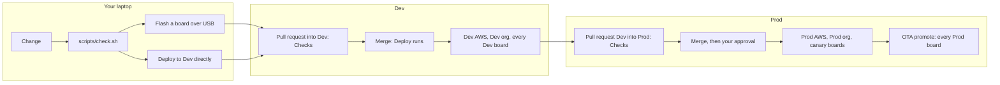

# Development: your laptop, then Dev, then Prod

Every change takes the same path. You prove it on your laptop and on a board on
your desk. A merge into `Dev` deploys it to the Dev environment and every Dev
board. A merge into `Prod` deploys it to production, with the firmware going to
a few canary boards first.

One rule holds this together: **the pipeline runs the same scripts you do.**
`scripts/check.sh` is the pull request check, `scripts/deploy-aws.sh` is the AWS
deploy step, and `scripts/firmware.sh` builds the binary the boards receive over
the air. A green run on your laptop predicts a green pipeline, and a red pipeline
reproduces on your laptop with one command.



## The two environments

| | Dev | Prod |
|---|---|---|
| Branch | `Dev`, the default branch | `Prod`, changed only by pull requests from `Dev` |
| AWS | its own account | its own account |
| Salesforce | the Dev org | the Prod org |
| Boards | the ones on your desk, all in `fleet-<type>` | `canary-<type>` first, then `fleet-<type>` |
| Deployed by | the pipeline on merge, or you from your laptop | the pipeline on merge, after your approval |

Separate AWS accounts are not a nicety. Function and group names are fixed, so
two environments in one account would overwrite each other. Each account carries
a label, the SSM parameter `/cloud-agentic-iot/environment`, written by its first
deploy and checked by every deploy after that. The wrong `AWS_PROFILE` stops a
deploy before it changes anything.

While you're only trying the system, Dev can be your own AWS project with a
spend limit and a Developer Edition org, under one profile and alias name, that
you deploy to from your laptop. [TRY-IT.md](TRY-IT.md) covers that setup, and
how to move to regular accounts when you want the pipelines.

## 1. On your laptop

Once, on top of the tools in [`SETUP.md`](SETUP.md):

```bash
scripts/firmware.sh setup     # the ESP32 core and the libraries the sketches use
pip install cfn-lint          # optional: without it, check.sh skips the template lint
brew install shellcheck       # optional: without it, check.sh skips the script lint
export AWS_PROFILE=iot-dev    # per shell, deliberately (SETUP.md, "Authorizing your local machine")
```

The Salesforce deploy runs as the deploy user, alias `iot-dev-deploy` (SETUP.md,
"The deploy user can actually deploy"), never as your admin user. An admin
deploy passes where the deploy user fails, so it would hide exactly the problems
the pipeline will hit.

The loop:

| Step | Command | What it tells you |
|---|---|---|
| Check | `scripts/check.sh` | The Lambda tests pass, every template lints, the scripts pass shellcheck, the Salesforce metadata resolves, and every sketch compiles. No credentials needed. |
| Flash | `scripts/firmware.sh flash patient-monitor` | Your working copy runs on a real board. It finds the USB port itself and keeps the board's Wi-Fi and certificate. |
| Try over the air | `scripts/ota.sh try Dev patient-monitor` | Your working copy runs on every Dev board of that type, sent as a Dev release is, with each board's answer printed as it comes. |
| Watch | `scripts/firmware.sh monitor` | What the board prints on its serial console |
| Deploy AWS | `scripts/deploy-aws.sh Dev` | Every stack and the real Lambda code, in the Dev account |
| Deploy Salesforce | `scripts/deploy-salesforce.sh Dev` | A check-only deploy with every Apex test, then the deploy. Add `--dry-run` to validate only. |

Two things happen only in the pipeline, on purpose:

- **Prod.** The scripts refuse `Prod` from a laptop. Prod changes through a
  merge, checks on that exact commit, and your approval.
  `ALLOW_LOCAL_PROD=yes` exists for a genuine emergency.
- **Over-the-air releases.** Each version is published once per environment. If
  you published one from your laptop, the merged code under the same version
  could never be published, and the boards would keep the unreviewed build. To
  try firmware before merging, flash it over USB, or send it to every Dev board
  of its type with `scripts/ota.sh try Dev <type>`. A try is published under
  `firmware/<type>/try/` and runs as `<version>-try.<n>`, a version no release
  uses, so the release of `<version>` still publishes and the boards still
  install it.

## 2. Dev: every merge deploys

Open a pull request into `Dev`. The **Checks** workflow runs the same parts as
`scripts/check.sh`, one job each, plus one more rule: if anything under
`firmware/` changed, `FIRMWARE_VERSION` must go up in every sketch it affects.
A change to the shared library affects them all.

Merge it, and **Deploy** runs on `Dev`:

1. **Checks**, again, on the merged commit.
2. **AWS.** It copies the Dev environment's secrets into SSM, deploys every
   stack, and uploads the real Lambda code.
3. **Salesforce.** A check-only deploy with every local Apex test, then the
   deploy, as the deploy user.
4. **Boards.** Every sketch whose version is not published yet is built,
   uploaded, and sent as an AWS IoT job to `fleet-<type>`, which is every Dev
   board.

A merge that leaves the versions alone, such as a Lambda fix or a docs edit,
sends no firmware anywhere. The published binary is the record that a version
shipped.

## 3. Prod: the same pipeline, two human checkpoints

Open a pull request from `Dev` into `Prod`, and the checks run. Merge it, and
Deploy runs on `Prod`, but the deploy job waits for **your approval** on the
Prod environment. Approve, and it deploys exactly what Dev ran, into the Prod
account and org, with new firmware going to `canary-<type>` only.

When the canary boards have run it long enough, run **OTA promote** from the
Actions tab on the `Prod` branch, giving the device type and the version. It
refuses unless that version's canary job finished with at least one board
updated and none that failed, refused it or timed out.

## Boards and groups

Each device type has two Thing Groups, created by
[`infra/ota/cloudformation.yaml`](../infra/ota/cloudformation.yaml):
`fleet-<type>` and, inside it, `canary-<type>`. A job sent to the fleet reaches
the canary boards too; they already run that version and report "already
current". A board is in one group or the other, never both:

```bash
scripts/ota.sh join Dev pm-desk-01 patient-monitor           # a Dev board: the fleet
scripts/ota.sh join Prod pm-ward-07 patient-monitor canary   # a Prod canary board
scripts/ota.sh status Prod                                   # the last five jobs, board by board
```

`scripts/setup-device.sh` puts a newly provisioned board in its fleet group.

Internal boards (an Asset of record type Internal Device, such as a
nurse-station indicator) run the patient-monitor build too. Their group,
`internal-devices`, sits inside `fleet-patient-monitor`, so every Dev release,
try, promotion and reading interval reaches them; in Prod a release reaches
them at promotion, after the canary. Salesforce provisions an Internal Device
whose Thing Group is blank into it. To move a board that is already
provisioned (AWS IoT allows one group per hierarchy, so it leaves fleet and
canary first):

```bash
scripts/ota.sh join Dev Test7 patient-monitor internal
```
Every sketch needs its pair of groups in that template, and `scripts/check.sh`
fails when one is missing.

## Turning it on

These are one-time GitHub settings, which the pipeline cannot make for itself:

1. **Branches.** Rename `main` to `Dev` and keep it as the default branch
   (Settings, Branches). GitHub redirects old links and moves open pull requests
   to the new name. Create `Prod` from `Dev` once the first Dev deploy is green.
2. **Environments** `Dev` and `Prod`, each with its own secrets and variables,
   listed in SETUP.md under "Secrets and variables, per environment".
   `scripts/setup-github-secrets.sh` creates each one, limits its deployment
   branches to the branch of the same name, so only `Prod` can use Prod's
   secrets, and makes you Prod's required reviewer.
3. **Branch rules** for `Dev` and `Prod`: require a pull request, and require
   the Checks jobs to pass (Lambda tests, CloudFormation templates, Shell
   scripts, Salesforce metadata, Firmware).
4. **The switch.** A push deploys only once the repository variable
   `AUTO_DEPLOY` names its branch:

   ```bash
   gh variable set AUTO_DEPLOY --body "Dev"        # once Dev's secrets are in
   gh variable set AUTO_DEPLOY --body "Dev Prod"   # once Prod's are too
   ```

   Until then, run Deploy by hand from the Actions tab, choosing the branch.
   A manual run can also deploy one part alone: aws, salesforce or firmware.

The stacks read Salesforce settings from SSM, which `scripts/seed-ssm.sh`
writes: the pipeline runs it before every AWS deploy, and on a laptop you run
it yourself once. On a brand-new environment it writes `placeholder` for the
integration values that do not exist yet, so the first run deploys AWS and
then Salesforce. `scripts/deploy-aws.sh` names any parameter that is missing
before it deploys anything.

Two guards on laptop deploys: `scripts/deploy-aws.sh` and
`scripts/deploy-salesforce.sh` refuse uncommitted changes (`ALLOW_DIRTY=yes`
overrides, and the recorded commit then ends in `-dirty`), and the Salesforce
deploy stops when the org is not the one paired with the AWS account
(`/cloud-agentic-iot/salesforce/org-id`). Both record the commit they shipped
under `/cloud-agentic-iot/deployed-commit/`, so a laptop-deployed test account
and the pipeline's Dev can be compared by SHA.

## What stays manual, and why

| Step | Why |
|---|---|
| A new board's first flash, over USB (`scripts/setup-device.sh`) | A blank ESP32 has no network stack. OTA works only once our firmware runs. |
| Approving a Prod deploy | It is the last look before production |
| Promoting a Prod release to the whole fleet | It is the judgement that the canary behaved |
| Entering secrets | Secret values never pass through automation or chat |
