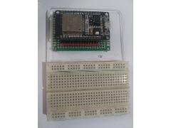
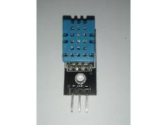
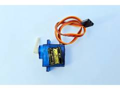
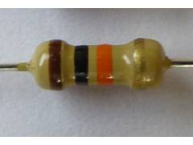
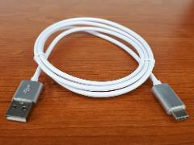
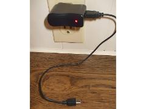
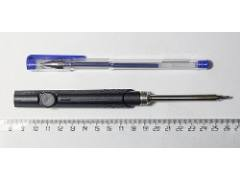
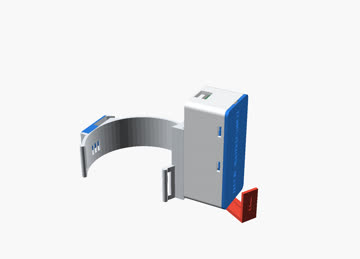

# Quick Install Guide

Every feature, from a fresh clone to a working system, in order: copy each block, paste it, and go on. Why each step is done this way: the [Detailed Install Guide](INSTALL-GUIDE.md#quick-install-explained).

<a id="step-map"></a>

**Step map.** Not sure which guide to follow? [Start here](START-HERE.md).

| # | Step | Where you work |
|---|---|---|
| [0](#step-0) | [Order the parts and print the cases](#step-0) |  Amazon + 3D printer |
| [1](#step-1) | [Install the tools](#step-1) |  Terminal |
| [2](#step-2) | [Create the AWS project and the Salesforce org](#step-2) |   Browser |
| [3](#step-3) | [Turn on the org's features](#step-3) |  Setup |
| [4](#step-4) | [Clone and sign in](#step-4) |   Terminal |
| [5](#step-5) | [Make what the deploy reads](#step-5) |   Setup + terminal |
| [6](#step-6) | [Deploy everything in one run](#step-6) |    Terminal + Setup |
| [7](#step-7) | [Let Salesforce call AWS](#step-7) |   Setup + terminal |
| [8](#step-8) | [Slack](#step-8) |   Slack + Setup |
| [9](#step-9) | [Data Cloud](#step-9) |  Data Cloud |
| [10](#step-10) | [Patient portal with Enhanced Chat](#step-10) |   Setup + terminal |
| [11](#step-11) | [MCP servers](#step-11) |  Setup |
| [12](#step-12) | [Add the boards](#step-12) |   Board + terminal |
| [13](#step-13) | [Check that it works](#step-13) |    App, Slack, portal |
| [14](#step-14) | [Dev and Prod pipelines](#step-14) |   GitHub + terminal |

> [!NOTE]
> About two hours, plus about 20 minutes for each board. Order and print (step 0) a few days before.

> [!IMPORTANT]
> **How to read a command block.** Every block starts with **Paste into your terminal** and how often to run it. Copy the whole block (the **Copy** button), paste it into the terminal in the `Cloud-Agentic-IoT` folder, and press Enter.
>
> **Fill in first.** A block that needs your own values has them on its first lines, with a **Fill in first** list above it. Replace only the text between the quotes, including the `<` `>`: `EMAIL='<your email>'` becomes `EMAIL='you@example.com'`.

> [!WARNING]
> Keys, passwords and tokens are typed only into your own terminal or into Salesforce Setup. Never paste them into a file in the repo, a chat or an issue.

<a id="resume"></a>

> [!NOTE]
> **Coming back later, or in a new terminal.** Run these lines first, every time. Your logins, the repo and the files you made stay.
>
> **Paste into your terminal.** In every new terminal, before any other block. If you chose your own name in step 4, put it between the quotes.
>
> ```bash
> NAME='test-cloud-agentic-iot'
> cd ~/Cloud-Agentic-IoT        # or wherever you cloned it in step 4
> export AWS_PROFILE="$NAME" SF_TARGET_ORG="$NAME"
> echo "AWS profile $AWS_PROFILE, org $SF_TARGET_ORG"
> ```

<a id="step-0"></a>

## 0. Order the parts and print the cases

Do this first: the parts take a few days to arrive, and step 12 puts them in the cases.

### Parts for both devices

The monitored device (arm cuff) and the corp ticket gauge (desk gauge with a bell). Prices on amazon.ca, checked Nov 27, 2026. Listings and prices change: when a link is gone, search for the part's name.

| Photo | Part | Order | Used in | Price (CA$) |
|---|---|---|---|---|
|  | [ESP32 38-pin development board, ESP-WROOM-32, CP2102, USB-C, 2-pack](https://www.amazon.ca/dp/B0F5GG3R82) | 1 pack | both devices, 1 board each | 25.10 |
|  | [DHT11 temperature and humidity sensor, bare 4-pin, 3 pcs](https://www.amazon.ca/dp/B0C2QBSDFQ) | 1 pack | monitored device | 6.49 |
|  | [SG90 9 g micro servo with horns and screws, 4 pcs](https://www.amazon.ca/dp/B09CGYX76S) | 1 pack | both devices, 1 servo each | 12.99 |
|  | [10 kΩ 1/4 W resistor, 200 pcs](https://www.amazon.ca/dp/B0C2Q2JS7D) | 1 pack | monitored device, across DHT11 legs 1 and 2 | 7.99 |
|  | [ELEGOO 120 Dupont jumper wires, M-F, M-M, F-F, 20 cm](https://www.amazon.ca/dp/B01EV70C78) | 1 kit | both devices | 12.99 |
|  | [USB-A to USB-C cable, 3 ft, data and charging, 2-pack](https://www.amazon.ca/dp/B0BVLVLGJ2) | 1 pack | both devices: flashing and power | 8.35 |
|  | [USB wall charger, 2 USB-A ports, 5 V 2.1 A](https://www.amazon.ca/dp/B0DM5T854F) | 1 | both devices: power | 11.99 |
|  | [HANDSKIT 60 W soldering iron kit with solder and stand](https://www.amazon.ca/dp/B075KLBQCV) | 1 kit | monitored device: the resistor | 23.99 |
|  | [PATIKIL mini cow bells, 36 mm, silver, 4 pcs](https://www.amazon.ca/dp/B0CWNGM2FJ) | 1 pack | corp ticket gauge | 17.39 |
| | **Total** | | | **127.28** + tax |

Photo credits: [part photos](images/parts/CREDITS.md).

### Print the cases

 

1. Download the print file for your printer from [`hardware/cases/print-beds`](https://github.com/CloudArchitect101/Cloud-Agentic-IoT/tree/Dev/hardware/cases/print-beds). Each file holds every part, laid out:

   | Printer | Open in Bambu Studio, OrcaSlicer or PrusaSlicer |
   |---|---|
   | Bambu Lab X2D | `x2d-one-plate/all-parts-x2d-plate-standing.3mf`: both devices in one print |
   | Bambu Lab A1 mini (180 x 180 mm) | `a1mini-two-beds/a1mini-oneset-bed1.3mf` and `a1mini-oneset-bed2.3mf` |
   | Any 220 x 220 mm bed | `cuff-220x220-bed1.3mf`, `gauge-220x220-bed1.3mf` and `gauge-220x220-bed2.3mf` |

2. Slice with these settings and print:

   | Setting | Value |
   |---|---|
   | Plastic | PLA, white: [ELEGOO PLA 1.75 mm, 1 kg](https://www.amazon.ca/dp/B0BM4QWPK9), CA$19.54. One spool covers both devices (about 270 g) |
   | Layer height | 0.2 mm |
   | Walls | 3 |
   | Infill | 20% |
   | Supports | Off |
   | Brim | 8 to 10 mm on the standing dial plate |

3. Paint the raised art on the dial plate: the CLEAR mark green, the sweep arc red, the words and bell black.

> [!TIP]
> **Check before you go on.** The parts are ordered, and you have the printed cuff, sensor lid, hub, hub lid and wiper, and the dial plate, tub, needle, mast and hanger.

[Step map](#step-map) · [1. Install the tools →](#step-1)

<a id="step-1"></a>

## 1. Install the tools

| Tool | Version | Install (macOS) | For |
|---|---|---|---|
| Node.js | 22+ | `brew install node` | everything |
| Salesforce CLI `sf` | 2.136+ | `npm install --global @salesforce/cli` | everything |
| AWS CLI | 2.32.0+ | `brew install awscli` | everything |
| jq | any | `brew install jq` | everything |
| arduino-cli | latest | `brew install arduino-cli` | boards (step 12) |
| uv | latest | `brew install uv` | MCP server (step 11) |
| GitHub CLI `gh` | latest | `brew install gh` | pipelines (step 14) |

**Paste into your terminal.** Once per computer. It installs the ESP32 board support and the four libraries the firmware needs for the boards in step 12.

```bash
arduino-cli core install esp32:esp32
arduino-cli lib install "PubSubClient" "ArduinoJson" "DHT sensor library" "ESP32Servo"
```

On Linux or Windows, the same tools: [SETUP.md §0](SETUP.md#0-prerequisites--install-the-tooling).

> [!TIP]
> **Check before you go on.** Each of these prints a version at least as new as the table: `node --version`, `sf --version`, `aws --version`, `jq --version`, `uv --version`, `gh --version`. `arduino-cli core list` shows `esp32:esp32`.

[← 0. Order the parts and print the cases](#step-0) · [Step map](#step-map) · [2. Create the AWS project and the Salesforce org →](#step-2)

<a id="step-2"></a>

## 2. Create the AWS project and the Salesforce org

1. Create an AWS **project** in [AWS Settings](https://settings.aws.com) on the paid plan, and set a monthly spend limit (the lowest is $20). Keep it a plain project with its advanced features off: that is what keeps the spend limit in place. Note its Region.
2. **Open Bedrock in the project.** Signed in to the project, in its Region: open the [Amazon Bedrock console](https://console.aws.amazon.com/bedrock/) → **Playgrounds** → **Chat / Text**, pick any model, and send "hello". It answers.
3. Sign up for a free **Developer Edition** org at [developer.salesforce.com/signup](https://developer.salesforce.com/signup).

**Paste into your terminal.** Once per AWS account, after step 4. It prints `AUTHORIZED`.

```bash
aws bedrock get-foundation-model-availability --model-id amazon.titan-embed-text-v2:0 \
  --query authorizationStatus --output text
```

> [!TIP]
> **Check before you go on.** The Bedrock playground answered "hello", AWS Settings shows the project with its spend limit, and you can sign in to the new Developer Edition org.

[← 1. Install the tools](#step-1) · [Step map](#step-map) · [3. Turn on the org's features →](#step-3)

<a id="step-3"></a>

## 3. Turn on the org's features

| Setup page | Do |
|---|---|
| **Einstein Setup** | **Turn on Einstein** |
| **Agentforce Agents** | Turn on **Agentforce** |
| **Account Settings** | **Enable Person Accounts**. Then Profiles → your profile → Object Settings → Accounts → Record Types: make **Person Account** the default, keep Business available |
| **Digital Experiences** → **Settings** | **Enable Digital Experiences**, pick a domain, then turn on **Allow using standard external profiles for self-registration, user creation, and login** |
| **Omni-Channel Settings** | **Enable Omni-Channel** |
| **Messaging Settings** | Turn on **Messaging** |

> [!TIP]
> **Check before you go on.** Reload each Setup page in the table: every switch stays on. In the Accounts tab, **New** offers the **Person Account** record type.

[← 2. Create the AWS project and the Salesforce org](#step-2) · [Step map](#step-map) · [4. Clone and sign in →](#step-4)

<a id="step-4"></a>

## 4. Clone and sign in

This guide calls your AWS profile and org alias `test-cloud-agentic-iot`, for simplicity, so every block pastes as it is. Any name works (letters, digits and `-`): change it here and in the [resume lines](#resume).

**Fill in first:**
- `REGION='us-east-2'`: your project's Region from step 2. Example: `REGION='ca-central-1'`.

**Paste into your terminal.** Once per computer. It clones the repo and signs you in to AWS and to the org in your browser.

```bash
NAME='test-cloud-agentic-iot'
REGION='us-east-2'
git clone https://github.com/CloudArchitect101/Cloud-Agentic-IoT.git
cd Cloud-Agentic-IoT
aws login --profile "$NAME"
aws configure set region "$REGION" --profile "$NAME"
sf org login web --alias "$NAME"
export AWS_PROFILE="$NAME" SF_TARGET_ORG="$NAME"
```

**Paste into your terminal.** Once per org. It lists the Customer Community licences the patient portal (step 10) uses.

```bash
sf data query --target-org "$NAME" \
  --query "SELECT Name, TotalLicenses, UsedLicenses FROM UserLicense WHERE Name LIKE '%Community%'"
```

> [!TIP]
> **Check before you go on.** `aws sts get-caller-identity` prints your project's account, and `sf org display --target-org "$NAME"` shows **Connected Status** `Connected`. The licence query above lists at least one Customer Community licence.

[← 3. Turn on the org's features](#step-3) · [Step map](#step-map) · [5. Make what the deploy reads →](#step-5)

<a id="step-5"></a>

## 5. Make what the deploy reads

**a. The integration certificate.**

**Paste into your terminal.** Once per org. It makes `scripts/server-integration.key` (private, stays on your computer) and `scripts/server-integration.crt` (you upload it in 5c).

```bash
openssl req -x509 -sha256 -nodes -days 3650 -newkey rsa:2048 \
  -keyout scripts/server-integration.key -out scripts/server-integration.crt \
  -subj "/CN=CloudAgenticIoT-Integration/O=Personal/C=CA"
```

**b. The integration user.** Setup → **Users** → **New User**:

| Field | Value |
|---|---|
| Last name | `Integration` |
| Email | Your own plus address, for example `you+integration@…` (never the admin's address) |
| Username | `integration@iot-dev.<yourdomain>` |
| User License | **Salesforce Integration** |
| Profile | **Salesforce API Only System Integrations** |

Then on the user's page: **Permission Set License Assignments** → Edit Assignments → **Salesforce API Integration**. Step 6 gives it the `Device_Integration` permission set.

**c. The External Client App.** Setup → **External Client App Manager** → **New External Client App**:

| Setting | Value |
|---|---|
| Name | `Cloud Agentic IoT Integration` |
| OAuth | **Enable OAuth**, scopes `api` and `refresh_token, offline_access` |
| JWT | **Enable JWT Bearer Flow**, upload `scripts/server-integration.crt` |

Save, and copy its **Consumer Key** for step 6.

**d. The Slack app.** First a free Slack workspace of your own:

1. Go to [slack.com/get-started#/createnew](https://slack.com/get-started#/createnew), enter your email, and type the code Slack emails you.
2. **Create a workspace**: name it, for example `Smart Ward Demo`, and enter your name.
3. At the invite page, click **Skip this step**, and leave the paid trial. Slack opens the workspace.

Then the app: at [api.slack.com/apps](https://api.slack.com/apps) → **Create New App** → **From scratch**, name `Ward Bot`, pick your workspace → **Create App**. Then **Basic Information** → **App Credentials** → **Signing Secret** → **Show**. Step 6 asks for it.

**e. The portal's chat certificate.** Setup → **Certificate and Key Management** → **Create Self-Signed Certificate**: Label and Unique Name `Patient_Portal_Chat`, key size 2048, **Exportable Private Key off**. Download the `.crt`, then:

**Fill in first:**
- `CRT=~/Downloads/Patient_Portal_Chat.crt`: where your browser saved the certificate. Change it only if it isn't in `~/Downloads`.

**Paste into your terminal.** Once per org. It makes `~/Downloads/patient-portal-chat-key.json`, which you upload in step 10.

```bash
CRT=~/Downloads/Patient_Portal_Chat.crt
node scripts/portal-chat-jwk.mjs "$CRT" patient-portal-chat-1 > ~/Downloads/patient-portal-chat-key.json
```

> [!TIP]
> **Check before you go on.** `ls scripts/server-integration.key scripts/server-integration.crt` lists both files. In Setup, the Integration user is active with the **Salesforce Integration** licence, and you have the External Client App's **Consumer Key**, the Slack **Signing Secret**, and `~/Downloads/patient-portal-chat-key.json`.

[← 4. Clone and sign in](#step-4) · [Step map](#step-map) · [6. Deploy everything in one run →](#step-6)

<a id="step-6"></a>

## 6. Deploy everything in one run

**Paste into your terminal.** Once per org. It deploys AWS and Salesforce and asks for the values from step 5 as it goes (typing is hidden).

```bash
SF_TARGET_ORG="$NAME" DATA_CLOUD_READER_USER=cloud-agentic-iot-data-cloud-reader scripts/install.sh Dev
```

Then:

1. **The app's policy.** External Client App Manager → `Cloud Agentic IoT Integration` → **Manage Policies**: **Admin approved users are pre-authorized**, permission set `Device_Integration`.
2. **The queue.** Setup → **Queues** → `Care_Team_Queue` → add the members who should get the temperature alert Cases.
3. **The spend card's budget.**

**Fill in first:**
- `LIMIT='20'`: your project's monthly spend limit in US dollars, from step 2. Example: `LIMIT='50'`.
- `EMAIL='<your email>'`: the address AWS sends the budget alerts to. Example: `EMAIL='you@example.com'`.

**Paste into your terminal.** Once per AWS account. It creates the `cloud-agentic-iot-monthly` budget the Home page shows.

```bash
LIMIT='20'
EMAIL='<your email>'
ACCOUNT=$(aws sts get-caller-identity --query Account --output text)
aws budgets create-budget --region us-east-1 --account-id "$ACCOUNT" \
  --budget "{\"BudgetName\":\"cloud-agentic-iot-monthly\",\"BudgetType\":\"COST\",\"TimeUnit\":\"MONTHLY\",\"BudgetLimit\":{\"Amount\":\"$LIMIT\",\"Unit\":\"USD\"},\"Metrics\":[\"UnblendedCost\"],\"FilterExpression\":{\"Not\":{\"Dimensions\":{\"Key\":\"RECORD_TYPE\",\"Values\":[\"Credit\",\"Refund\",\"Tax\"]}}}}" \
  --notifications-with-subscribers "[{\"Notification\":{\"NotificationType\":\"ACTUAL\",\"ComparisonOperator\":\"GREATER_THAN\",\"Threshold\":80,\"ThresholdType\":\"PERCENTAGE\"},\"Subscribers\":[{\"SubscriptionType\":\"EMAIL\",\"Address\":\"$EMAIL\"}]},{\"Notification\":{\"NotificationType\":\"FORECASTED\",\"ComparisonOperator\":\"GREATER_THAN\",\"Threshold\":100,\"ThresholdType\":\"PERCENTAGE\"},\"Subscribers\":[{\"SubscriptionType\":\"EMAIL\",\"Address\":\"$EMAIL\"}]}]"
```

**Paste into your terminal.** Once. It prints the integration username AWS signs in as: the user from 5b.

```bash
aws lambda get-function-configuration --function-name cloud-agentic-iot-salesforce-sync \
  --query Environment.Variables.SALESFORCE_USERNAME --output text
```

> [!TIP]
> **Check before you go on.** `scripts/install.sh` ends by printing the values for the next steps. The App Launcher shows **Cloud Agentic IoT**, and the last command prints the same integration username as the user in 5b.

[← 5. Make what the deploy reads](#step-5) · [Step map](#step-map) · [7. Let Salesforce call AWS →](#step-7)

<a id="step-7"></a>

## 7. Let Salesforce call AWS

**a. The caller IAM user and its key.**

**Paste into your terminal.** Once per AWS account. It creates the IAM user Salesforce signs its calls with and prints its access key once.

```bash
STACK=cloud-agentic-iot-queue-relay-Dev
CALLER=cloud-agentic-iot-salesforce-caller
ROLE_ARN=$(aws cloudformation describe-stacks --stack-name "$STACK" \
  --query "Stacks[0].Outputs[?OutputKey=='SalesforceCallerRoleArn'].OutputValue" --output text)
echo "$ROLE_ARN"   # prints the role ARN
aws iam create-user --user-name "$CALLER" > /dev/null
aws iam put-user-policy --user-name "$CALLER" --policy-name assume-salesforce-caller-role \
  --policy-document "{\"Version\":\"2012-10-17\",\"Statement\":[{\"Effect\":\"Allow\",\"Action\":\"sts:AssumeRole\",\"Resource\":\"$ROLE_ARN\"}]}"
aws iam create-access-key --user-name "$CALLER"
```

**b. Type the key and the role into the external credential.** Setup → **Named Credentials** → **External Credentials** → `AWS_IoT_Relay_Credential`:

1. **Edit**: type the key from a into **STS Access Key** and **STS Access Secret**, then **Save**.
2. Under **Principals**, edit `SalesforceCaller`: type the role ARN that step 6 printed into **IAM Role ARN** (it has `:role/`, not `:user/`), then **Save**.

**c. Check the named credential.** **Named Credentials** → `AWS_IoT_Relay`: the URL is the named credential URL that step 6 printed, the external credential is the one from b, and **Enabled for Callouts** and **Generate Authorization Header** are both on.

**d. Who may use it.** Give the integration user `AWS_IoT_Relay_Callers` and `AWS_IoT_Relay_Credential_Reader` (step 6 gave both to you):

**Fill in first:**
- `INTEGRATION_USER='<integration username>'`: the integration user's username from 5b. Example: `INTEGRATION_USER='integration@iot-dev.jsmith.com'`. To look it up, paste this into your terminal:

  ```bash
  sf data query --target-org "$NAME" \
    --query "SELECT Username FROM User WHERE Profile.Name = 'Salesforce API Only System Integrations' AND IsActive = true"
  ```

**Paste into your terminal.** Once per org.

```bash
INTEGRATION_USER='<integration username>'
sf org assign permset --name AWS_IoT_Relay_Callers --on-behalf-of "$INTEGRATION_USER" --target-org "$NAME"
sf org assign permset --name AWS_IoT_Relay_Credential_Reader --on-behalf-of "$INTEGRATION_USER" --target-org "$NAME"
```

Every care team member who uses the agent also needs it: `sf org assign permset --name AWS_IoT_Relay_Callers --on-behalf-of '<username>' --target-org "$NAME"`.

> [!TIP]
> **Check before you go on.** Open the app's **Home** tab: the cost card shows this month's AWS spend against your limit, as in the [picture on Start here](START-HERE.md#what-success-looks-like).

[← 6. Deploy everything in one run](#step-6) · [Step map](#step-map) · [8. Slack →](#step-8)

<a id="step-8"></a>

## 8. Slack

`Test8` is the name you give the monitored device in step 12.

**a. The `/patient-status` command** (the Ward Bot app from 5d):

1. In the app: **Slash Commands** → **Create New Command**: Command `/patient-status`, Request URL = the Slack Request URL step 6 printed, usage hint `Test8`.
2. **Install App** → **Install to Workspace** → **Allow**.
3. In any channel: `/patient-status Test8`.

**b. The Patient Care Agent in Slack:**

1. In Slack, as the workspace owner: **Tools & settings** → **Manage Salesforce Organizations** → **Connect Salesforce Org**: your My Domain URL, account mapping field **Email**, **Automatic account mapping** off → **Request Connection**.
2. In Salesforce: Setup → Quick Find **Slack** → **Manage Slack Connection** → approve. Back in Slack's **Manage Salesforce Organizations**, open the pending connection → **Activate**.
3. Same page → the org → **Users** → **Add Individually**: each Slack member who may use the agent. Each needs one Salesforce user with the same email, and two permission sets:

   **Fill in first:**
   - `MEMBER='<username>'`: that member's Salesforce username (Setup → **Users**, the **Username** column). Example: `MEMBER='nurse.lee@iot-dev.jsmith.com'`.

   **Paste into your terminal.** Once per Slack member.

   ```bash
   MEMBER='<username>'
   sf org assign permset --name SlackSalesCloud --on-behalf-of "$MEMBER" --target-org "$NAME"
   sf org assign permset --name Patient_Care_Agent --on-behalf-of "$MEMBER" --target-org "$NAME"
   ```

4. Slack **Admin** → **Manage Agentforce** → **Review agent** → **Install Agent**. Quit and reopen Slack.
5. DM the agent: "What is Test8 reading?"

> [!TIP]
> **Check before you go on.** `/patient-status` answers in the channel, and the agent answers your DM. Both show the board's live reading once you add it in step 12.

[← 7. Let Salesforce call AWS](#step-7) · [Step map](#step-map) · [9. Data Cloud →](#step-9)

<a id="step-9"></a>

## 9. Data Cloud

1. **Its key**, typed into the connection in step 2 and nowhere else.

   **Paste into your terminal.** Once per AWS account. It prints the reader user's access key and secret once.

   ```bash
   aws iam create-access-key --user-name cloud-agentic-iot-data-cloud-reader
   ```

2. **Connection.** Data Cloud Setup → **Other Connectors** → **New** → **Amazon S3**: Name `Room Readings S3`, **Bucket Name** = the Data Cloud bucket step 6 printed, **Parent Directory** `datacloud/room-readings/`, **Access Key/Secret Based** with the key from 1. **Test Connection** → **Save**.
3. **Data stream.** Data Streams → **New** → **Amazon S3** → `Room Readings S3`:

   | Setting | Value |
   |---|---|
   | File Type / File Name | CSV, `room-readings-*.csv` (Import from Directory empty) |
   | Source | `AWS_IoT`. Letters, digits and single underscores only: no spaces, starts with a letter, no `__`, no `_` at the end, unique in the org |
   | Data lake object | New, `Room_Readings`. `reading_ts` and `received_ts` DateTime, `temperature_c` and `humidity_pct` Number, the rest Text |
   | Date format of `reading_ts` and `received_ts` | Not in the list: choose the manual (custom) format and type `yyyy-MM-dd'T'HH:mm:ss.SSSXXX`. The CSV writes them as `2026-11-19T18:00:00.123Z` (UTC, milliseconds, a literal `Z`) |
   | Category / primary key / event time | Engagement, `reading_id`, `reading_ts` |
   | Refresh | **Upsert**, the most frequent schedule |

   **Deploy**, then **Refresh Now**.

4. **Mapping.** On the stream, **Start** the mapping → **New Custom Object** `Room_Readings`, every field under the same name, `reading_id` as primary key → Save.
5. **Who may ask the agent for a device's history.** Give yourself, and every care team member who uses the agent, the **Data Cloud User** permission set: Setup → **Users** → the user → **Permission Set Assignments** → **Edit Assignments** → **Data Cloud User** → **Save**.

> [!TIP]
> **Check before you go on.** The data stream is deployed, its mapping to `Room_Readings` is saved, and you hold **Data Cloud User**.

[← 8. Slack](#step-8) · [Step map](#step-map) · [10. Patient portal with Enhanced Chat →](#step-10)

<a id="step-10"></a>

## 10. Patient portal with Enhanced Chat

1. **Chat deployment.** Setup → **Embedded Service Deployments** → **New Deployment** → **Enhanced Chat** → Web. Name `Patient_Portal_Chat`, domain = the site's `*.my.site.com` domain, let it create the Messaging channel. Open it → **Switch to V2** → **Publish**.
2. **User verification.** Setup → **Enhanced Chat User Verification** → **JSON Web Keys** → **New Key**: upload `patient-portal-chat-key.json` (5e). Then **JSON Web Keysets** → **New Keyset**: name `Patient_Portal_Keyset`, issuer `cloud-agentic-iot-patient-portal`, add the key. In **Messaging Settings**, open the channel: tick **Add User Verification**, save, then **User Verification Configuration** → **New** → `Patient_Portal_Keyset`.
3. **The agent user.** Setup → **Users** → **New User**: licence **Einstein Agent**, profile **Einstein Agent User**. Then:

   **Fill in first:**
   - `AGENT_USER='<agent username>'`: the username of the Einstein Agent user you just made. Example: `AGENT_USER='portal-agent@iot-dev.jsmith.com'`. To look it up, paste this into your terminal:

     ```bash
     sf data query --target-org "$NAME" \
       --query "SELECT Username FROM User WHERE Profile.Name = 'Einstein Agent User' AND IsActive = true"
     ```

   **Paste into your terminal.** Once per org. It takes a few minutes.

   ```bash
   AGENT_USER='<agent username>'
   sf org assign permset --name AgentforceServiceAgentBase --on-behalf-of "$AGENT_USER" --target-org "$NAME"
   sf org assign permset --name AgentforceServiceAgentUser --on-behalf-of "$AGENT_USER" --target-org "$NAME"
   sf org assign permset --name EinsteinGPTPromptTemplateUser --on-behalf-of "$AGENT_USER" --target-org "$NAME"
   sf org assign permset --name Patient_Portal_Agent --on-behalf-of "$AGENT_USER" --target-org "$NAME"
   PORTAL_AGENT_USER="$AGENT_USER" scripts/publish-portal-agent.sh "$NAME"
   sf agent activate --api-name Patient_Portal_Agent --target-org "$NAME"
   scripts/deploy-portal-routing.sh "$NAME"
   ```

   **Paste into your terminal.** Once per org, in the same terminal as the block above.

   ```bash
   sf org assign permset --name AWS_IoT_Relay_Callers --on-behalf-of "$AGENT_USER" --target-org "$NAME"
   ```

4. **Routing.** **Messaging Settings** → the channel → Routing Type **Omni-Flow**, Flow `Route_Patient_Portal_Chat`, Fallback Queue **Care Team Queue**.
5. **The site's chat link.** From the deployment's code snippet, copy the site URL (it holds `ESW`).

   **Fill in first:**
   - `CHAT_SITE_URL='<the site URL>'`: the URL you just copied. Example: `CHAT_SITE_URL='https://yourdomain.my.site.com/ESWPatientPortalChat1700000000000'`.

   **Paste into your terminal.** Once per org.

   ```bash
   CHAT_SITE_URL='<the site URL>'
   scripts/set-portal-chat-url.sh "$NAME" "$CHAT_SITE_URL"
   ```

6. **CORS.** Setup → **CORS** → **New**: `https://<your My Domain>.my.site.com`. Publish the Embedded Service deployment again.
7. **Guest user.** The site → **Administration** → **Pages** → **Public Access**: assign `Patient_Portal_Guest_Api`.
8. **Patients.** Setup → **Users** → your user → **Edit** → Role **Care Team Administrator**. Then make the test patient: Accounts → **New** → **Person Account**, with its own plus-address email, for example `you+patient-a@example.com`. On it, **Enable Customer User** (profile Customer Community User, the same email), and:

   **Fill in first:**
   - `PATIENT_USER='<patient username>'`: the username Salesforce gave the patient's Customer Community user. Example: `PATIENT_USER='you+patient-a@example.com'`. To look it up, paste this into your terminal:

     ```bash
     sf data query --target-org "$NAME" \
       --query "SELECT Username, Contact.Name FROM User WHERE Profile.Name = 'Customer Community User' AND IsActive = true"
     ```

   **Paste into your terminal.** Once per patient.

   ```bash
   PATIENT_USER='<patient username>'
   sf org assign permset --name Patient_Portal_User --on-behalf-of "$PATIENT_USER" --target-org "$NAME"
   sf org assign permset --name AWS_IoT_Relay_Callers --on-behalf-of "$PATIENT_USER" --target-org "$NAME"
   ```


9. **Try it.** Sign in as the patient and tell the assistant "I need a nurse": a Case appears on Care_Team_Queue.

> [!TIP]
> **Check before you go on.** Item 9 above works: the patient signs in to the portal, the assistant answers, and "I need a nurse" opens a Case on Care_Team_Queue.

[← 9. Data Cloud](#step-9) · [Step map](#step-map) · [11. MCP servers →](#step-11)

<a id="step-11"></a>

## 11. MCP servers

**a. Our MCP server in Claude Code**

**Fill in first:**
- `MCP_URL`: the "Step 11, MCP endpoint" URL step 6 printed. Example: `'https://abc123.lambda-url.us-east-2.on.aws/'`.
- `REGION`: your Region. Example: `'us-east-2'`.

**Paste into your terminal.** Once per computer.

```bash
MCP_URL='<MCP endpoint>'
REGION='<your region>'
claude mcp add smart-ward -- uvx mcp-proxy-for-aws-cli@latest "$MCP_URL" \
  --service lambda --region "$REGION" --profile "$NAME"
```

<a id="espressif-mcp"></a>

**b. Espressif's MCP servers in both agents**

| Name in Registry | URL | Tools to allowlist |
|---|---|---|
| `ESPPilot` | `https://mcp.esp-pilot.espressif.com/mcp` | `catalog_list_socs`, `catalog_list_bmgr_boards`, `catalog_list_bmgr_peripherals` |
| `ESPComponentRegistry` | `https://components.espressif.com/mcp` | `search_components`, `fetch_component_detailed_information` |

1. **Register both servers.** Setup → **Agentforce Registry** → **New** → name and URL from the table (letters and digits only), authentication **No Authentication** → **Create and Continue** → allowlist that row's tools → **Save**.
2. **Add the actions.** Agentforce Builder → **Patient Care Agent** → subagent **ESP32 Hardware Questions** → add the five actions → **Commit** → **Activate**. Repeat in **Patient Portal Agent**, subagent **ESP32 Hardware**.
3. **Save them to the repo.**

   **Paste into your terminal.** Once, after 2.

   ```bash
   sf project retrieve start --metadata AiAuthoringBundle:Patient_Care_Agent --target-org "$NAME"
   sf project retrieve start --metadata AiAuthoringBundle:Patient_Portal_Agent --target-org "$NAME"
   ```

4. **Try it** in the agent panel, Slack or the portal: "What is the spec of the ESP32-S3-DevKitC-1?" The answer ends with a docs.espressif.com link.

> [!TIP]
> **Check before you go on.** `claude mcp list` shows `smart-ward`, item 4 of b works in both agents, and `node scripts/lib/mcp-probe.js` reports both servers answering.

[← 10. Patient portal with Enhanced Chat](#step-10) · [Step map](#step-map) · [12. Add the boards →](#step-12)

<a id="step-12"></a>

## 12. Add the boards

Two boards: the monitored device (this guide calls it `Test8`) and the corp ticket gauge (`Test7`). Do 1 to 4 for each, then 5 once.

1. Take the parts and cases from [step 0](#step-0), wire them as drawn (each wire ends on the pin printed on the board), and put them in the cases as the [case assembly](https://github.com/CloudArchitect101/Cloud-Agentic-IoT/tree/Dev/hardware/cases#1-monitored-device-arm-cuff) shows.

   

   The corp ticket gauge has the servo only: [its wiring](images/wiring-corp-gauge.svg).

2. In the Cloud Agentic IoT app, create a **Wi-Fi Network** (the network the board joins), then an **Asset**:

   | Field | Value |
   |---|---|
   | Record type | **Patient Device** for a monitored device; **Internal Device** for a corp ticket gauge |
   | Asset Name and Serial Number | `Test8` for the monitored device, `Test7` for the gauge |
   | Account | A Patient Device: the test patient's **Person Account** from step 10. An Internal Device: a business account, for example your ward |
   | Wi-Fi Network | The network you just created |

   Once saved, the Asset turns **Provisioned** with a bundle link within a minute (reload the page).
3. Download the bundle, plug the board in by USB, and run:

**Fill in first:**
- `BUNDLE=~/Downloads/bundle.json`: where you saved the bundle. Change it only if it's somewhere else.

**Paste into your terminal.** Once per board. It writes the firmware, the certificate and the Wi-Fi to the board, then deletes the bundle.

```bash
BUNDLE=~/Downloads/bundle.json
./scripts/firmware.sh flash patient-monitor && ./scripts/provision-device.sh "$BUNDLE" && rm "$BUNDLE"
```

**4. Your phone's hotspot** as a second Wi-Fi network.

**Fill in first:**
- `HOTSPOT='<hotspot name>'`: the network's name. Example: `HOTSPOT='My iPhone'`.

**Paste into your terminal.** Once per board. It asks for the hotspot's password, hidden.

```bash
HOTSPOT='<hotspot name>'
./scripts/update-wifi.sh "$HOTSPOT"
```

**5. Data Cloud's calculated insights**, once the boards have sent readings for a few minutes.

**Paste into your terminal.** Once per org.

```bash
SF_TARGET_ORG="$NAME" scripts/data-cloud-insights.sh --dry-run
SF_TARGET_ORG="$NAME" scripts/data-cloud-insights.sh
```

> [!TIP]
> **Check before you go on.** Within a minute or two each board's Asset shows Connection `Online` and readings on the Live Status card. Data Cloud's data stream shows a record count above 0, and `scripts/data-cloud-insights.sh --dry-run` prints the two insights.

[← 11. MCP servers](#step-11) · [Step map](#step-map) · [13. Check that it works →](#step-13)

<a id="step-13"></a>

## 13. Check that it works

| Check | Expect |
|---|---|
| The board's Asset | Connection `Online`, a reading every 2 s on the Live Status card |
| **Send Command** → `RESTART` on the Asset | The Device Command goes `Sent`, then `Acked` |
| Warm the sensor to 30 C (under an arm) | The board's motor sweeps, and a Case opens in Care_Team_Queue |
| Ask the agent "what is Test8 reporting?" (your board's name) | The latest readings, and an SOP citation when you ask what to do |
| Ask the agent "How long was Test8 at or above 30 C yesterday?" (the day after step 12) | An answer from Data Cloud, with a note that the newest hour or two may be missing |
| Ask any agent "What is the spec of the ESP32-S3-DevKitC-1?" | An answer from Espressif's catalogs, with a docs.espressif.com link for the rest |
| The app's Home tab | This month's AWS spend against the limit, and the org's limits |
| `/patient-status Test8` in Slack | The live reading |
| The portal, as a patient | The patient's own device, and the assistant answering "what is my temperature?" |

The full checklist: [Detailed Install Guide, Stage 4](INSTALL-GUIDE.md#stage-4--verify-end-to-end).

[← 12. Add the boards](#step-12) · [Step map](#step-map) · [14. Dev and Prod pipelines →](#step-14)

<a id="step-14"></a>

## 14. Dev and Prod pipelines

Two environments, Dev and Prod, each with its own branch, GitHub Environment, regular AWS account and Salesforce org. Do 1 to 5 for `Dev`, then again for `Prod` with the Prod account and org (replace `dev` with `prod` in the names).

1. **The AWS account, as root.** Create a regular AWS account and turn on MFA for root. IAM → **Policies** → **Create policy** → JSON: paste [`scripts/aws-project-policy.json`](../scripts/aws-project-policy.json), name `cloud-agentic-iot-operator`. IAM → **Users** → **Create user** `iot-operator`, attach that policy, MFA on, then **Security credentials** → **Create access key** (CLI). Then do the Bedrock check from step 2 in this account too.
2. **The deploy role and the budget.**

   **Fill in first:**
   - `aws configure` asks for `iot-operator`'s access key ID and secret (from 1). Type them at its prompts, Region `ca-central-1`, output `json`.
   - `BUDGET_USD='20'`: the monthly amount to watch, in US dollars. Example: `BUDGET_USD='50'`.
   - `BUDGET_EMAIL='<your email>'`: where the budget alerts go. Example: `BUDGET_EMAIL='you@example.com'`.
   - For Prod, use `iot-prod` instead of `iot-dev` and `Prod` instead of `Dev`.

   **Paste into your terminal.** Once per AWS account. `aws configure` and `gh auth login` ask questions: answer them.

   ```bash
   BUDGET_USD='20'
   BUDGET_EMAIL='<your email>'
   aws configure --profile iot-dev
   export AWS_PROFILE=iot-dev
   gh auth login
   BUDGET_USD="$BUDGET_USD" BUDGET_EMAIL="$BUDGET_EMAIL" scripts/bootstrap-aws.sh Dev
   ```

3. **The org's two service users and apps.** In the environment's org, do steps 3 and 5a to 5c as before (the integration user and app). Then add the deploy user the pipeline signs in as:

   **Paste into your terminal.** Once per environment's org. It signs you in to that org as `iot-dev-admin`, makes the deploy certificate in `scripts/`, and deploys the `Metadata_Deploy` permission set.

   ```bash
   sf org login web --alias iot-dev-admin
   export SF_TARGET_ORG=iot-dev-admin
   openssl req -x509 -sha256 -nodes -days 3650 -newkey rsa:2048 \
     -keyout scripts/server-deploy.key -out scripts/server-deploy.crt \
     -subj "/CN=CloudAgenticIoT-Deploy/O=Personal/C=CA"
   sf project deploy start --source-dir scripts/Metadata_Deploy.permissionset-meta.xml --target-org iot-dev-admin
   ```

   Setup → **Users** → **New User**: Last name `Deploy`, its own plus-address email, Username `deploy@iot-dev.<yourdomain>`, licence **Salesforce**, profile **System Administrator**. Then give it the permission set:

   **Fill in first:**
   - `DEPLOY_USER='<deploy username>'`: the username you just gave it. Example: `DEPLOY_USER='deploy@iot-dev.jsmith.com'`.

   **Paste into your terminal.** Once per environment's org.

   ```bash
   DEPLOY_USER='<deploy username>'
   sf org assign permset --name Metadata_Deploy --on-behalf-of "$DEPLOY_USER" --target-org iot-dev-admin
   ```

   Create a second External Client App, `Cloud Agentic IoT Deploy`, as in 5c with `scripts/server-deploy.crt`, and set its policy: **Admin approved users are pre-authorized**, permission set `Metadata_Deploy`. Copy its **Consumer Key**.

4. **GitHub secrets and variables.**

   **Paste into your terminal.** Once per environment. Choose `Dev`, type each value it asks for, and answer `n` to `AUTO_DEPLOY` for now.

   ```bash
   ./scripts/setup-github-secrets.sh
   ```

   **Fill in first:**
   - `EVAL_DEVICE='Test8'`: the test patient's board, its Asset's Serial Number from step 12.
   - `EVAL_OTHER_DEVICE='Test7'`: the corp ticket gauge's Serial Number from step 12, a board that is not the test patient's.
   - `EVAL_PATIENT_USERNAME='<patient username>'`: the test patient's username from step 10. Example: `EVAL_PATIENT_USERNAME='you+patient-a@example.com'`.

   **Paste into your terminal.** Once. It sets the three repository variables the **Agent evals** workflow reads.

   ```bash
   EVAL_DEVICE='Test8'
   EVAL_OTHER_DEVICE='Test7'
   EVAL_PATIENT_USERNAME='<patient username>'
   gh variable set EVAL_DEVICE --body "$EVAL_DEVICE"
   gh variable set EVAL_OTHER_DEVICE --body "$EVAL_OTHER_DEVICE"
   gh variable set EVAL_PATIENT_USERNAME --body "$EVAL_PATIENT_USERNAME"
   ```

   **Data Cloud's sign-in to the bucket**, as an AWS admin:

   **Fill in first:**
   - `MY_DOMAIN='<your My Domain>'`: from Setup → **My Domain**, without `https://`. Example: `MY_DOMAIN='jsmith-dev-ed.develop.my.salesforce.com'`.
   - `EXTERNAL_ID='<External ID>'`: the External ID the Data Cloud connection showed (9, step 2).
   - For Prod, use `--env Prod`.

   **Paste into your terminal.** Once per AWS account.

   ```bash
   MY_DOMAIN='<your My Domain>'
   EXTERNAL_ID='<External ID>'
   aws iam create-open-id-connect-provider \
     --url "https://$MY_DOMAIN/services/connectors" --client-id-list "https://$MY_DOMAIN"
   gh variable set DATA_CLOUD_OIDC_PROVIDER_ARN --env Dev \
     --body "arn:aws:iam::$(aws sts get-caller-identity --query Account --output text):oidc-provider/$MY_DOMAIN/services/connectors"
   gh variable set DATA_CLOUD_EXTERNAL_ID --env Dev --body "$EXTERNAL_ID"
   ```

   After the next deploy, paste the patient-vitals stack's `DataCloudReaderRoleArn` output into the connection's **IAM Role Name**.

5. **First run.** Actions → **Deploy** → **Run workflow** → branch `Dev` → part `everything`. When it's green: set the integration app's policy (step 6), then steps 7 to 13 against this org and account. Then switch pushes on.

   **Paste into your terminal.** Once. From now on a push to `Dev` deploys Dev.

   ```bash
   gh variable set AUTO_DEPLOY --body "Dev"
   ```

6. **Prod.** Once Dev's first deploy is green, create the branch and repeat 1 to 5 with `Prod`, the Prod account (`iot-prod`) and the Prod org (`iot-prod-admin`, `deploy@iot-prod.<yourdomain>`):

   **Paste into your terminal.** Once. It creates the `Prod` branch from `Dev`, asks for Prod's values (choose `Prod`), then lets pushes deploy Prod too.

   ```bash
   git switch Dev && git pull && git switch -c Prod && git push -u origin Prod
   ./scripts/setup-github-secrets.sh
   gh variable set AUTO_DEPLOY --body "Dev Prod"
   ```

   From then on, a pull request from `Dev` into `Prod` deploys Prod after you approve the run in the Actions tab.

7. **Branch rules.** Settings → **Branches** → add a rule for `Dev` and one for `Prod`: require a pull request, and require the checks to pass (Lambda tests, CloudFormation templates, Shell scripts, Salesforce metadata, Firmware, Patient portal (React)).

[← 13. Check that it works](#step-13) · [Step map](#step-map) · [Docs home](index.md)

---

[← Docs home](index.md) · [Start here](START-HERE.md) · [Troubleshooting](TROUBLESHOOTING.md)
