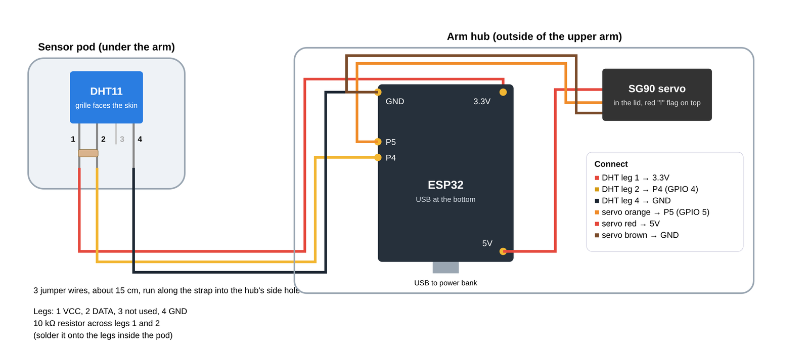

<a href="START-HERE.md">Start here</a> › Device builder

Path for a device builder
<h1 class="lp-title">Build and connect your own monitored device</h1>

You'll wire an ESP32 to a temperature sensor and an alert motor, flash it once over USB, and give it its own certificate. Every update after that goes over the air.

<h2>Your steps</h2>

<h4><a href="INSTALL-GUIDE.md#what-you-need">Get the parts</a></h4>
ESP32 (38-pin), DHT11, SG90 servo, a 10 kΩ resistor, jumper wires and a data USB cable.

✓ Check: plugged in, the board appears as a new port in <code>ls /dev/cu.*</code>

<h4><a href="INSTALL.md#step-12">Wire it</a></h4>
Sensor to 3.3V, P4 and GND with the resistor across legs 1 and 2. Motor to 5V, P5 and GND.

✓ Check: your six wires match the diagram

<h4><a href="INSTALL.md#step-12">Register the device</a></h4>
In the app, create a Wi-Fi Network, then an Asset with the board's name as its Serial Number.

✓ Check: the Asset turns Provisioned with a bundle link

<h4><a href="INSTALL.md#step-12">Flash and provision</a></h4>
One copy-paste block writes the certificate and Wi-Fi to the board over USB, then deletes the bundle.

✓ Check: within a minute or two the Asset shows Online

<h4><a href="INSTALL.md#step-13">Test the alert</a></h4>
Warm the sensor to 30 C, for example under your arm. The motor turns at once, even offline.

✓ Check: one Case opens on the care team queue

<h4><a href="../hardware/cases/README.md">Print a case</a></h4>
A wearable sensor pod and arm hub, or a desk gauge with a bell. OpenSCAD sources and STLs.

✓ Check: the sensor grille faces the surface you measure

Each step links to its full instructions in the <a href="INSTALL.md">Quick install</a>, where the commands and the check box are.

<h4>Before you start</h4><ul><li>Quick install steps 1 to 7 are done, so the app can provision the board</li><li>About $37 CAD of parts</li><li>No soldering except the resistor</li></ul>

<h4>Going further</h4><a href="DEVICE-IDENTITY.md">Device identity</a>: certificates and Wi-Fi that survive updates. <a href="../firmware/README.md">Firmware</a>: live mode, commands and OTA.

<h4>Stuck?</h4>Board problems and their fixes are in <a href="TROUBLESHOOTING.md#the-board-and-the-serial-scripts">Troubleshooting: the board</a>.

Other paths: [Clinic Salesforce admin](PATH-ADMIN.md) · [Developer](PATH-DEVELOPER.md) · [Pipelines team](PATH-PIPELINES.md)

---

[← Docs home](index.md) · [Start here](START-HERE.md) · [Quick install](INSTALL.md) · [Troubleshooting](TROUBLESHOOTING.md)
