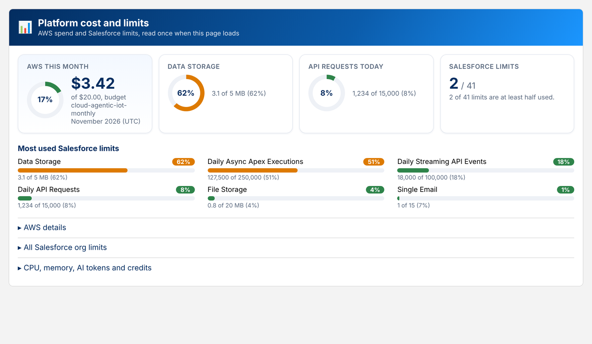
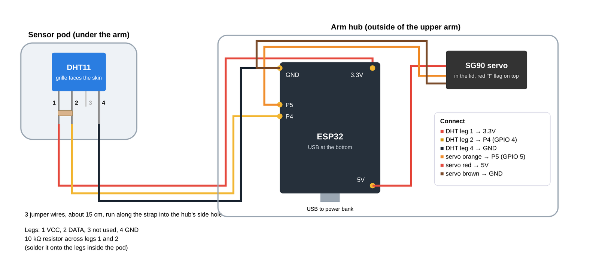

# Start here

New to this project? Pick the row that sounds like you, follow that one guide from top to bottom, and use the links at the end of each step to move on. Every page links back here.

| You are | Follow | You will need | Time |
|---|---|---|---|
| **A Salesforce admin** who wants to try it in a free org | [Quick install](INSTALL.md), with the [admin notes below](#for-a-salesforce-admin) | A Salesforce Developer Edition org, an AWS project with a spend limit, and a terminal for the copy-paste blocks | About two hours, plus 20 minutes per board |
| **A developer** who wants it running fast | [Quick install](INSTALL.md) | The tools in [step 1](INSTALL.md#step-1) | About two hours |
| **A team** that wants Dev and Prod deployed by GitHub Actions | [Quick install](INSTALL.md) steps 1 to 13 first, then [step 14](INSTALL.md#step-14) and the [Install guide](INSTALL-GUIDE.md) for the why | Two AWS accounts, two orgs, a GitHub repository | About a day |

Only want to see what it does first? Watch the [step-by-step walkthrough](process/) (no install), then read [How it connects](HOW-IT-CONNECTS.md).

## The install at a glance

The [Quick install](INSTALL.md) is the one path everyone follows. The other install pages explain it, they do not replace it:

| Page | Use it for |
|---|---|
| [Quick install](INSTALL.md) | The steps, in order, with a check after each one |
| [Install guide](INSTALL-GUIDE.md) | Why each step is done that way, and what to look at when one fails |
| [Try it](TRY-IT.md) | The demos to run once it works: warm the sensor, the saga, Slack |
| [Setup](SETUP.md) | Accounts, licences and secrets in detail, for the Dev and Prod pipelines |
| [Troubleshooting](TROUBLESHOOTING.md) | Every problem met so far, with its cause and fix |

## For a Salesforce admin

Most of the install is Setup work you already know. The rest is copy and paste into a terminal: you never write code.

| Step | Where you work | Required? |
|---|---|---|
| [1. Install the tools](INSTALL.md#step-1) | Terminal, once per computer | Yes |
| [2. Create the AWS project and the org](INSTALL.md#step-2) | Browser: AWS Settings, Developer Edition sign-up | Yes |
| [3. Turn on the org's features](INSTALL.md#step-3) | **Setup only** | Yes |
| [4. Clone and sign in](INSTALL.md#step-4) | Terminal, then a browser sign-in | Yes |
| [5. Make what the deploy reads](INSTALL.md#step-5) | **Setup** (users, External Client App) and one terminal block | Yes |
| [6. Deploy everything in one run](INSTALL.md#step-6) | Terminal, then three **Setup** clicks | Yes |
| [7. Let Salesforce call AWS](INSTALL.md#step-7) | **Setup** (Named Credentials) and two terminal blocks | Yes |
| [8. Slack](INSTALL.md#step-8) | Slack admin, **Setup**, one terminal block | Optional |
| [9. Data Cloud](INSTALL.md#step-9) | **Data Cloud Setup** and two terminal blocks | Optional |
| [10. Patient portal](INSTALL.md#step-10) | **Setup** (Embedded Service, Messaging, users) and terminal blocks | Optional |
| [11. MCP servers](INSTALL.md#step-11) | **Setup** (Agentforce Registry, Agentforce Builder) | Optional |
| [12. Add a board](INSTALL.md#step-12) | The app, a USB cable and one terminal block | Yes, for live readings |
| [13. Check that it works](INSTALL.md#step-13) | The app, Slack and the portal | Yes |
| [14. Dev and Prod pipelines](INSTALL.md#step-14) | GitHub and the terminal | Optional |

**Never used a terminal?** On a Mac, press Cmd+Space, type `Terminal` and press Enter. Each block in the guide starts with **Paste into your terminal**: click **Copy** on the block, click in the Terminal window, press Cmd+V, then Enter. If a block has a **Fill in first** list, change only the text between the quotes on its first lines before you press Enter.

**Stuck?** Each step ends with a **Check before you go on** box. If what you see doesn't match, look the message up in [Troubleshooting](TROUBLESHOOTING.md) before you move on.

## What success looks like

The app's Home tab after step 7 (sample data):

The board after step 12: an ESP32 with a DHT11 temperature sensor and an SG90 servo. The servo turns while the temperature is at or above 30 C.

The Business Value card in Data Cloud after step 9 (sample data) is in [Business value](BUSINESS-VALUE.md).

---

[Docs home](index.md) · [Quick install →](INSTALL.md)
