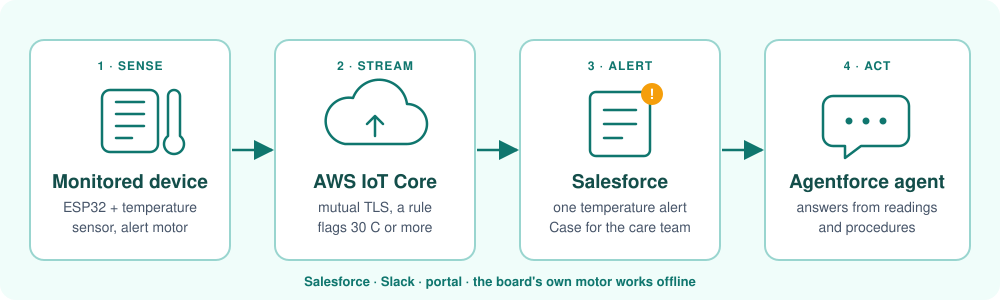

Open-source healthcare IoT reference build

<h1 class="lp-title">Build your own monitored device, end to end</h1>

A temperature sensor on an ESP32 streams to AWS IoT. At 30 C a temperature alert opens one Case for the care team in Salesforce, and an Agentforce agent answers from the readings and your procedures, in Salesforce, Slack and a portal.

≈ $0.08 AWS per device a month ≈ $37 CAD of hardware alert on the device in about 5 s, offline too

## Who are you? Pick your path

<h3>Clinic Salesforce admin</h3>
Turn it on in a free org: Setup clicks you know, copy-paste for the rest, and a check after every step.
<a class="lp-go" href="PATH-ADMIN.md">Admin path →</a>
About 2 hours · no code to write

<h3>Device builder</h3>
Parts, wiring, firmware, the device's own certificate, and printable cases for your own board.
<a class="lp-go" href="PATH-DEVICE.md">Device path →</a>
About 20 minutes per board

<h3>Developer</h3>
Deploy AWS and Salesforce in one run from your laptop, then read the code behind each part.
<a class="lp-go" href="PATH-DEVELOPER.md">Developer path →</a>
About 2 hours

<h3>Pipelines team</h3>
Separate Dev and Prod accounts and orgs, deployed by GitHub Actions with an approval for Prod.
<a class="lp-go" href="PATH-PIPELINES.md">Pipelines path →</a>
About a day

Not sure? **[Start here](START-HERE.md)** compares the paths. Only want to see it work first? **[Step through the process](process/)**, no install needed.

> [!NOTE]
> **Video walkthrough: coming soon.** A short video showing the end result and where each part lives in the repository.

## What you get at the end

<b>1 Case</b>per device per alert, routed to the care team queue

<b>3 places</b>the agent answers: Salesforce, Slack and a portal

<b>Live</b>status card and remote commands on each device

<b>Cost and limits</b>AWS spend and org limits on the app's Home tab

## Platforms at a glance

Each icon marks the platform a step or a page is about.

 <b>Salesforce</b> the app, Cases for the care team, Setup

 <b>Agentforce</b> the agents that answer

 <b>Data Cloud</b> readings for KPIs

 <b>Portal</b> the React site on Experience Cloud

 <b>Slack</b> status and the agent in chat

 <b>AWS</b> your project with a spend limit

 <b>IoT Core</b> device certificates and MQTT

 <b>Lambda</b> readings, commands, the relay

 <b>DynamoDB and S3</b> latest readings and the archive

 <b>Bedrock</b> SOP search embeddings

 <b>ESP32</b> the board and its firmware

 <b>Electronics</b> sensor, motor, wiring

 <b>Git and GitHub</b> code, pipelines, OTA releases

 <b>Terminal</b> copy-paste command blocks

<small>Product names and logos belong to their owners. They are used to show what this project works with, not endorsement. Where each icon comes from: [icon credits](images/platforms/CREDITS.md).</small>

## What it does

| Part | What happens |
|---|---|
|    **Sense** | An ESP32 with a DHT11 sends readings to AWS IoT Core over mutual TLS. No secrets are compiled into the firmware, and every update after the first USB flash goes over the air. |
|    **Alert** | At 30 C the board's own motor turns at once (it works offline), and AWS flags the reading so Salesforce opens one Case for the care team. A ward board spins while that queue has work. |
|   **Act** | The Patient Care Agent (Agentforce, new builder) reads the device, cites the ward's SOPs found with Bedrock embeddings, and escalates only after you confirm. Guardrails and PII masking run outside the model. |
|   **Reach** | Patients sign in to a **React site on Salesforce** (Multi-Framework, React 19) and chat with their own care assistant through **Enhanced Chat v2**: a second Agentforce agent that only ever sees the signed-in patient's devices and can send a nurse request. Staff use **Slack**: `/patient-status <device>` answers with no Salesforce login (JWT integration user), and the Patient Care Agent answers in Slack DMs. |
|   **Measure** | The app's Home tab shows the month's AWS spend against its limit, the org's limits, and a Business Value dashboard: alert response, chat deflection, hours avoided and cost per device. |

## How it works

## Install

New here? **[Start here](START-HERE.md)** picks your path: clinic Salesforce admin, device builder, developer, or a team with pipelines. Everyone follows the Quick Install Guide, with a check after each step; the Detailed Install Guide explains the why.

| | [Quick Install Guide](INSTALL.md) | [Detailed Install Guide](INSTALL-GUIDE.md) |
|---|---|---|
| For | Getting it running | Understanding every step |
| What you get | Every feature as execution steps in order, deployed in one run by `scripts/install.sh` | Each step, why it is done that way, and what to check when it fails |
| Time | About two hours for every feature, plus 20 min per board | About a day for the full pipeline setup |

## Documentation

Grouped by what you came to do, after the [Diátaxis](https://diataxis.fr/) framework.

| Learn by doing | Get a task done |
|---|---|
| [Start here](START-HERE.md): the four paths (admin, device builder, developer, pipelines) | |
|    [Quick Install Guide](INSTALL.md): every feature, step by step | [Detailed Install Guide](INSTALL-GUIDE.md): every step, explained |
|   [Use case scenarios](TRY-IT.md): after install, test every feature as one real situation each, by who you act as |    [Setup](SETUP.md): accounts, identities, licences, Connected Apps, GitHub secrets |
|  [Platform primer](PLATFORM-PRIMER.md): Apex, SOQL and LWC through their Python equivalents |  [Development](DEVELOPMENT.md): laptop to Dev to Prod |
| |  [Migration runbook](MIGRATION-RUNBOOK.md): phased cutover with a rollback per phase |
| | [Troubleshooting](TROUBLESHOOTING.md): what broke, why, and the fix |

| Understand the design | Look something up |
|---|---|
| [The chapters](CHAPTERS.md): 14 capabilities, one system |  [Data model](DATA-MODEL.md): why each object is standard or custom |
| [How it connects](HOW-IT-CONNECTS.md) and [Architecture overview](ARCHITECTURE-OVERVIEW.md) |   [Cost model](COST-MODEL.md): per device, per user, per customer |
|   [Device identity](DEVICE-IDENTITY.md): certificates and WiFi that survive OTA |   [Spend and limits](SPEND-AND-LIMITS.md): the Home page's numbers |
|   [SOP grounding](SOP-GROUNDING.md) and [Guardrails and MCP](GUARDRAILS-AND-MCP.md) |  [CI/CD and secrets](CI-CD-SECRETS.md): what is automated and the conventions |
|   [Patient portal](PATIENT-PORTAL.md): the React site, Enhanced Chat and the patient agent |   [Agent evals](AGENT-EVALS.md): Testing Center specs and retrieval scores |
|  [Slack](CHAPTERS.md#04--headless-slack-integration): `/patient-status` with no login, and [the agent in Slack](SETUP.md#talk-to-the-agent-from-slack-optional) |  [Business value](BUSINESS-VALUE.md): the KPI dashboard and its assumptions |
|   [Live status](LIVE-STATUS.md), [Data Cloud](DATA-CLOUD.md), [Scaling](SCALING.md) | |

## KPIs and cost

| Measure | Value | Source |
|---|---|---|
| AWS per monitored device | ≈ $0.08 a month (readings every 30 s) | [COST-MODEL.md](COST-MODEL.md) |
| Total per patient and device | ≈ $0.60 to $2.50 a month, driven by Agentforce use | [COST-MODEL.md](COST-MODEL.md) |
| Hardware per board | ≈ $37 CAD retail | [COST-MODEL.md](COST-MODEL.md) |
| SOP search | Under a cent a month, nothing runs while idle | [SOP-GROUNDING.md](SOP-GROUNDING.md) |
| Alert on the board | Within about 5 s of reaching 30 C, offline too | [CHAPTERS.md §03](CHAPTERS.md#temperature-alert-demo-rule) |
| Business value | Net value, deflection vs break-even, response time before vs after, hours avoided | [BUSINESS-VALUE.md](BUSINESS-VALUE.md) |
| Retrieval quality | hit@1, hit@3 and MRR on every eval run | [AGENT-EVALS.md](AGENT-EVALS.md) |
| Spend guard | An AWS project spend limit, shown on the Home tab | [SPEND-AND-LIMITS.md](SPEND-AND-LIMITS.md) |
