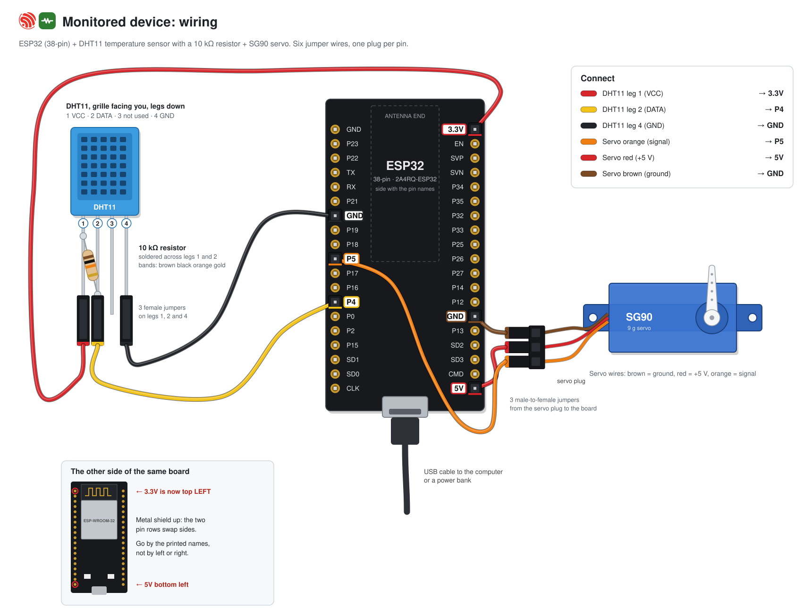
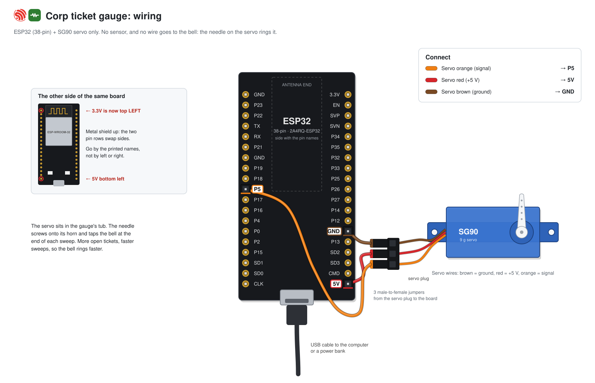
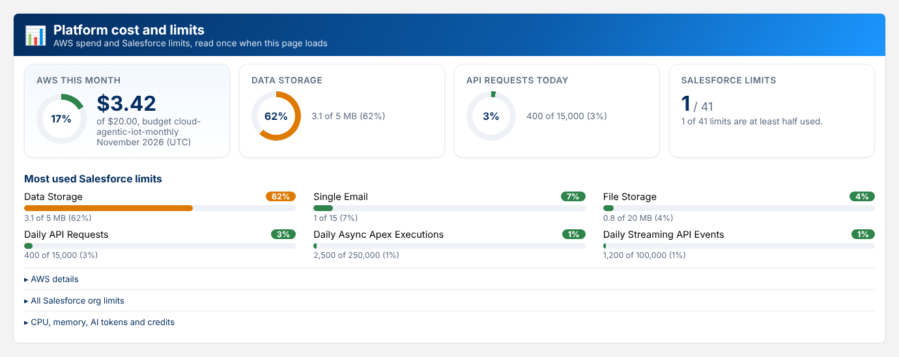
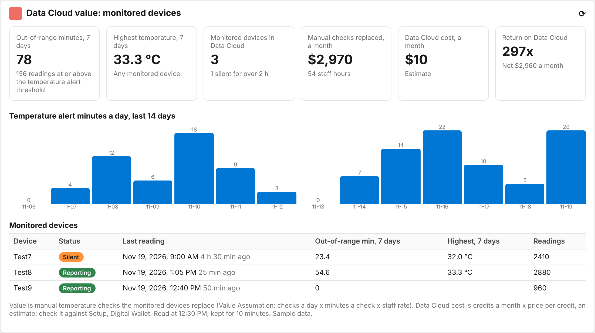

Open-source healthcare IoT reference build

<h1 class="lp-title">Build your own monitored device, end to end</h1>

A temperature sensor on an ESP32 streams to AWS IoT. At 30 C a temperature alert opens one Case for the care team in Salesforce, and an Agentforce agent answers from the readings and your procedures, in Salesforce, Slack and a portal.

≈ $0.08 AWS per device a month ≈ $37 CAD of hardware alert on the device in about 5 s, offline too

## See what you build

Two ESP32 boards in 3D-printed cases, AWS IoT, Salesforce with Agentforce and Data Cloud, all running together. Everything below comes from the [Quick Install Guide](INSTALL.md), steps 12 and 13.

<h3 class="sw-step">0. Tech stack</h3>

 Salesforce

 <b>Salesforce</b>: Service Cloud Cases, Apex, Lightning  <b>Agentforce</b>: two agents, new builder  <b>Data Cloud</b>: reading history and insights  <b>Slack</b>: slash command and agent DMs  <b>Multi-Framework React portal</b>: external patient site, React 19 on Salesforce  <b>Enhanced Chat v2</b>: the portal's verified chat with the patient agent  <b>MCP</b>: both agents use Espressif's MCP servers through Agentforce Registry

 AWS

 <b>AWS IoT Core</b>: mutual TLS, rules, OTA jobs  <b>Lambda</b>: alerts, commands, Salesforce sync  <b>Bedrock</b>: SOP search with embeddings  <b>S3</b>: reading archive and firmware

<h3 class="sw-step">1. Build two devices (<a href="INSTALL.md#step-12">step 12</a>)</h3>

<video src="videos/assembly-monitored-device.mp4" poster="videos/assembly-monitored-device.jpg" autoplay muted loop playsinline controls width="640" aria-label="Animation: the ESP32, DHT11 sensor and servo go into the 3D-printed arm cuff"></video>
<b>Monitored device</b> <code>PatientExternalESP32</code>: an ESP32, a DHT11 temperature sensor and a servo in a 3D-printed arm cuff.

Wiring, drawn from the real parts: DHT11 on P4 with a 10 kΩ pull-up, servo on P5.

<video src="videos/assembly-corp-gauge.mp4" poster="videos/assembly-corp-gauge.jpg" autoplay muted loop playsinline controls width="640" aria-label="Animation: the ESP32 and servo go into the 3D-printed ticket gauge with its bell"></video>
<b>Corp ticket gauge</b> <code>CompanyInternalESP32</code>: an ESP32 and a servo that swings a needle and rings a bell for the care team.

Wiring: one servo on P5. Saving the board's Asset in Salesforce gives it its own X.509 certificate, with no secrets in the firmware.

<h3 class="sw-step">2. Watch it work (<a href="INSTALL.md#step-13">step 13</a>)</h3>

<video src="videos/working-monitored-device.mp4" poster="videos/working-monitored-device.jpg" autoplay muted loop playsinline controls width="640" aria-label="Animation: the monitored device on the arm reaches 30 C and its servo starts to spin"></video>
<b>30 C on the arm.</b> The board's own servo spins within 5 s, even offline. AWS IoT Core flags the crossing, and Salesforce opens one Case for the care team.

<video src="videos/working-corp-gauge.mp4" poster="videos/working-corp-gauge.jpg" autoplay muted loop playsinline controls width="640" aria-label="Animation: the corp ticket gauge sweeps its needle and rings the bell for the open Case"></video>
<b>The office hears it.</b> The open Case drives the gauge through a platform event, an AWS callout and MQTT: its needle sweeps and its bell rings until someone closes the Case. The Patient Care Agent then reads the device and cites the ward's procedure.

<h3 class="sw-step">3. Run it as a business (the app's Home tab)</h3>

<b>Cost and limits.</b> This month's AWS spend against its budget (about $0.08 per device a month), and the org's limits: storage, API calls, async Apex, streaming events.

<b>Data Cloud value.</b> Out-of-range minutes, the highest temperature, which devices went silent, and the manual checks the system replaces, measured against what Data Cloud costs.

The animations are renders of the real 3D models, and the Home cards show sample data. Real footage and org screenshots will replace them under the same file names.

## Who are you? Pick your path

<h3>Clinic Salesforce admin</h3>
Turn it on in a free org: Setup clicks you know, copy-paste for the rest, and a check after every step.
<a class="lp-go" href="PATH-ADMIN.md">Admin path →</a>
About 2 hours · no code to write

<h3>Device builder</h3>
Parts, wiring, firmware, the device's own certificate, and printable cases for your own board.
<a class="lp-go" href="PATH-DEVICE.md">Device path →</a>
About 20 minutes per board

<h3>Developer</h3>
Deploy AWS and Salesforce in one run from your laptop, then read the code behind each part.
<a class="lp-go" href="PATH-DEVELOPER.md">Developer path →</a>
About 2 hours

<h3>Pipelines team</h3>
Separate Dev and Prod accounts and orgs, deployed by GitHub Actions with an approval for Prod.
<a class="lp-go" href="PATH-PIPELINES.md">Pipelines path →</a>
About a day

Not sure? **[Start here](START-HERE.md)** compares the paths. Only want to see it work first? **[Step through the process](process/)**, no install needed.

> [!NOTE]
> **Video walkthrough: coming soon.** A short video showing the end result and where each part lives in the repository.

## What you get at the end

<b>1 Case</b>per device per alert, routed to the care team queue

<b>3 places</b>the agent answers: Salesforce, Slack and a portal

<b>Live</b>status card and remote commands on each device

<b>Cost and limits</b>AWS spend and org limits on the app's Home tab

## Platforms at a glance

Each icon marks the platform a step or a page is about.

 <b>Salesforce</b> the app, Cases for the care team, Setup

 <b>Agentforce</b> the agents that answer

 <b>Data Cloud</b> readings for KPIs

 <b>Portal</b> the React site on Experience Cloud

 <b>Slack</b> status and the agent in chat

 <b>AWS</b> your project with a spend limit

 <b>IoT Core</b> device certificates and MQTT

 <b>Lambda</b> readings, commands, the relay

 <b>DynamoDB and S3</b> latest readings and the archive

 <b>Bedrock</b> SOP search embeddings

 <b>ESP32</b> the board and its firmware

 <b>Electronics</b> sensor, motor, wiring

 <b>Git and GitHub</b> code, pipelines, OTA releases

 <b>Terminal</b> copy-paste command blocks

<small>Product names and logos belong to their owners. They are used to show what this project works with, not endorsement. Where each icon comes from: [icon credits](images/platforms/CREDITS.md).</small>

## What it does

| Part | What happens |
|---|---|
|    **Sense** | An ESP32 with a DHT11 sends readings to AWS IoT Core over mutual TLS. No secrets are compiled into the firmware, and every update after the first USB flash goes over the air. |
|    **Alert** | At 30 C the board's own motor turns at once (it works offline), and AWS flags the reading so Salesforce opens one Case for the care team. A ward board spins while that queue has work. |
|   **Act** | The Patient Care Agent (Agentforce, new builder) reads the device, cites the ward's SOPs found with Bedrock embeddings, and escalates only after you confirm. Guardrails and PII masking run outside the model. |
|   **Reach** | Patients sign in to a **React site on Salesforce** (Multi-Framework, React 19) and chat with their own care assistant through **Enhanced Chat v2**: a second Agentforce agent that only ever sees the signed-in patient's devices and can send a nurse request. Staff use **Slack**: `/patient-status <device>` answers with no Salesforce login (JWT integration user), and the Patient Care Agent answers in Slack DMs. |
|   **Measure** | The app's Home tab shows the month's AWS spend against its limit, the org's limits, and a Business Value dashboard: alert response, chat deflection, hours avoided and cost per device. |

## How it works

## Install

New here? **[Start here](START-HERE.md)** picks your path: clinic Salesforce admin, device builder, developer, or a team with pipelines. Everyone follows the Quick Install Guide, with a check after each step; the Detailed Install Guide explains the why.

| | [Quick Install Guide](INSTALL.md) | [Detailed Install Guide](INSTALL-GUIDE.md) |
|---|---|---|
| For | Getting it running | Understanding every step |
| What you get | Every feature as execution steps in order, deployed in one run by `scripts/install.sh` | Each step, why it is done that way, and what to check when it fails |
| Time | About two hours for every feature, plus 20 min per board | About a day for the full pipeline setup |

## Documentation

Grouped by what you came to do, after the [Diátaxis](https://diataxis.fr/) framework.

| Learn by doing | Get a task done |
|---|---|
| [Start here](START-HERE.md): the four paths (admin, device builder, developer, pipelines) | |
|    [Quick Install Guide](INSTALL.md): every feature, step by step | [Detailed Install Guide](INSTALL-GUIDE.md): every step, explained |
|   [Use case scenarios](TRY-IT.md): after install, test every feature as one real situation each, by who you act as |    [Setup](SETUP.md): accounts, identities, licences, Connected Apps, GitHub secrets |
|  [Platform primer](PLATFORM-PRIMER.md): Apex, SOQL and LWC through their Python equivalents |  [Development](DEVELOPMENT.md): laptop to Dev to Prod |
| |  [Migration runbook](MIGRATION-RUNBOOK.md): phased cutover with a rollback per phase |
| | [Troubleshooting](TROUBLESHOOTING.md): what broke, why, and the fix |

| Understand the design | Look something up |
|---|---|
| [The chapters](CHAPTERS.md): 14 capabilities, one system |  [Data model](DATA-MODEL.md): why each object is standard or custom |
| [How it connects](HOW-IT-CONNECTS.md) and [Architecture overview](ARCHITECTURE-OVERVIEW.md) |   [Cost model](COST-MODEL.md): per device, per user, per customer |
|   [Device identity](DEVICE-IDENTITY.md): certificates and WiFi that survive OTA |   [Spend and limits](SPEND-AND-LIMITS.md): the Home page's numbers |
|   [SOP grounding](SOP-GROUNDING.md) and [Guardrails and MCP](GUARDRAILS-AND-MCP.md) |  [CI/CD and secrets](CI-CD-SECRETS.md): what is automated and the conventions |
|   [Patient portal](PATIENT-PORTAL.md): the React site, Enhanced Chat and the patient agent |   [Agent evals](AGENT-EVALS.md): Testing Center specs and retrieval scores |
|  [Slack](CHAPTERS.md#04--headless-slack-integration): `/patient-status` with no login, and [the agent in Slack](SETUP.md#talk-to-the-agent-from-slack-optional) |  [Business value](BUSINESS-VALUE.md): the KPI dashboard and its assumptions |
|   [Live status](LIVE-STATUS.md), [Data Cloud](DATA-CLOUD.md), [Scaling](SCALING.md) | |

## KPIs and cost

| Measure | Value | Source |
|---|---|---|
| AWS per monitored device | ≈ $0.08 a month (readings every 30 s) | [COST-MODEL.md](COST-MODEL.md) |
| Total per patient and device | ≈ $0.60 to $2.50 a month, driven by Agentforce use | [COST-MODEL.md](COST-MODEL.md) |
| Hardware per board | ≈ $37 CAD retail | [COST-MODEL.md](COST-MODEL.md) |
| SOP search | Under a cent a month, nothing runs while idle | [SOP-GROUNDING.md](SOP-GROUNDING.md) |
| Alert on the board | Within about 5 s of reaching 30 C, offline too | [CHAPTERS.md §03](CHAPTERS.md#temperature-alert-demo-rule) |
| Business value | Net value, deflection vs break-even, response time before vs after, hours avoided | [BUSINESS-VALUE.md](BUSINESS-VALUE.md) |
| Retrieval quality | hit@1, hit@3 and MRR on every eval run | [AGENT-EVALS.md](AGENT-EVALS.md) |
| Spend guard | An AWS project spend limit, shown on the Home tab | [SPEND-AND-LIMITS.md](SPEND-AND-LIMITS.md) |

## Reuse and licence

You can reuse this project, including commercially, as is or as a starting point. The code is under the [MIT licence](https://github.com/CloudArchitect101/Cloud-Agentic-IoT/blob/Dev/LICENSE). These docs, the diagrams, images, videos and the 3D case designs are under [CC BY 4.0](LICENSE-CC-BY-4.0.txt): credit **Cloud-Agentic-IoT by Vitaly Makarkin** with a link to [the repository](https://github.com/CloudArchitect101/Cloud-Agentic-IoT) and say what you changed. Part photos and product logos keep their owners' terms: see the [part photo](images/parts/CREDITS.md) and [icon](images/platforms/CREDITS.md) credits, and [what each licence covers](https://github.com/CloudArchitect101/Cloud-Agentic-IoT#license).
