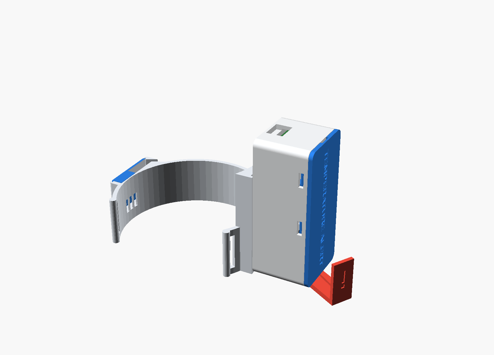
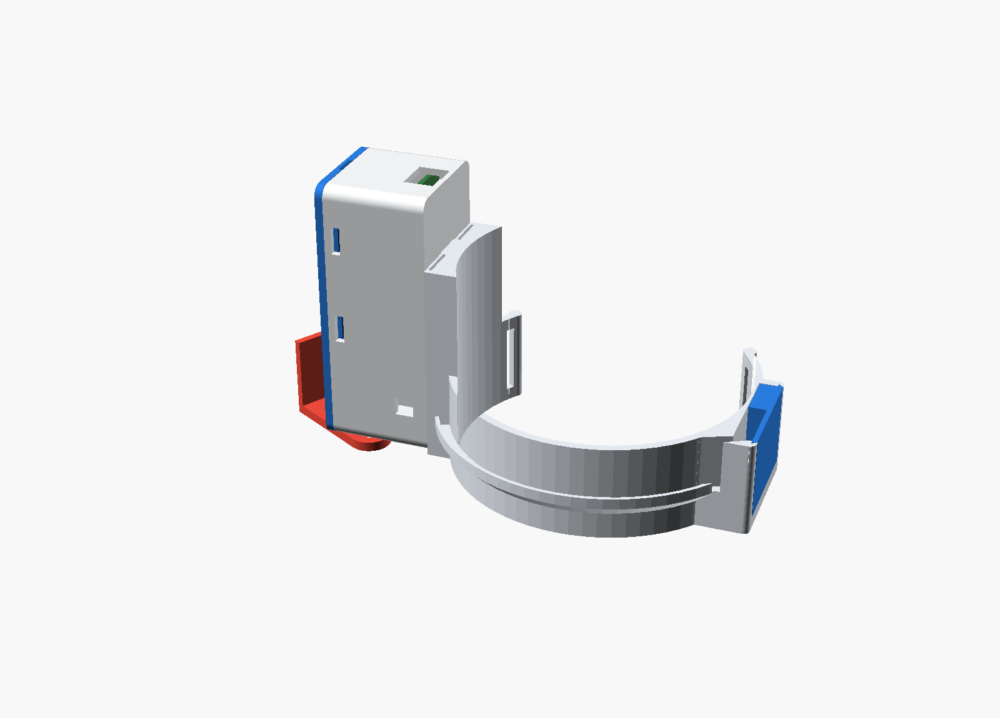
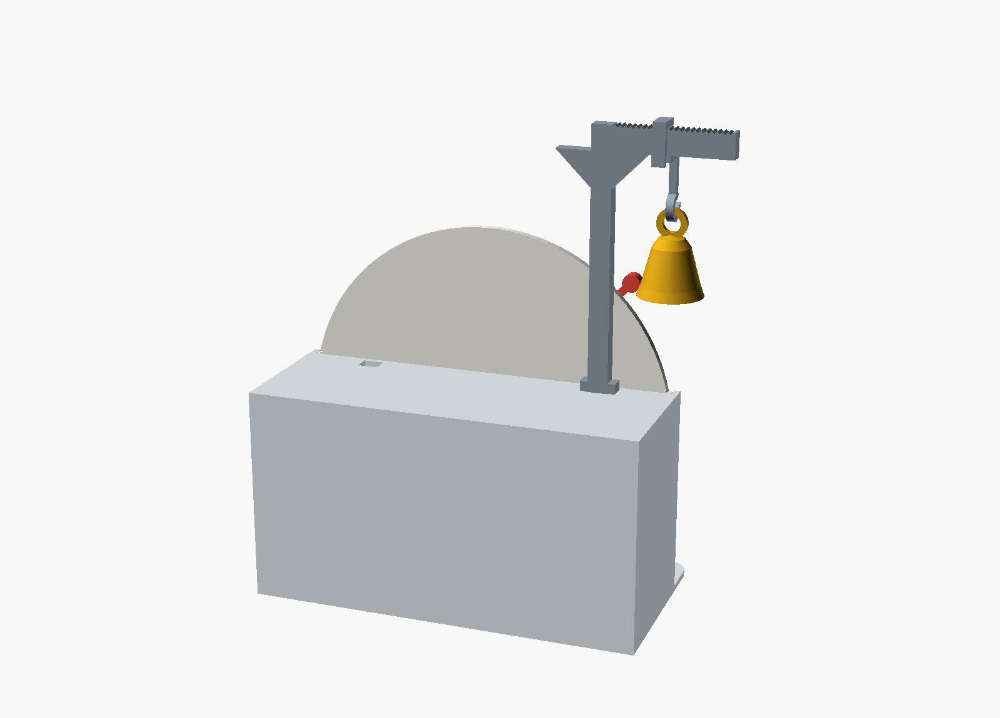
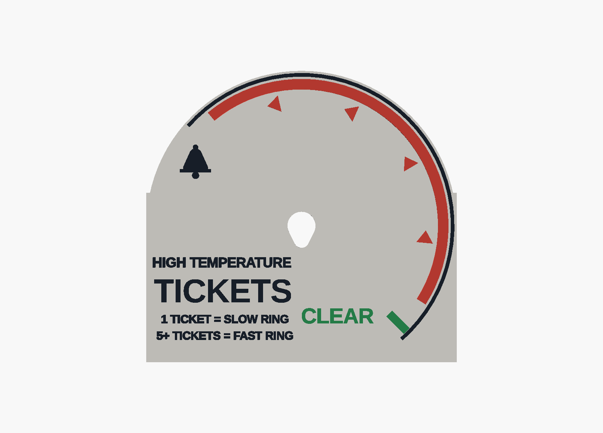

# 3D-printed cases, version 2 (Nov 20)

Part of the [device builder path](../../docs/PATH-DEVICE.md). The `.scad` files are the source; the STLs in `stl/` and the beds in `print-beds/` are exported from them.

Version 2 replaces the first models. Both devices were redesigned after a design review found problems that would have stopped the first version from printing or fitting. Still **not test printed**: print one set, check the fit, then adjust the numbers at the top of the `.scad` files (OpenSCAD) and export again.

Every case part is printed in rigid plastic (PLA, PETG or ABS). No flexible TPU, no supports. Not printed: ESP32, DHT11 with its 10 kΩ resistor, SG90 servo with its horn and screws, jumper wires, USB cable, and the optional bought bell.

## Wiring

## 1. Monitored device: arm cuff

One springy C-shaped cuff clips round the upper arm. The DHT11 sits in the cuff on the inner side of the arm (under the arm, against the body). The hub with the ESP32 and the servo slides onto a rail on the outer side and clicks. A red "!" tile on the servo swings over the hub while the reading is 30 C or more.

| Part | STL | Print | Notes |
|---|---|---|---|
| Cuff | `stl/monitored-cuff-arm-r40.stl` / `r46` / `r52` | standing on its edge | Pick by upper-arm size: r40 = 24 to 27 cm round, r46 = 27 to 31 cm, r52 = 31 to 35 cm. Sensor pocket with 3 slots to the skin, wire gutter round the outside, rail and click bumps for the hub, a slot at each tip in case you ever want to add a strap. |
| Sensor lid | `stl/monitored-sensor_lid.stl` | flat, plug up | Slides in from the cuff's edge and holds the DHT11 down. |
| Hub | `stl/monitored-hub.stl` | floor down | 86 x 38 x 33 mm. ESP32 lies component side down with its pins up, USB at the open end. Servo lies on its side at the other end, shaft out through the end wall. |
| Hub lid | `stl/monitored-hub_lid.stl` | top face down | Snaps into 4 windows. Engraved TEMPERATURE ALERT. |
| Wiper | `stl/monitored-wiper.stl` | "!" tile on the bed | Goes on the servo's one-arm horn with the horn's own screw. |

Assembly:
1. DHT11 into the pocket, grille to the slots, legs toward the long end of the pocket. Solder the 10 kΩ resistor across legs 1 and 2. Plug 3 jumper wires on legs 1, 2 and 4, lay them through the exit into the gutter, slide the lid in.
2. Wiring (unchanged): DHT11 leg 1 to 3.3V, leg 2 to P4 (GPIO 4), leg 4 to GND. Servo orange to P5 (GPIO 5), red to 5V, brown to GND. The servo's plug needs 3 male-to-female jumpers to reach those pins.
3. Drop the servo into the hub (tabs between the ribs), the board into its bay, bring the sensor wires in through the hole low on the side wall, snap the lid on.
4. Slide the hub onto the cuff's rail until it clicks.
5. With the board powered and the servo parked, push the horn and wiper on so the tile points to one side of the hub. At mid sweep it should point straight out from the arm. It must never point toward the arm.

Notes: skin under the arm is about 33 to 35 C, so the alert will be on while the cuff is worn. For a demo, show it off the arm first (below 30 C, wiper still), then put it on. The DHT11 lags a few minutes. This is a demo of a temperature alert, not a medical device.

## 2. Corp device: ticket gauge with a bell

A desk gauge about 155 mm wide, 81 mm deep and 145 mm tall (190 mm with the bell post). With no tickets the needle rests on the green CLEAR mark. With any open ticket it sweeps the whole red arc, its hammer hits the bell side-on at the end, and it swings back. More tickets make it sweep faster, so the bell rings faster. The dial has no ticket numbers, because the needle never stops at a level. No wire goes to the bell.

| Part | STL | Print | Notes |
|---|---|---|---|
| Dial plate | `stl/gauge-plate-bell-left.stl` | flat, art up | 150 x 141 mm. Green CLEAR mark, one red sweep arc with arrows toward the bell, a bell symbol, and "HIGH TEMPERATURE TICKETS / 1 TICKET = SLOW RING / 5+ TICKETS = FAST RING". Art is raised in 3 steps (green, red, black): change filament at 3.4, 3.8 and 4.2 mm, or paint the tops. |
| Tub | `stl/gauge-tub-bell-left.stl` | on its back | Servo posts, board cradle, USB hole, coin pocket for ballast under the bell side, front tray so it cannot tip. |
| Needle | `stl/gauge-needle.stl` | flat | Pocket for the servo horn on the back, round cap hides the hole, hammer at the tip. |
| Mast | `stl/gauge-mast-bell-left.stl` | flat | The stick. Plugs 24 mm into the sleeve in the tub's roof. Its arm has notches every 2 mm. |
| Hanger | `stl/gauge-hanger-for-36mm-bell.stl` (also 23, 29, 32, 43) | flat | Sits on the mast's arm. Pick the one for your bell's total height including its loop. Slide it along the notches until the hammer just reaches the bell's rim. |
| Printed bell (fallback) | `stl/gauge-printed-bell.stl` | mouth down | Use with the 32 mm hanger. A plastic bell only makes a "tick"; a metal bell is far better. |

`bell-left` or `bell-right`? Most SG90 servos turn anticlockwise (seen from the shaft) as the angle goes up, which needs the **bell-left** set. Check before printing: power the board with no tickets, let the servo park, put the bare horn on, then create a test ticket. If the horn's first move is clockwise, print the `bell-right` plate, tub and mast instead.

Assembly:
1. Servo: lower it into the tub beside the posts, slide it sideways onto them so its cable drops into the slot, fix with its 2 screws. Wire it: orange to P5, red to 5V, brown to GND.
2. Board: clip it into the cradle on the back wall, pins facing the front, USB toward the side hole.
3. A few coins in the pocket under the bell side.
4. Snap the dial plate into the front of the tub.
5. With the servo parked, push the horn on pointing at the green CLEAR mark, then screw the needle on over it.
6. Mast into the sleeve on the bell side, hanger on the arm, bell on the hook.

### Which bell to buy (checked on amazon.ca, Nov 20)

The bell must hang from a loop, be open at the bottom, and be 18 to 38 mm wide. Closed "jingle" bells and desk bells with a plunger do not work.

| Bell | Size | Price | Hanger |
|---|---|---|---|
| **PATIKIL mini cow bells, 4 pcs, silver** (B0CWNGM2FJ). Recommended: widest rim to hit, flat lug that fits the hook. | 36 x 23 x 36 mm, iron | CA$17.39 | 36 mm |
| SWENSENLin vintage brass hanging bells, 4 pcs (B0B8G5Q2PF). Nicer tone, smaller target. | 20 x 29 mm, brass | CA$27.50 | 29 mm |
| Fibraze small brass door bells, 2 pcs (B0H5JLNTX7) | about 25 mm (listed as 1 x 1 inch) | CA$25.17 | 29 or 32 mm |

The hook takes a loop with a hole of 4 mm or more. If a bell's loop is smaller, hang it with a small key ring.

### How the servo behaves

Full sweeps every time, faster with more open tickets: about 7 s per sweep at 1 ticket, about 1 s at 5 or more, parked with none. So the bell rings once per sweep: slowly with 1 ticket, fast with 5 or more. That is exactly what the dial says. A "hold at the level and ding once per new ticket" mode is a small firmware change that has not been made.

## Print settings and size

0.2 mm layers, 3 walls, 15 to 20% infill, no supports. Largest parts: tub 155 x 85 mm on the bed and 81 mm tall, plate 150 x 141 mm. Rough plastic use: gauge about 190 g, wearable about 80 g.

## What changed from version 1, and why

Wearable: the servo hit the ESP32, there was no room for jumper plugs, the strap loops could not be threaded, the lids were not held, and the straps needed flexible TPU that many shops do not print. Now it is one rigid cuff with a slide-on hub.

Gauge: the body could not print without supports, the needle only brushed past the bell, the hanger could not be fitted, the servo was exposed and the box was light and tippy. Now it is a flat plate plus a tub, the hammer hits the bell square, and the hanger is adjustable.

An independent check of version 2 found 11 more issues (a rail that would bind, a wiring bay too short for jumper plugs, a servo that could not be inserted with its cable, a loose board cradle, thin lettering and others). All were fixed and re-checked for collisions in all three cuff sizes and both bell sides.

## Print beds: all parts arranged, ready to print in one go

Folder `print-beds/` has the parts already laid out on a print bed, as a **3MF project file** (opens in PrusaSlicer, Bambu Studio, Cura, OrcaSlicer with every part separate) and as one combined **STL** per bed. Each has a top-view picture.

| Printer bed | Arm cuff | Ticket gauge |
|---|---|---|
| 220 x 220 mm (most home printers) | 1 bed: cuff r46, hub, hub lid, sensor lid, flag | bed 1: dial plate alone. bed 2: tub, stick, needle, hanger (36 mm bell), printed bell |
| 203 x 152 mm (The UPS Store's Stratasys) | 1 bed: same 5 parts | bed 1: dial plate alone. bed 2: tub, needle, hanger, printed bell. bed 3: stick |

Why not everything on one bed: the tub (155 x 85) and dial plate (150 x 141) are each nearly a full bed, and the dial plate prints alone because of its colour changes at 3.4, 3.8 and 4.2 mm. The beds use the default set (cuff r46, bell on the left, 36 mm hanger). For another cuff size or bell side, swap that part in the slicer, or edit the list at the top of `print-beds/pack.py` and run it again.

### One print for everything (Bambu X2D, 235 x 256 mm) and two prints (A1 mini, 180 x 180 mm)

| Printer | Folder | Notes |
|---|---|---|
| X2D, recommended | `print-beds/x2d-one-plate/all-parts-x2d-plate-standing.3mf` | Dial plate stands on its 150 mm edge (8 to 10 mm brim), every other part flat around it. No supports. |
| X2D, stacked | `print-beds/x2d-one-plate/all-parts-x2d-one-plate.3mf` | Dial plate printed back-down over the flat parts, Support for PLA as the interface. Supports on for the stack object only. |
| A1 mini | `print-beds/a1mini-two-beds/` | 2 beds, dial plate standing. No supports. |

The `pack*.py` and `x2d_*.py` scripts that made the beds read STLs from a local `out/stl/` folder; point `S` at `stl/` to rerun them here.

---

[← Device builder path](../../docs/PATH-DEVICE.md) · [Docs home](../../docs/index.md) · [Troubleshooting](../../docs/TROUBLESHOOTING.md)
