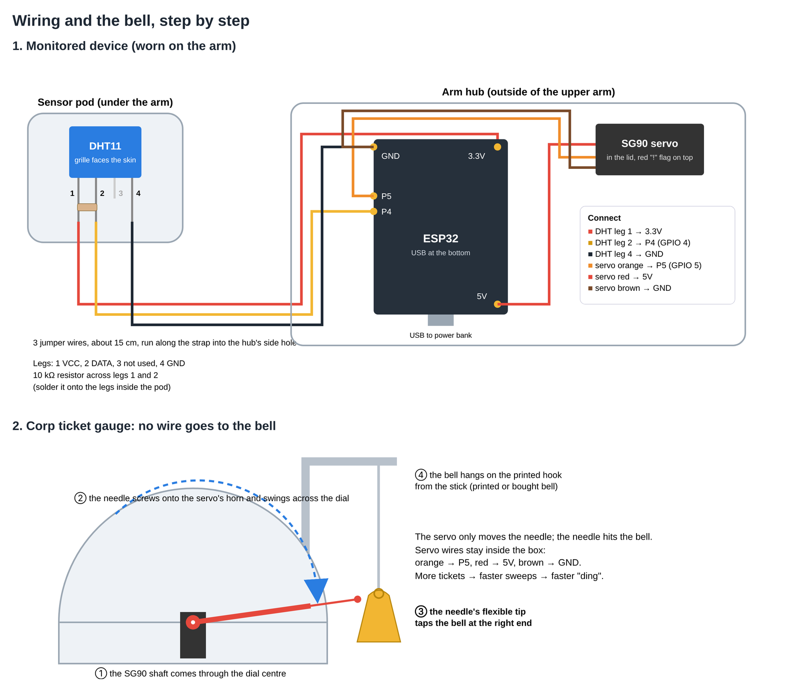
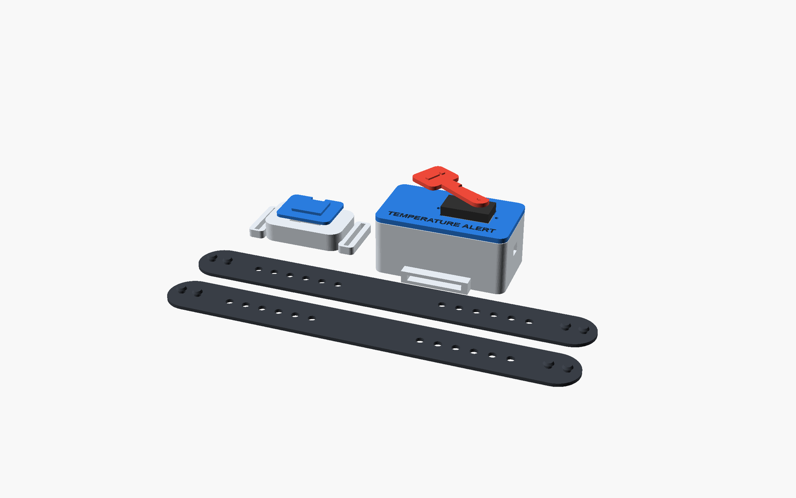
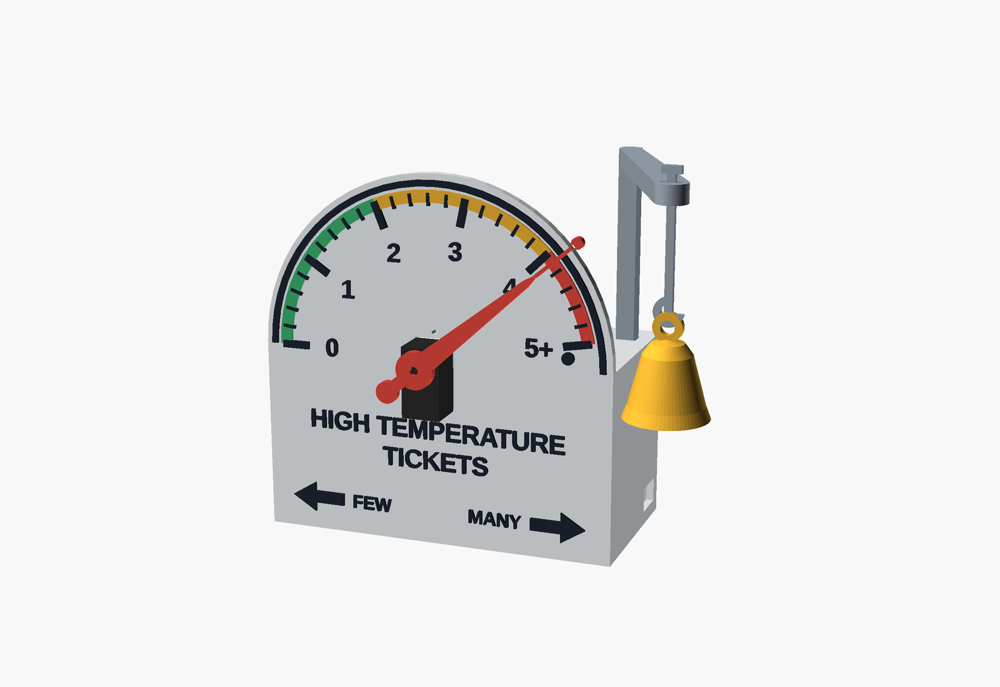

# 3D-printed cases: monitored device and corp ticket gauge

Part of the [device builder path](../../docs/PATH-DEVICE.md). The `.scad` files are the source; the STLs in `stl/` are exported from them.

Concept models, made in OpenSCAD (open the `.scad` to change any size, then export STL). Not test-printed yet: print one copy, check fit, adjust.

**Every case part is printed.** The only things not printed are the electronics: ESP32, DHT11, SG90 (with the horn and screws in its bag), jumper wires, USB cable. A bought bell is optional.

## Wiring, and how the needle rings the bell

Monitored device: DHT11 leg 1 to 3.3V, leg 2 to P4 (GPIO 4), leg 4 to GND, 10 kΩ across legs 1 and 2 inside the pod. Servo orange to P5 (GPIO 5), red to 5V, brown to GND. Corp gauge: same servo wiring inside the box; no wire goes to the bell, the needle's printed tip taps it.

## 1. Monitored device: wearable underarm kit

The 38-pin ESP32 (55 x 28 mm) is too big to sit in an armpit, so the kit is a pod and a hub joined by two printed straps around the upper arm:

| Part | STL | What it does |
|---|---|---|
| Sensor pod | `stl/monitored-pod.stl` | Holds the bare DHT11 with its grille against the skin under the arm (55 x 26 x 9 mm with lugs). Vents on the skin side, a strap lug at each end. |
| Pod lid | `stl/monitored-pod_lid.stl` | Presses the DHT11 down; wire notch toward the hub. |
| Arm hub | `stl/monitored-hub.stl` | Rides on the upper arm. Holds the ESP32, USB opening on one end, sensor wire entry on the other, band loops under it. |
| Hub lid | `stl/monitored-hub_lid.stl` | SG90 drops in through the lid; engraved TEMPERATURE ALERT. Print top face down. |
| Alert flag | `stl/monitored-flag.stl` | Fits the SG90 single-arm horn (the horn screw holds it). Sweeps while the reading is 30 C or more, stops below. |
| Strap (print 2) | `stl/monitored-strap.stl` | TPU 95A, 190 x 22 mm. Each end goes through a hub loop or pod lug, folds back, and its 2 snap studs press into 2 of its 6 holes, so the fit adjusts in 8 mm steps (about 30-40 cm around). |

Wire: DHT11 to the hub with 3 thin jumper wires (about 15 cm). Power: USB power bank in a pocket.

Notes: the DHT11 reads 1-2 C slow and lags a few minutes against skin; fine for the demo, not a medical device. The flag moves near the arm: keep it on the outside of the arm.

## 2. Corp device: ticket gauge with stick and bell

| Part | STL | What it does |
|---|---|---|
| Body | `stl/corp-gauge-body.stl` | 116 x 56 x 120 mm. Dial with levels 0-5+, green/amber/red bands, FEW / MANY arrows, HIGH TEMPERATURE TICKETS. SG90 goes in from the front, shaft at the dial centre; ESP32 lies in the box. Print standing on its open back. |
| Back cover | `stl/corp-gauge-back.stl` | Vented, drops into the open back. |
| Needle | `stl/corp-gauge-needle.stl` | Pocket for the SG90 horn on the back. A thin printed tongue at the tip is the striker: it flexes when it hits the bell. |
| Gallows (the stick) | `stl/corp-gauge-gallows.stl` | Plugs into the socket on top; its arm reaches over the right end of the needle's travel and has a twist-lock slot. |
| Hanger | `stl/corp-gauge-hanger.stl` | T head goes up through the arm's slot, turn it 90 degrees and it rests on top. The open hook below holds the bell's loop. |
| Bell | `stl/corp-gauge-bell.stl` | 26 mm, thin wall, loop on top. Print mouth-down in PLA, 3 walls, 100% infill. |
| Clapper | `stl/corp-gauge-clapper.stl` | T head goes up through the slot inside the bell's crown, turn 90 degrees. Rattles when the bell is hit. |

Sound: a printed PLA bell gives a short bright "tink" or clack, not the long ring of a metal bell.

**Using a bell bought on Amazon instead:** pick a hanging bell with a loop on top (a craft or "jingle" bell, 20-35 mm, loop wire up to 4 mm thick) and hang its loop on the same printed hook. Hang it so its mouth is about 7 mm below the needle's centre: use `corp-gauge-hanger.stl` for bells up to about 28 mm tall and `corp-gauge-hanger-short.stl` (12 mm shorter) for taller ones, or set `hanger_len` in the .scad. A desk "service" bell with a plunger won't fit this design.

### How the servo behaves today (firmware 2.7.0)

- Speed scales with tickets: Salesforce sends intensity = open Cases / 5 (Full_Speed_Depth__c = 5 on Care_Team_Queue), capped at 100%. One sweep takes about 7 s at 1 ticket and about 1 s at 5 or more. 0 tickets stops it.
- The angle does not change: it always sweeps the full 0-180 degrees.
- So with this print, today, the needle sweeps across the whole dial and the striker taps the bell just past 5+ at the right end of every sweep: more tickets, faster ringing.

### Optional "gauge mode" (firmware change, not made)

Needle holds at the level for the ticket count (0 tickets at the left, 5+ at the 10-degree mark), and swings into the bell zone once for a ding each time a ticket is added. About 30 lines in ServoDemand.h / ServoSweep.h plus unit tests in test/firmware; no Salesforce change (it already sends openCaseCount). Built only if asked.

## Print settings

PLA or PETG, 0.2 mm layers, 3 walls, 20% infill, no supports. Straps in TPU 95A. Bell in PLA at 100% infill. Gauge body prints standing on its open back.

---

[← Device builder path](../../docs/PATH-DEVICE.md) · [Docs home](../../docs/index.md) · [Troubleshooting](../../docs/TROUBLESHOOTING.md)
